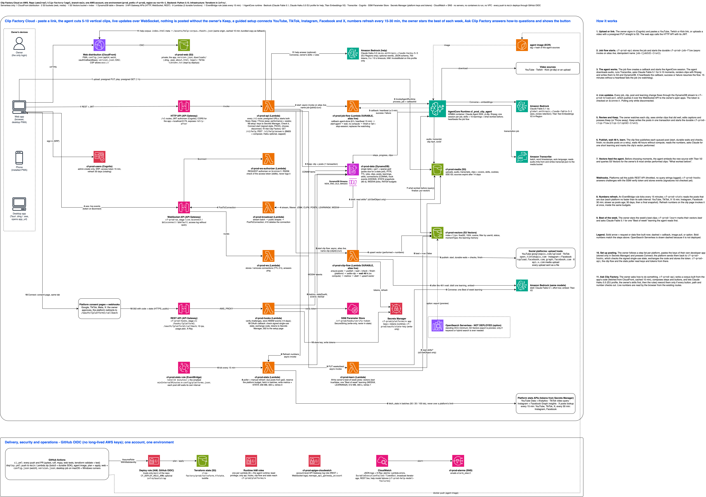

# Clip Factory Cloud

Clip Factory Cloud turns long videos and streams into short, vertical clips that are ready to post. It is the cloud
version of the Clip Factory app that used to run on one Mac. Everything now runs on AWS, serverless, and you use it
from a browser, from your phone, or as an app on your computer (a `.dmg` for Mac, an `.exe` for Windows, or installed
from the browser). It is built so simply that a child could use it.

**Nothing is ever posted without your Confirm.**

## How it works

1. **Sign in.** One owner account (Amazon Cognito). You stay signed in for as long as you use the app at least once a month.
2. **Paste a link or upload a file.** A YouTube, Twitch or Kick link, or a video from your device.
3. **The agent gets to work in the cloud.** An agent on Amazon Bedrock AgentCore, running Claude Fable 5.1, downloads
   the audio, transcribes it with Amazon Transcribe and finds the most viral moments, guided by your skills and by
   what worked on earlier posts. In Settings › Clip making › Skills you write a skill by answering three questions
   (or upload a `SKILL.md` or `.zip`), read it, change it and delete it. Every skill is always used: every AI call,
   on AgentCore or Bedrock, in the agent or the API, gets all of them first.
   Every step appears on screen within a second or two, pushed over a WebSocket connection.
4. **It cuts 5 to 10 clips.** Each clip is 1080×1920 with a text hook, burned-in captions, a cover image, a pre-post
   checklist and a caption for each platform.
5. **You review.** Watch each clip, edit its captions, then press **Confirm** or **Decline**.
6. **Confirmed clips are posted, and checked 48 hours later.** A durable Lambda function handles each kept clip: it
   posts it to every platform you set up (YouTube, TikTok, Instagram, Facebook and X; a platform not set up yet
   shows "waiting for the account connection"), waits 48 hours without running, reads the numbers, writes a short learning and remembers the clip in
   S3 Vectors, so the next jobs see "what worked before".
7. **Get the app.** **Get the app** in the sidebar (on a phone: Settings › App & account) offers what fits your device: the Mac
   `.dmg`, the Windows `.exe`, the Android install button or the iPhone Add to Home Screen steps. Once the app is
   installed it stops asking.
8. **Always up to date.** After every update a bar at the bottom says what changed in a word or three
   (`Settings · Profile picture`). Press **Reload** and a quick, smooth progress bar brings in the new version.
9. **Settings, neatly organised.** Settings is laid out like a field of apple trees: four trees (Clip making,
   Posting, Look & feel, App & account), each with a few branches (Skills, Set up posting, Sounds and so on), and on each
   branch the settings you change, each with a one-line hint. Every branch has its own address, a **Find a setting**
   box finds anything by name, and on a wide screen a folder panel shows the whole tree. Under **Look & feel ›
   Sounds** you pick your click sound and your error sound from 30 each and try them on a pretend Sign in button; the
   defaults are the owner's picks, **Water drop** and **Nope nope nope**
   ([details](docs/UX_DESIGN_SYSTEM.md#settings-tree)).
10. **See how every clip did, everywhere.** Tap any clip in Library: the video sits on top and five smooth lines lead
    to five stacks, one each for YouTube, TikTok, Instagram, Facebook and X, with that platform's own numbers (views,
    likes, comments, shares, watch time and more), its status and a crown on the best one. The numbers refresh by
    themselves (every 15 minutes for YouTube, TikTok and X, every 30 for Instagram and Facebook, slower as a post ages,
    for 30 days), and **Refresh numbers** asks again at once, never over a platform's limit
    ([details](docs/UX_DESIGN_SYSTEM.md#clip-performance-page)).
11. **Star the best of the week.** Library › This week lists the week's clips by views. Star the best ones, and
    Claude writes one "Best of week" learning, so the next clips are picked and hooked more like them
    ([details](docs/AGENT.md#best-of-the-week)).
12. **Set up posting, once per platform.** Settings › Posting › Set up posting lists YouTube, TikTok, Instagram,
    Facebook and X with a "2 of 5 ready" ring. Each platform is a short list of big numbered steps: make your own
    free developer app on the platform's website (Open and Copy buttons for everything), paste its keys, press
    **Connect**, approve on the platform, and you are back with confetti. No code, and the steps were checked
    against each platform on 16 Nov 2026. TikTok posts may stay private until TikTok approves the app, and X costs a
    little per post ([the steps](docs/SETUP_POSTING.md)).
13. **Ask Clip Factory.** Tap **Ask** on any page and type "Where do I change my click sound?" or "How many views did
    my best clip get this week?". You get a few short steps with the app's own button names, and a button that opens
    the right page and lights up the right control. It answers from knowledge built from the app itself, so it never
    makes things up, and it still works when the AI model is off ([details](docs/HELP_ASSISTANT.md)).

## Architecture

Python for every backend, Terraform for every resource, and serverless only: CloudFront, S3 (web, media),
S3 Vectors, DynamoDB with Streams, three API Gateway APIs (HTTP for the app, WebSocket for live updates, REST for
platform webhooks), nine Lambdas (two of them durable functions), one EventBridge rule (the 15-minute numbers tick),
Amazon Bedrock AgentCore, Claude Fable 5.1, Claude Haiku 5.5 (EU profile, for Ask Clip Factory) and Titan embeddings on Bedrock, Transcribe, Cognito, SSM Parameter Store,
Secrets Manager (the only place for platform keys and tokens), CloudWatch and SNS. No servers, no containers to
run, no VPC. OpenSearch Serverless is drawn as an option, not deployed.



The editable diagram is [docs/architecture/aws-architecture.drawio](docs/architecture/aws-architecture.drawio) (open
it in draw.io or at app.diagrams.net); [docs/ARCHITECTURE.md](docs/ARCHITECTURE.md) walks through every flow.

## Documentation

| Document | What it covers |
|---|---|
| [Set up posting](docs/SETUP_POSTING.md) | The step-by-step setup for YouTube, TikTok, Instagram, Facebook and X, the same steps the app shows, with the research sources |
| [Business requirements](docs/BUSINESS_REQUIREMENTS.md) | Every requirement from the owner's brief, numbered, with acceptance criteria and open questions |
| [Contracts](docs/CONTRACTS.md) | The single source of truth: routes, data shapes, DynamoDB keys, S3 layout, names, outputs |
| [Architecture](docs/ARCHITECTURE.md) | AWS services and why, the durable job and clip flows, live updates, the learning memory, webhooks, the numbers poller and the weekly best, sequence diagrams, failure handling, cost, limits |
| [Ask Clip Factory](docs/HELP_ASSISTANT.md) | The in-app help assistant: how it answers, the guides, adding a guide or anchor, the model and its fallback, the kill switch, live numbers, the routes it links to |
| [Agent](docs/AGENT.md) | How the clip agent behaves: pipeline steps, tools, skills, prompts, the learnings loop, best of the week |
| [UX design system](docs/UX_DESIGN_SYSTEM.md) | Colours, liquid glass, type, layout, navigation, the Settings tree and search, the sound catalog and picker, the clip performance page (lines and stacks per screen size) and This week, the Ask Clip Factory launcher and panel, motion, overflow rules, PWA, Get the app card, update bar and reload curve, kid-proof checklist |
| [Deployment](docs/DEPLOYMENT.md) | One-time AWS and GitHub setup (deploy role, Bedrock data retention, API Gateway logging role), what a deploy does, desktop downloads and their first open, release labels, clip numbers and X API credits, first sign-in, rollback, tearing down |
| [Security](docs/SECURITY.md) | What is protected and how, token lifetimes, platform keys and tokens in Secrets Manager, the Connect state, the owner's convenience-first stance |
| [Testing](docs/TESTING.md) | Every test suite, how to run it locally, what CI runs |
| [Decisions](docs/DECISIONS.md) | Why each major choice was made |
| [Roadmap](docs/ROADMAP.md) | Phase 2 social integrations (built and still open) and what comes after |
| [Git workflow](docs/GIT_WORKFLOW.md) | Feature branches, pull requests, automatic merge after green CI, branch clean-up, `Area:` lines for the update bar |

## Repository map

```
/                         GitHub Pages legal site (index.html, privacy.html, terms.html, style.css, .nojekyll) + this README
config/models.json        the only place model ids live
config/platforms.json     numbers refresh intervals, batch sizes, rate budgets, scopes and publish settings per platform
skills/<name>/SKILL.md    built-in skills (bundled into the agent and the API; read-only, always used)
docs/                     all documentation and the architecture diagram
web/                      the app: React 19 + Vite + TypeScript, installable PWA (web/areas.json: folder → update label)
desktop/                  the desktop app: a thin Tauri v2 window around the live web app (.dmg and .exe)
api/                      Python 3.13 Lambdas: HTTP API, durable job and clip flows, WebSocket (authorizer, connections,
                          broadcast), platform webhooks, the numbers poller (stats) and the weekly learn
agent/                    Python 3.13 AgentCore runtime (Claude Agent SDK, yt-dlp, ffmpeg) and its Dockerfile
infra/                    Terraform: envs/prod, modules (incl. flows, realtime, hooks, vectors, stats) and bootstrap (deploy role)
scripts/                  deploy helpers (state bucket, image push, web config, release areas)
.github/workflows/        ci.yml (every push and pull request), deploy.yml (every push to main)
```

**The legal pages stay at the root on purpose.** GitHub Pages serves `index.html`, `privacy.html` and `terms.html`
from the root of this repository. The social platforms' developer programmes link to those exact URLs, so the files
must not move. The app itself is served by CloudFront, not by GitHub Pages.

## Run the web app locally

You need Node.js (the version in `web/`'s settings) and npm. No AWS account is needed: mock mode runs the whole app
on an in-memory fake API, with a fake signed-in owner and sample jobs and clips.

```bash
cd web
npm install
npm run dev:mock
```

Open <http://localhost:5173>. Details on the other test suites are in [docs/TESTING.md](docs/TESTING.md).

## How deploys happen

Every push to `main` deploys production through GitHub Actions ([deploy.yml](.github/workflows/deploy.yml)), using a
GitHub OIDC role, so no AWS keys are stored anywhere. Each deploy also writes `/version.json`, which makes open apps
show the update bar, and rebuilds the Mac and Windows downloads on GitHub's runners when the desktop app changed
([docs/DEPLOYMENT.md](docs/DEPLOYMENT.md#desktop-downloads)). Pushes that only change documentation do not deploy. Every push
and pull request runs [ci.yml](.github/workflows/ci.yml) first. Work happens on feature branches that merge to `main`
automatically once CI is green ([docs/GIT_WORKFLOW.md](docs/GIT_WORKFLOW.md)).

Before the first deploy the owner creates the OIDC deploy role (by hand or with `infra/bootstrap`), sets one variable
and one secret in GitHub, and opts the account in to Bedrock's `aws_review` data retention for Claude Fable 5.1. The
steps are in [docs/DEPLOYMENT.md](docs/DEPLOYMENT.md).

## Status

| Phase | What | Status |
|---|---|---|
| 1 | Infrastructure (Terraform), CI/CD, Cognito sign-in, HTTP API, media uploads | Built; waits for the owner's OIDC role to deploy |
| 1 | AgentCore clip agent (download, transcribe, select, render, checklist, captions) | Built; waits for the first deploy |
| 1 | Web app: glass UI, phone tab bar, desktop sidebar, review, skills, settings, sounds, PWA | Built |
| 1 | Confirm and the durable clip flow (posts wait as "pending integration") | Built |
| 1 | 48-hour durable wait, learnings loop and S3 Vectors learning memory | Built; produces data once posting exists |
| 1 | Durable job flow with agent callback (replaces the watchdog) | Built |
| 1 | Live updates over the WebSocket API, polling as fallback | Built |
| 1 | REST API for platform webhooks and OAuth callbacks | Built; the OAuth callback finishes Connect (phase 2) |
| 1 | Get the app per device (Mac `.dmg`, Windows `.exe`, Android install, iPhone steps), hidden once installed | Added after the first build ([contracts §12](docs/CONTRACTS.md#12-get-the-app-updates-and-kid-proof-ux-added-by-the-owner-after-the-first-build)); downloads appear after the first deploy |
| 1 | Desktop app (Tauri v2) built on GitHub's macOS and Windows runners | Added after the first build; unsigned for now |
| 1 | Update bar with area labels and the smooth Reload | Added after the first build |
| 1 | Kid-proof screens (one next step, big buttons, Undo instead of "Are you sure?") | Added after the first build |
| 1 | Settings as a tree with search and a folder panel; pick your click and error sounds (30 each) | Added after the first build ([contracts §15](docs/CONTRACTS.md#15-settings-as-a-tree-and-choosing-your-click-sounds-owner-request-2026-11-16)) |
| 1 | Clip performance page (video, five lines, five stacks), numbers refresh every 15–30 min and Refresh numbers, Library › This week with the weekly best | Added ([contracts §16](docs/CONTRACTS.md#16-clip-performance-stats-refresh-and-weekly-best-owner-request-2026-11-16)); shows real numbers once accounts connect |
| 1 | Ask Clip Factory: in-app help with steps, navigation and spotlight, grounded in the app's own code, Claude Haiku 5.5 optional | Added ([contracts §19](docs/CONTRACTS.md#19-ask-clip-factory-grounded-in-app-help-assistant-owner-request-2026-11-16), [help](docs/HELP_ASSISTANT.md)) |
| 2 | Set up posting: a guided setup list per platform, real Connect (OAuth, tokens in Secrets Manager) and real posting to YouTube, TikTok, Instagram, Facebook and X | Added ([contracts §17](docs/CONTRACTS.md#17-posting-setup-a-setup-list-per-platform-real-connect-real-posting-owner-request-2026-11-16), [steps](docs/SETUP_POSTING.md)); works once the owner sets up each platform |
| 2 | Real numbers from each platform | Added with the setup; TikTok numbers need TikTok's audit |
| 2 | Post clips kept before a platform was connected, webhook signatures | Planned ([roadmap](docs/ROADMAP.md#phase-2-social-integrations)) |
| Later | Signed and notarized desktop builds | Planned ([roadmap](docs/ROADMAP.md#later)) |
