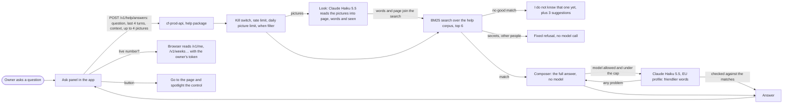

## How it works

1. **The knowledge comes from the app's own code.** `web/scripts/help-corpus.mjs` reads the router, the navigation, the
   whole Settings tree, the screens (headings, button labels, `aria-label`s, tips, toasts, empty states, `data-help`
   anchors) and adds the hand-written guides in `web/src/features/help/helpKb.json`. The result,
   `web/src/features/help/help-corpus.json`, is committed. A UI change updates the assistant in the same deploy.
2. **Search, not guessing.** Both the API and the browser rank the corpus with the same BM25 rules (title and keywords
   count most, synonyms like "delete" → **Throw away**, "videos" → clips and "my clips" → Library, small typos
   forgiven; "help" is a stopword, so a bare "help" gets the suggestions). A hand-written guide within 10% of the best
   generated page on the same route wins the tie (`GUIDE_TIE = 0.9` in both `retrieve.py` and `retrieve.ts`). If
   nothing matches well enough, it says "I don't know that one yet." and never makes something up.
3. **It always works without the model.** The composer builds a complete answer from the best match: one or two
   sentences, at most 6 numbered steps with the app's own button names, and up to 2 buttons. The model only rewrites
   that answer in friendlier words, and its answer is thrown away (silently) if it names a button, page or number the
   matches do not contain, writes a link or a domain, or repeats a price the owner typed (outcome `kb_ungrounded`).
4. **It uses the owner's skills.** Like every AI call in Clip Factory
   ([CONTRACTS.md §18.6](CONTRACTS.md#186-every-ai-call-uses-every-skill-one-shared-rule)), the model's instructions
   start with every skill (through the shared `skill_prompt.load_block` and `learn.converse_text`), and the grounding
   rules follow. When the two disagree, the grounding rules win: the skills set the tone and the clip advice, and facts
   about the app come only from the corpus. If the skills cannot be read, the model is not asked and the composed
   answer is shown (outcome `kb_skills`).
5. **Live numbers come from the browser.** "How many views did my best clip get this week?" is answered with a
   placeholder that the panel fills by reading the same APIs the pages use, with the owner's own token. The assistant
   itself never reads clips, posts or weeks.
6. **Actions, not just text.** A button navigates (asking first if a caption edit or pasted link is not saved yet) and
   draws a bone ring around the control for 2.4 seconds.
7. **Private.** Questions and answers are never stored and never logged. Each request logs one outcome line with a
   request id, which the "Copy the help code" link copies when something goes wrong.
8. **Pictures** ([CONTRACTS.md §26](CONTRACTS.md#26-pictures-in-ask-owner-request-2026-11-19), ADR-48). The owner can
   add, paste or drop up to 4 pictures. The browser shrinks each to a clean JPEG (at most 1568 px and 600 KB, no
   EXIF or GPS). One "look" call reads them into a page, up to 12 labels and one sentence (`seen`); search runs on the
   question plus those labels, and the rewrite is grounded exactly as before. Pictures are never stored or logged;
   later questions carry only `seen`.
