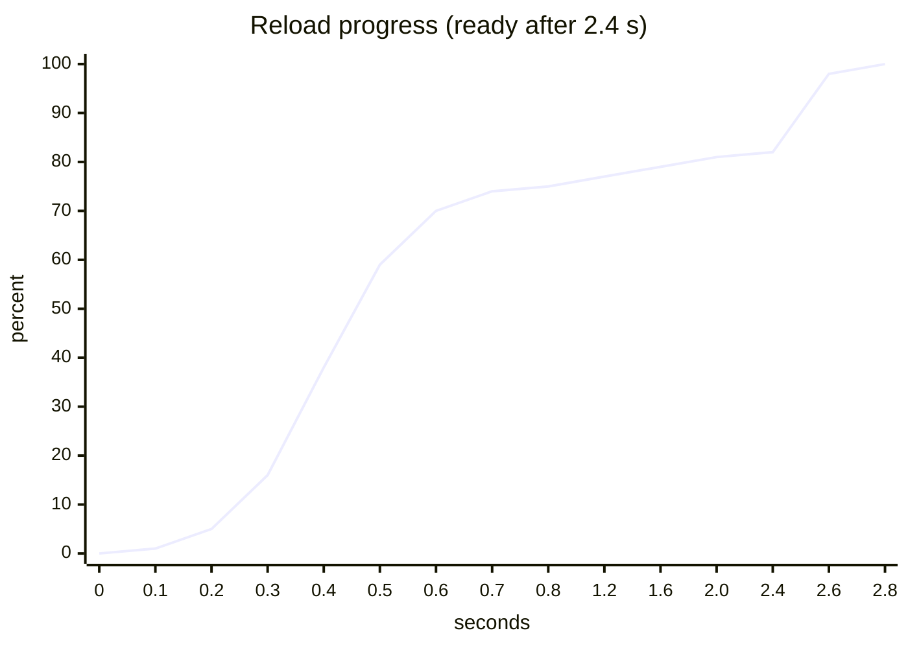

## Update bar

Shown when `/version.json` reports a version other than the running one ([CONTRACTS.md §12.2](CONTRACTS.md#122-update-banner-whats-new--reload)).

```
 ┌───────────────────────────────────────────────────────────────┐
 │ ✦  New!  [ Settings ] [ Profile picture ]      Later  (↻ Reload) │
 └───────────────────────────────────────────────────────────────┘
   sparkle  area pills (1–3 words each, max 3)      quiet   vermilion CTA
```

| Part | Spec |
|---|---|
| Container | `.glass--strong` pill bar, fixed at the bottom, centred, max width 640 px, 12 px from the edge; on phones it sits above the tab bar (`bottom: calc(tab-bar height + env(safe-area-inset-bottom) + 8px)`). `role="status"`, `aria-live="polite"`. |
| Entrance | Slides up 24 px and fades in over 320 ms, `cubic-bezier(.2,.8,.2,1)`; one soft sparkle twinkle. Reduced motion: fade only. |
| Sparkle | 20 px vermilion four-point star icon. |
| Title | "New!" in Inter 600. Never a version number. |
| Pills | Bone glass chips, 13 px Inter 500, `--r-pill`, single line with ellipsis; on narrow phones they wrap under the title and the bar grows taller rather than overflowing. Labels come from `version.json` `areas`. |
| Reload | Vermilion pill, refresh icon + "Reload", 48 px tall. It is the one allowed second vermilion button on a screen, because it belongs to the app, not to the page. |
| Later | Quiet text button; hides the bar until the next check (5 minutes, or when the app comes back to the screen). |
| While reloading | Pills and buttons fade out; the bar's fill becomes the progress bar (below) with "Updating…" and the percentage for screen readers (`role="progressbar"`, `aria-valuenow`). |

### The reload curve

The owner asked for "fast to 80 % or to 70 %, slow in and slow out, but in the middle really quick". The bar runs in
three phases:

| Phase | From → to | Time | Curve |
|---|---|---|---|
| 1. Rush | 0 → 75 % | 800 ms | ease-in-out cubic, `cubic-bezier(0.65, 0, 0.35, 1)`: soft start, fast middle, soft landing |
| 2. Creep | 75 → at most 90 % | while the new service worker installs and activates (`skipWaiting` by `postMessage`) and fresh files load | `p = 75 + 15 × (1 − e^(−t / 2.5 s))`: always moving, slower and slower, never reaching 90 |
| 3. Finish | current → 100 % | 400 ms | ease-out cubic, `cubic-bezier(0.33, 1, 0.68, 1)`; then a 350 ms sparkle, then `location.reload()` |

A cap of 10 s from the press jumps straight to phase 3. Reduced motion: a plain linear fill to 100 %, no sparkle.

Example: ready after 2.4 s.

| Time (s) | 0 | 0.1 | 0.2 | 0.3 | 0.4 | 0.5 | 0.6 | 0.7 | 0.8 | 1.2 | 1.6 | 2.0 | 2.4 | 2.6 | 2.8 |
|---|---|---|---|---|---|---|---|---|---|---|---|---|---|---|---|
| Bar (%) | 0 | 1 | 5 | 16 | 38 | 59 | 70 | 74 | 75 | 77 | 79 | 81 | 82 | 98 | 100 |



Why it works: the first 0.8 s shows most of the progress, so the press feels instant; the slow creep hides the
unknown wait without ever freezing; the quick finish and sparkle land the reward.
