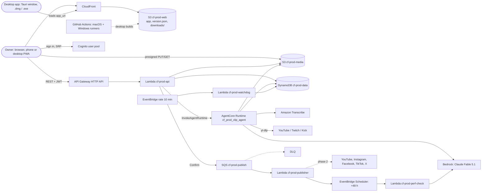
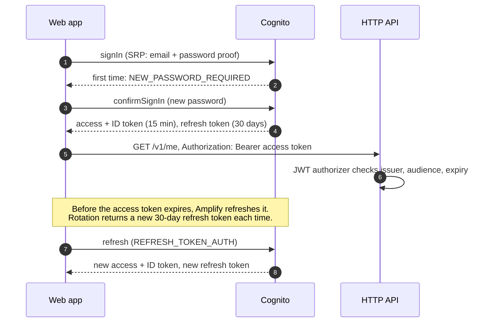
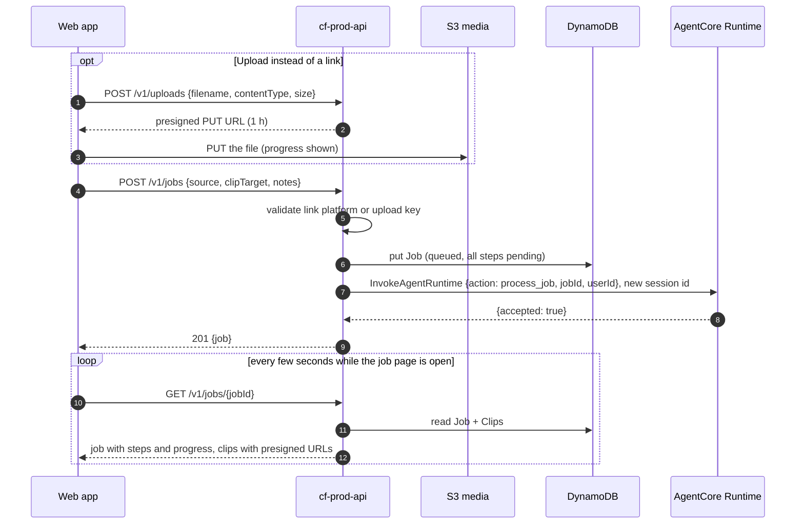
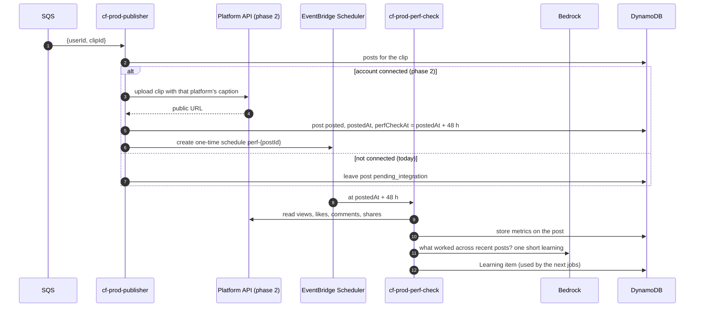
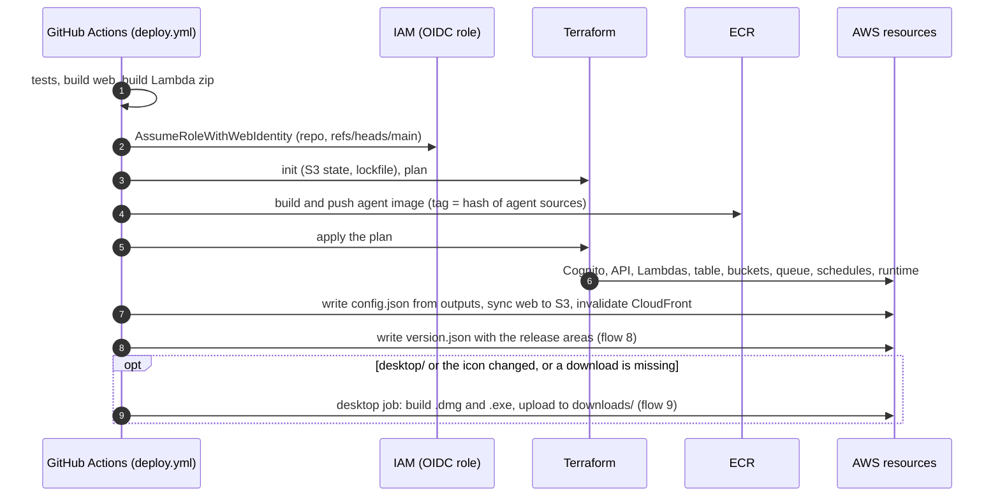
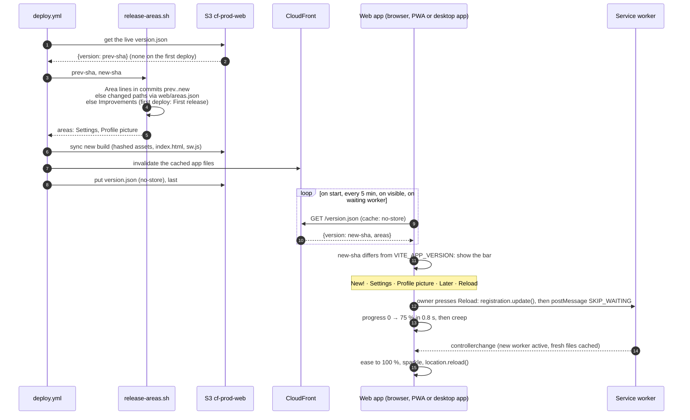
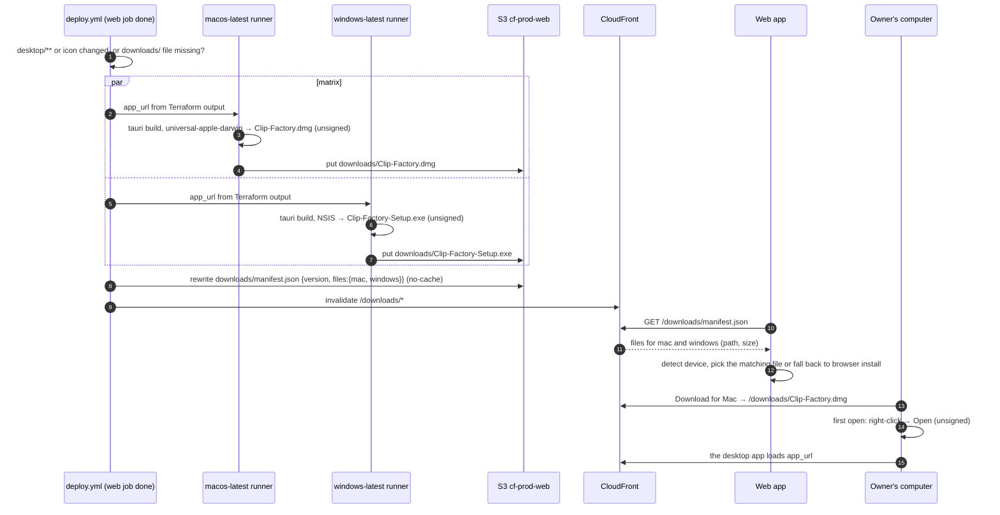

# Architecture

Clip Factory Cloud is a serverless application in one AWS account and one environment (`prod`, resource prefix
`cf-prod`, region `eu-north-1`). The diagram is [architecture/aws-architecture.drawio](architecture/aws-architecture.drawio).
Names, routes, shapes and keys are defined in [CONTRACTS.md](CONTRACTS.md); this document explains how the pieces
work together and why.

## Overview



## Services and why each one

Only managed, pay-per-use services. Nothing to patch, nothing running while the app is idle except storage.

| Service | Resource | Why |
|---|---|---|
| Amazon CloudFront | web distribution | HTTPS, global caching for the PWA, `config.json` served with `no-store`, `version.json` and `downloads/manifest.json` never cached. Origin Access Control keeps the bucket private. |
| Amazon S3 | `cf-prod-web` | The built web app, `version.json` (what is new), and `downloads/` (the desktop `.dmg` and `.exe` plus `manifest.json`). Private; only CloudFront reads it. |
| Amazon S3 | `cf-prod-media-<accountId>` | Uploads, extracted audio, transcripts, rendered clips and covers, skills and the optional YouTube cookies. Private, SSE-S3, lifecycle rules expire sources after 14 days. Browsers read and write it only through presigned URLs. |
| Amazon Cognito | user pool `cf-prod-users`, client `cf-prod-web` | One owner, admin-created. Short access tokens and a rotating 30-day refresh token. |
| Amazon API Gateway | HTTP API | Cheapest API Gateway type, with a built-in JWT authorizer, so no authorizer Lambda. CORS for the app and `localhost:5173`. |
| AWS Lambda | `cf-prod-api` | Every `/v1` route: validation, DynamoDB, presigned URLs, starting and cancelling agent sessions, Confirm. |
| AWS Lambda | `cf-prod-publisher` | Reads the publish queue, posts through the platform adapters (phase 2), sets `postedAt`, creates the 48-hour schedule. |
| AWS Lambda | `cf-prod-perf-check` | Runs once per post 48 hours after posting: stores metrics, asks Claude for one learning. |
| AWS Lambda | `cf-prod-watchdog` | Every 10 minutes: fails jobs whose agent stopped sending heartbeats. |
| Amazon DynamoDB | `cf-prod-data` | Single table for all entities, on-demand, point-in-time recovery, TTL. See [ADR-05](DECISIONS.md#adr-05-one-dynamodb-table-single-table-design). |
| Amazon SQS | `cf-prod-publish` + dead-letter queue | Confirm returns immediately; publishing retries on its own; poison messages are kept for inspection. |
| Amazon EventBridge Scheduler | one-time `perf-<postId>` schedules | Exact 48-hour timing per post with no polling. Schedules delete themselves after running. |
| Amazon EventBridge | rule `rate(10 minutes)` | Triggers the watchdog. |
| Amazon Bedrock AgentCore Runtime | `cf_prod_clip_agent` | Runs the agent container for as long as a job needs, one isolated session per job. See [ADR-03](DECISIONS.md#adr-03-amazon-bedrock-agentcore-runtime--claude-agent-sdk-for-the-agent). |
| Amazon Bedrock | Claude Fable 5.1, global profile | Moment selection, facecam detection (vision), checklist judgement, captions, learnings. |
| Amazon Transcribe | batch jobs | Word-level timestamps and language detection, replacing local Whisper. |
| Amazon ECR | agent repository | The ARM64 agent image, tagged by a hash of its sources. |
| Amazon CloudWatch | logs, alarms | Structured logs for every function and the agent; alarms on errors, DLQ depth and failed jobs. |
| Amazon SNS | alarm topic | Emails `alarm_email` when an alarm fires (optional). |
| AWS IAM | GitHub OIDC deploy role, one role per function | No long-lived keys anywhere; each function can touch only what it needs. |
| GitHub Actions (not AWS) | `macos-latest` and `windows-latest` runners | Build the desktop app ([§12.3](CONTRACTS.md#123-desktop-wrapper-desktop-tauri-v2)); free for a public repository, so there is no build server to pay for. |

## Data flows

### 1. Sign in and token lifetimes



An owner who opens the app at least once every 30 days never signs in again. After 30 days without use the refresh
token expires and the sign-in screen appears. See [SECURITY.md](SECURITY.md).

### 2. Create a job (link or upload)



### 3. The agent pipeline

The agent owns the job record from the moment it accepts. Each step updates `steps[i]`, `progress` and `heartbeatAt`.
Details of each step and the prompts are in [AGENT.md](AGENT.md).

```mermaid
sequenceDiagram
  autonumber
  participant R as Agent (AgentCore)
  participant D as DynamoDB
  participant S as S3 media
  participant Y as Source site
  participant T as Transcribe
  participant B as Bedrock (Fable 5.1)
  R->>D: job running; load settings, enabled skills, latest 10 learnings
  R->>Y: resolve: metadata (title, channel, duration) or S3 head for uploads
  R->>Y: download: audio only, capped at maxSourceHours
  R->>S: audio.m4a
  R->>T: StartTranscriptionJob (word timestamps, auto language)
  T->>S: transcript.json
  R->>S: words.json, loudness.json
  R->>B: select: transcript windows + loudness + skills + learnings
  B-->>R: ranked moments (+ spares) with hooks and moment types
  loop each moment
    R->>Y: download only that section of video
    R->>B: one frame: where is the facecam?
    R->>R: ffmpeg: 1080x1920, hook, captions, cover
    R->>B: checklist judgement (with measured values)
    R->>S: clip.mp4, cover.jpg
    R->>D: Clip (status review)
  end
  R->>B: captions per platform
  R->>D: job ready, clipCount
```

### 4. Review and confirm

```mermaid
sequenceDiagram
  autonumber
  participant W as Web app
  participant A as cf-prod-api
  participant D as DynamoDB
  participant Q as SQS cf-prod-publish
  W->>A: GET /v1/clips?status=review
  A-->>W: clips with presigned video and cover URLs (1 h)
  opt edit captions
    W->>A: PATCH /v1/clips/{clipId} {captions}
  end
  alt Confirm
    W->>A: POST /v1/clips/{clipId}/confirm
    A->>D: clip confirmed; one Post per enabled platform<br/>(pending_integration until that account is connected)
    A->>Q: {userId, clipId}
    A-->>W: {clip, posts}  (celebration + tap sound)
  else Decline
    W->>A: POST /v1/clips/{clipId}/decline
    A->>D: clip declined
    A->>A: delete clip.mp4 and cover.jpg
  end
```

### 5. Publish (phase 2 adapters) and the 48-hour performance check



### 6. Watchdog

Every 10 minutes `cf-prod-watchdog` queries the owner's running jobs. A job with `heartbeatAt` older than 15 minutes
is set to `failed` with "The agent stopped responding. Press Retry." Retry starts a new session from the beginning and
reuses the cached source in S3.

### 7. Deploy



Step-by-step setup is in [DEPLOYMENT.md](DEPLOYMENT.md).

### 8. Updates: `version.json`, release areas and the update bar

Every deploy tells running apps that something is new, and in a word or three what it is
([CONTRACTS.md §12.2](CONTRACTS.md#122-update-banner-whats-new--reload)).

- **Build.** The web build embeds its own version (`VITE_APP_VERSION`, the short git sha).
- **Areas.** `scripts/release-areas.sh <prev-sha> <new-sha>` collects the labels. `prev-sha` is the `version` in the
  live `/version.json` in the web bucket. Rule, in order: the `Area:` lines in the commit messages between the two
  ([GIT_WORKFLOW.md](GIT_WORKFLOW.md#area-lines-what-the-update-bar-says)); otherwise the changed files mapped through
  `web/areas.json` (longest folder prefix wins, for example `web/src/routes/settings` → "Settings"); otherwise
  `["Improvements"]`. At most three labels, duplicates removed. With no live `version.json` (first deploy) the label
  is `["First release"]`.
- **Publish.** After the web files are synced, the deploy writes
  `{"version":"<short sha>","builtAt":"<ISO time>","areas":[...]}` to `/version.json` with `Cache-Control: no-store`.
  It is written **last**, so an app never sees a new version before its files are in place.
- **Detect.** The app fetches `/version.json` (bypassing every cache) on start, every 5 minutes, when the tab or window
  becomes visible, and when its service worker reports a waiting worker. A different `version` shows the update bar.
- **Reload.** The progress bar runs the [reload curve](UX_DESIGN_SYSTEM.md#the-reload-curve) while the app tells the
  waiting service worker to `skipWaiting`, waits for `controllerchange`, then reloads (at most 10 s).



Installed apps (phone PWA, desktop PWA and the desktop app) run the same code, so they show the same bar. The desktop
app never needs its own update: it loads the site, and the site updates itself.

### 9. Get the app and the desktop wrapper

The app offers the right install for each device ([CONTRACTS.md §12.1](CONTRACTS.md#121-get-the-app-sidebar-item-on-phones-a-card-in-settings-plus-a-one-time-banner-on-home))
and the Mac and Windows downloads come from a thin Tauri v2 window ([§12.3](CONTRACTS.md#123-desktop-wrapper-desktop-tauri-v2),
[ADR-18](DECISIONS.md#adr-18-a-thin-tauri-desktop-wrapper-not-electron)).

**The wrapper** (`desktop/`) bundles no screens. It opens `app_url` in the system web view (WebKit on macOS, WebView2 on
Windows), sets the title "Clip Factory" and the app icon, keeps a 380 × 600 minimum size, remembers size and position,
opens outside links in the normal browser, appends `ClipFactoryDesktop` to the user agent and sets
`window.__CF_DESKTOP__ = true`, so the web app hides Get the app inside it. Sign-in, tokens and the service worker
work as in a browser; tokens live in the wrapper's own web storage.

**The build** is the `desktop` job in `deploy.yml`. It runs after the web deploy, only when `desktop/**` or the app
icon changed or a download is missing from the bucket:



**Phones** never get a file. Android installs the PWA through the browser's own prompt. iPhone and iPad get three
picture steps to Add to Home Screen, because Apple allows no app download outside its store
([ADR-21](DECISIONS.md#adr-21-iphone-and-ipad-get-add-to-home-screen-steps-not-a-download)).

**Hiding it once installed.** The web app checks `display-mode: standalone` / `window-controls-overlay`,
`navigator.standalone` (iOS), the desktop wrapper markers, and `cf.installed=1` in local storage (set on the
`appinstalled` event).

## Failure handling

| What can fail | What happens |
|---|---|
| A pipeline step (download blocked, Transcribe error, render error) | The step is marked `failed` with a plain message, the job becomes `failed`, the app shows **Retry**. |
| One clip fails the checklist | One fix pass; if it still fails, a spare moment replaces it. The job finishes with the clips that pass. |
| The agent container dies or the session ends | Heartbeats stop; the watchdog fails the job within about 25 minutes. |
| Bedrock throttling | The SDK retries with exponential backoff; the global profile spreads load across regions. |
| The owner cancels | The API sends `{action: cancel}` to the session; the agent stops ffmpeg and yt-dlp, marks the job `canceled`. |
| Publishing fails | SQS retries the message (visibility timeout); after 3 failed receives it moves to the DLQ and an alarm fires. |
| A perf-check schedule fails | EventBridge Scheduler retries; failed invocations are logged and alarmed. |
| A presigned URL expires | URLs last 1 hour; the app refetches the clip or job and gets fresh ones. |
| Bad deploy | Revert the commit on `main`; the next deploy restores the previous state ([DEPLOYMENT.md](DEPLOYMENT.md#rollback)). |
| Data deleted by mistake | DynamoDB point-in-time recovery (35 days). |
| `version.json` cannot be read | The app shows no update bar and checks again in 5 minutes. It never blocks the app. |
| The new service worker is slow to activate | The reload bar creeps, and after 10 s the page reloads anyway. |
| `release-areas.sh` finds nothing usable | The label is "Improvements". The deploy never fails because of labels. |
| A desktop build fails | The `desktop` job fails on its own; the web deploy has already finished. The old files and `manifest.json` stay, so downloads keep working. |
| A download file is missing | `manifest.json` does not list it; Get the app falls back to the browser install. The next deploy rebuilds it. |

## Cost notes

Rough, for one owner running about 10 jobs a month on 2-hour sources. Everything else is close to free tier.

| Item | Driver | Rough monthly |
|---|---|---|
| Bedrock, Claude Fable 5.1 | Moment selection reads the transcript; checklist, captions and vision are small | the largest line; a few dollars per job, depending on source length |
| Amazon Transcribe | $0.024 per audio minute | 10 × 120 min ≈ $29 |
| AgentCore Runtime | CPU and memory per second while a job runs (30–60 min) | a few dollars |
| S3 | Clips kept; sources expire after 14 days | under $1 |
| Lambda, API Gateway, DynamoDB, SQS, Scheduler | Requests | under $1 |
| CloudFront | Web app, config, `version.json` checks, desktop downloads (about 10 MB each) | under $1 |
| GitHub Actions | macOS and Windows runners for the desktop app | free (public repository) |

`maxSourceHours` (default 6) is the main cost lever: it limits how much audio is transcribed and read by Claude.

## Limits

- **YouTube may block cloud IP addresses.** Requests from AWS addresses are sometimes asked to "sign in to confirm
  you're not a bot". Two ways out: add a `cookies.txt` from a signed-in browser in Settings (stored privately at
  `private/<userId>/youtube-cookies.txt`, used only by yt-dlp), or download the video yourself and upload it. The job
  error says which one to try.
- **Twitch and Kick** VODs can be subscriber-only or deleted after a while; those fail at the resolve step with a
  plain reason.
- **Very long streams** are processed up to `maxSourceHours` (1–12).
- **Uploads** are limited to 5 GB per file.
- **AgentCore sessions** have a maximum lifetime; a job that would exceed it should lower `maxSourceHours`.
- **Presigned URLs** last 1 hour.
- **One owner**: the data model supports more users, but sign-up is off.
- **Desktop builds are unsigned** ([ADR-19](DECISIONS.md#adr-19-unsigned-desktop-builds-for-now)): macOS and Windows
  warn on the first open; the Get the app card explains the one extra click.
- **The desktop app has the app address built in.** If `app_url` changes (for example a custom domain), the desktop
  files must be rebuilt: delete them from `downloads/` and the next deploy rebuilds them
  ([DEPLOYMENT.md](DEPLOYMENT.md#desktop-downloads)). Already installed copies keep opening the old address.
- **No iPhone download.** Apple allows no app files outside its store; iPhone and iPad use Add to Home Screen.
