# Architecture

Clip Factory Cloud is a serverless application in one AWS account and one environment (`prod`, resource prefix
`cf-prod`, region `eu-north-1`). Backend code is Python 3.13 (`api/`, `agent/`); every AWS resource is Terraform
(`infra/`). There is no server, no container service to run and no VPC.

The diagram is [architecture/aws-architecture.drawio](architecture/aws-architecture.drawio) (a PNG copy is
[architecture/aws-architecture.png](architecture/aws-architecture.png)). Names, routes, shapes and keys are defined in
[CONTRACTS.md](CONTRACTS.md), especially [§14](CONTRACTS.md#14-serverless-expansion-websocket-api-rest-api-durable-functions-s3-vectors);
this document explains how the pieces work together and why.

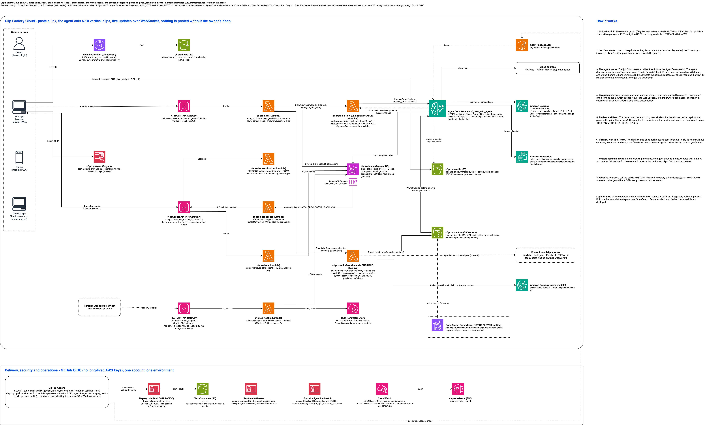

## Overview

The numbers match the numbered flows in the diagram.

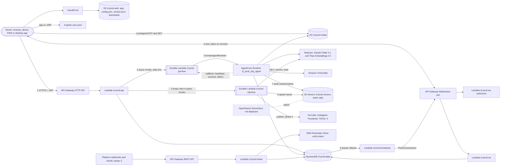

## Services and why each one

Only managed, pay-per-use services. Nothing runs while the app is idle except storage. Why each choice was made is in
[DECISIONS.md](DECISIONS.md).

| Service | Resource | Why |
|---|---|---|
| Amazon CloudFront | web distribution | HTTPS, caching for the PWA, `config.json`, `version.json` and `downloads/manifest.json` never cached. Origin Access Control keeps the bucket private. The CSP allows `wss://*.execute-api.eu-north-1.amazonaws.com` for live updates. |
| Amazon S3 | `cf-prod-web` | The built web app, `version.json` (what is new), and `downloads/` (the desktop `.dmg` and `.exe` plus `manifest.json`). Private; only CloudFront reads it. |
| Amazon S3 | `cf-prod-media-<accountId>` | Uploads, extracted audio, transcripts, rendered clips and covers, skills and the optional YouTube cookies. Private, SSE-S3, sources expire after 14 days. Browsers use presigned URLs only. |
| Amazon S3 Vectors | bucket `cf-prod-vectors-<accountId>`, index `clips` (1024 dimensions, cosine, float32) | The learning memory: one vector per clip, so the agent can find "what worked before" and the app can show "Like clips that did well". Paid per request and per stored vector, nothing standing. See [ADR-25](DECISIONS.md#adr-25-s3-vectors-for-the-learning-memory-opensearch-not-deployed). |
| Amazon Cognito | user pool `cf-prod-users`, client `cf-prod-web` | One owner, admin-created. Short access tokens and a rotating 30-day refresh token. |
| Amazon API Gateway, HTTP API | `/v1` routes | The app's API. Cheapest type, with a built-in JWT authorizer. CORS for the app and `localhost:5173`. |
| Amazon API Gateway, WebSocket API | `cf-prod-ws`, stage `live` | Pushes job, clip, post and learning changes to open apps, so screens update without waiting for a poll. See [ADR-23](DECISIONS.md#adr-23-live-updates-over-a-websocket-api-polling-only-as-the-fallback). |
| Amazon API Gateway, REST API | `cf-prod-hooks`, stage `v1` | The one public, unauthenticated surface: platform webhooks and OAuth callbacks (phase 2), with per-method throttling, a usage plan, request validation and X-Ray. See [ADR-24](DECISIONS.md#adr-24-a-separate-rest-api-for-public-platform-webhooks). |
| AWS Lambda | `cf-prod-api` | Every `/v1` route: validation, DynamoDB, presigned URLs, starting the two durable flows, cancel, Keep and Throw away, similar clips. |
| AWS Lambda, durable function | `cf-prod-job-flow` (alias `live`) | Starts the agent for a job and waits (no compute) for its callback; fails the job if heartbeats stop. Replaces the watchdog. See [ADR-22](DECISIONS.md#adr-22-lambda-durable-functions-for-the-job-and-clip-workflows). |
| AWS Lambda, durable function | `cf-prod-clip-flow` (alias `live`) | After Keep: makes the posts, publishes (phase 2), waits 48 hours (no compute), reads metrics, writes a learning, updates the clip's vector. Replaces the publish queue, the publisher, the scheduler and perf-check. |
| AWS Lambda | `cf-prod-ws-authorizer` | Checks the Cognito access token on `$connect` (standard library RS256 check, no extra packages). |
| AWS Lambda | `cf-prod-ws` | `$connect` stores the connection, `$disconnect` removes it, `$default` answers `ping`. |
| AWS Lambda | `cf-prod-broadcast` | Reads the DynamoDB stream and sends each change to the owner's open connections. |
| AWS Lambda | `cf-prod-hooks` | Answers webhook verification challenges, stores webhook events, redirects OAuth callbacks to Settings. |
| Amazon DynamoDB | `cf-prod-data` + stream | Single table for all entities including WebSocket connections and webhook events. On-demand, point-in-time recovery, TTL, stream `NEW_AND_OLD_IMAGES` feeding `cf-prod-broadcast`. See [ADR-05](DECISIONS.md#adr-05-one-dynamodb-table-single-table-design). |
| AWS Systems Manager Parameter Store | `/cf-prod/hooks/verify-token` (SecureString) | The Meta webhook verify token. Generated by Terraform as a write-only value, so it never enters the Terraform state. |
| Amazon Bedrock AgentCore Runtime | `cf_prod_clip_agent` | Runs the agent container for as long as a job needs, one isolated session per job. See [ADR-03](DECISIONS.md#adr-03-amazon-bedrock-agentcore-runtime--claude-agent-sdk-for-the-agent). |
| Amazon Bedrock | Claude Fable 5.1 (global profile), Titan Text Embeddings V2 (in-Region) | Fable: moment selection, facecam detection, checklist judgement, captions, learnings. Titan: 1024-number embeddings of clip text for S3 Vectors. |
| Amazon Transcribe | batch jobs | Word-level timestamps and language detection. |
| Amazon ECR | agent repository | The ARM64 agent image, tagged by a hash of its sources. |
| Amazon CloudWatch | logs, alarms | JSON logs for every function and the agent; access logs for the WebSocket and REST APIs (never the query string); alarms on Lambda errors, failed or timed-out durable executions, stream lag and REST 5xx. |
| Amazon SNS | `cf-prod-alarms` | Emails `alarm_email` when an alarm fires (optional). |
| AWS IAM | GitHub OIDC deploy role, one role per function, the API Gateway logging role | No long-lived keys anywhere; each function can touch only what it needs. |
| Amazon OpenSearch Serverless | not deployed | Shown dashed in the diagram as an option for keyword or hybrid search later ([ADR-25](DECISIONS.md#adr-25-s3-vectors-for-the-learning-memory-opensearch-not-deployed)). |
| GitHub Actions (not AWS) | CI, deploy, desktop runners | Tests and deploys through OIDC; builds the desktop app on `macos-latest` and `windows-latest` ([§12.3](CONTRACTS.md#123-desktop-wrapper-desktop-tauri-v2)). |

### Lambda functions

All seven share one zip (`api/dist/lambda.zip`), Python 3.13, arm64, JSON logs, X-Ray active
([CONTRACTS.md §9](CONTRACTS.md#9-lambdas-one-zip-apidistlambdazip-python-313-arm64-package-clipfactory_api)).

| Function | Started by | Memory / timeout | Durable |
|---|---|---|---|
| `cf-prod-api` | HTTP API | as before | no |
| `cf-prod-job-flow` | `cf-prod-api`, async invoke of alias `live` | 256 MB / 120 s per invocation; whole execution up to 8 h 30 min | yes, retention 14 days |
| `cf-prod-clip-flow` | `cf-prod-api`, async invoke of alias `live` | 512 MB / 900 s per invocation; whole execution up to 3 days | yes, retention 14 days |
| `cf-prod-ws-authorizer` | WebSocket `$connect` | 128 MB / 10 s | no |
| `cf-prod-ws` | WebSocket routes | 128 MB / 10 s | no |
| `cf-prod-broadcast` | DynamoDB stream (filtered) | 256 MB / 60 s | no |
| `cf-prod-hooks` | REST API | 256 MB / 10 s | no |

### What was removed

The expansion removed these, with nothing left that refers to them ([CONTRACTS.md §14.1](CONTRACTS.md#141-what-is-removed-delete-it-from-terraform-code-tests-and-docs-nothing-may-still-reference-it)):

| Removed | Replaced by |
|---|---|
| Lambda `cf-prod-publisher` | `cf-prod-clip-flow` steps `ensure-posts` and `publish-{platform}` |
| Lambda `cf-prod-perf-check` | `cf-prod-clip-flow` steps `wait-48h`, `metrics`, `distil` |
| Lambda `cf-prod-watchdog` and its EventBridge rule (every 10 minutes) | the job-flow callback heartbeat timeout (15 minutes) |
| SQS `cf-prod-publish` and its dead-letter queue | durable execution: steps retry and checkpoint, no queue |
| EventBridge Scheduler group, role and one-time `perf-{postId}` schedules | `context.wait(48 h)` inside `cf-prod-clip-flow` |
| The DLQ alarm | alarms on `DurableExecutionFailed` and `DurableExecutionTimedOut` |
| Polling as the only way to see progress | WebSocket push; polling stays as the fallback |

## Data flows

### 1. Sign in and token lifetimes

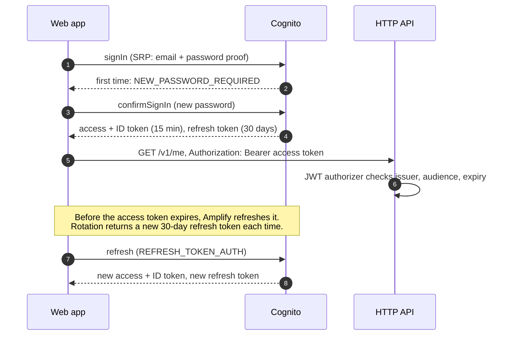

An owner who opens the app at least once every 30 days never signs in again. After 30 days without use the refresh
token expires and the sign-in screen appears. See [SECURITY.md](SECURITY.md).

### 2. Create a job and start `cf-prod-job-flow`

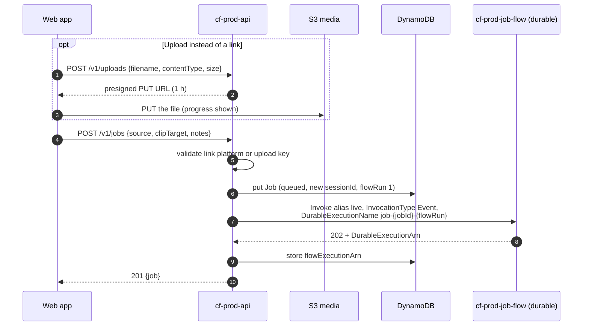

The start is idempotent: the payload has no timestamps, so starting the same name again either returns the running
execution or `DurableExecutionAlreadyStartedException`, which the API treats as "already started". **Retry** writes a
new `sessionId`, adds 1 to `flowRun` and starts `job-{jobId}-{flowRun}`. If the invoke itself fails, the job becomes
`failed` with "Could not start. Press Try again."

### 3. Job flow: the agent and its callback

`cf-prod-job-flow` replaces the watchdog. It costs nothing while it waits: the durable SDK checkpoints and the function
stops until the callback arrives.

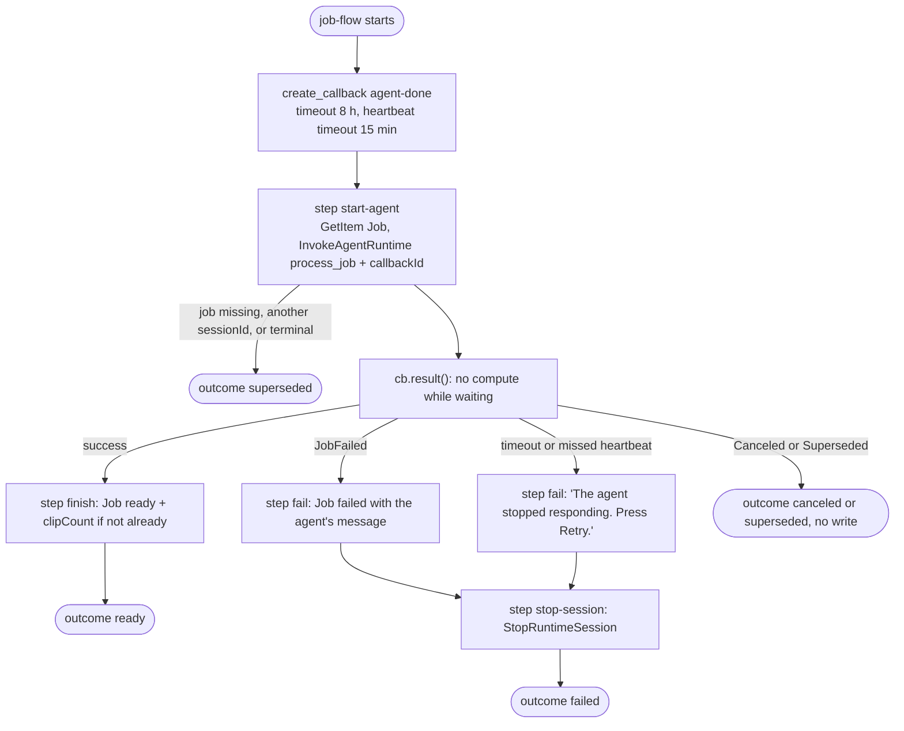

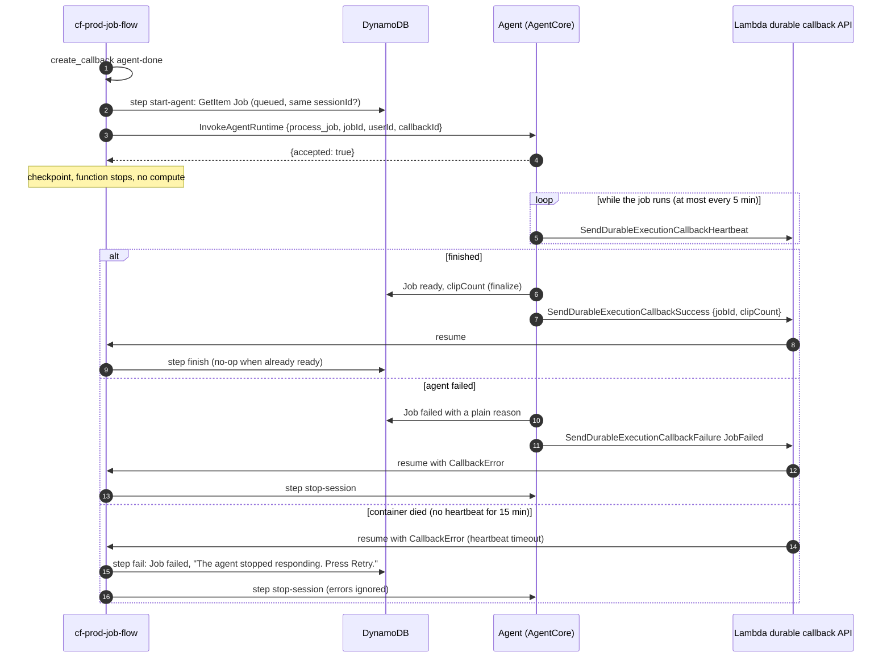

Every write by the flow is conditional on the Job's `sessionId`, so an old run can never overwrite a newer retry.
**Cancel** is handled by the API (Job `canceled`, `cancel` to the agent, `StopRuntimeSession`); the agent sends
`Canceled` and the flow writes nothing.

### 4. The agent pipeline

The agent owns the job record from the moment it accepts. Each step updates `steps[i]`, `progress` and `heartbeatAt`;
each write reaches the app through the live updates of flow 5. Details are in [AGENT.md](AGENT.md).

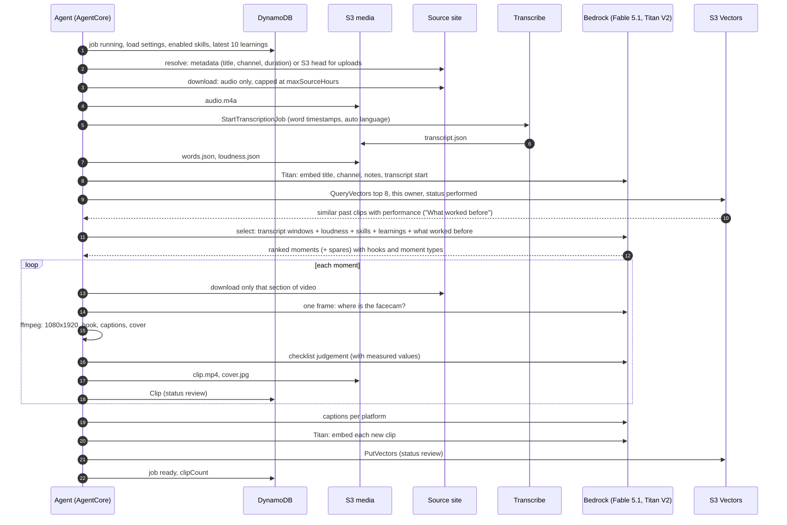

If the vector query fails, the agent logs `vectors.query_failed` and carries on without the section; fewer than three
`performed` hits are topped up with the owner's other clips.

### 5. Live updates over the WebSocket API

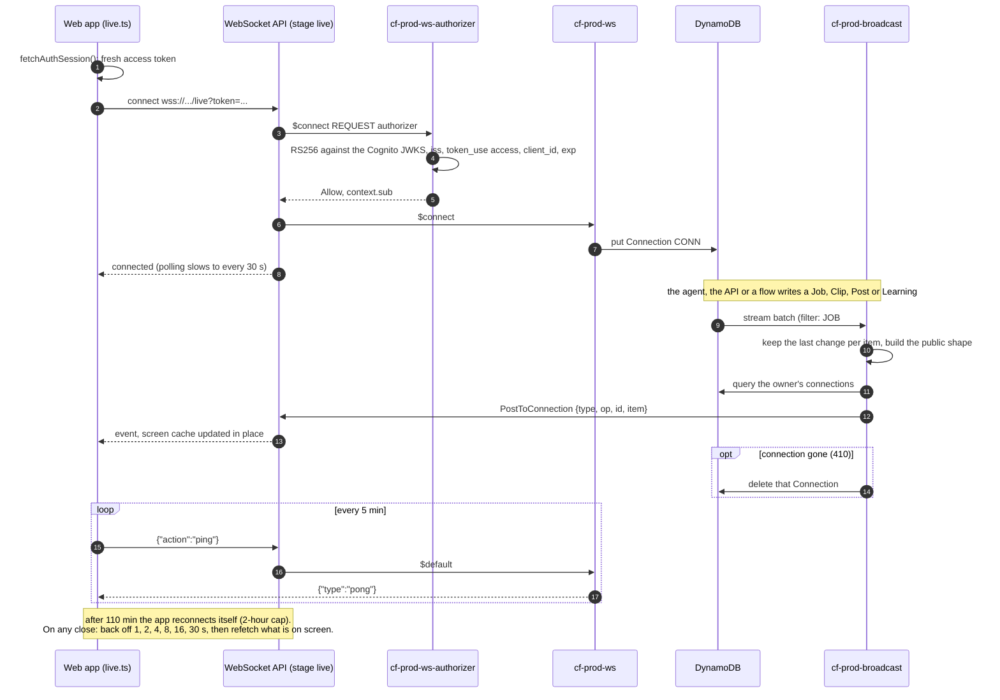

- Events carry the same public shapes as the HTTP API, so internal fields (`sessionId`, `videoKey`, `publishState`,
  `flowExecutionArn` and so on) never leave AWS. An event over 24 KB is sent as `partial: true` and the app refetches.
- The token is in the query string of the connect request, so the WebSocket access log has a fixed list of fields with
  no query and no headers, data tracing is off, and the Lambdas never log the token.
- Without a connection (mock mode, an old `config.json`, or a dropped socket) the app polls as before. Nothing on
  screen complains about a dropped socket.

### 6. Review, Keep and Throw away

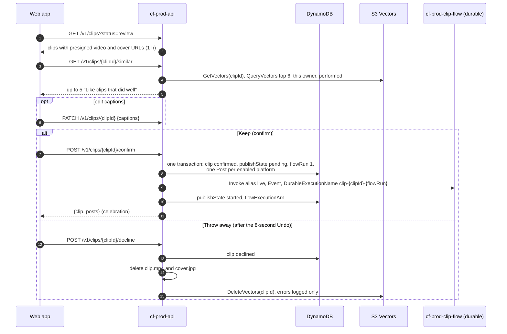

Keep is safe to press twice: a clip whose flow is `pending` is started again with the same name and payload (a no-op if
it is already running), and a `started` or `posted` clip just returns its current state. A clip that ended `failed`
shows **Try again**, which starts `clip-{clipId}-{flowRun + 1}`.

### 7. Clip flow: publish, wait 48 hours, learn

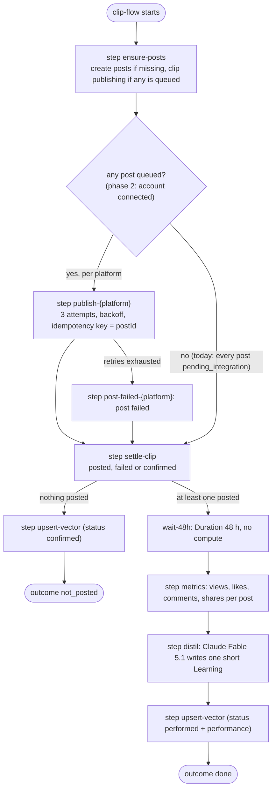

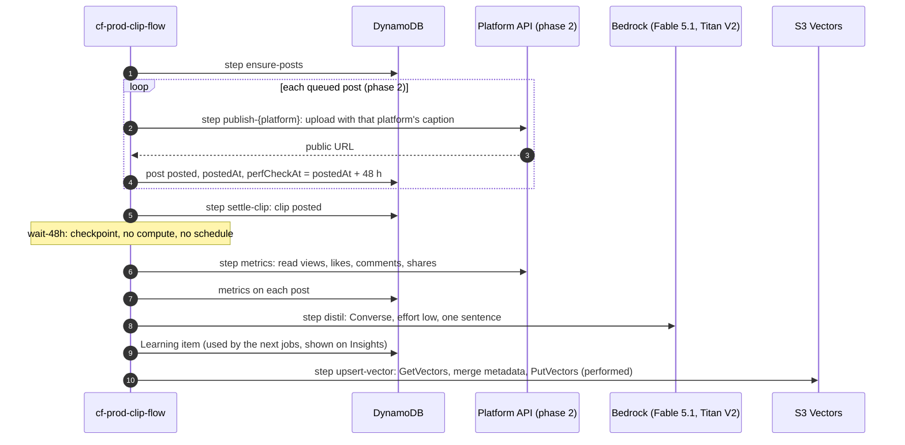

Every step is at-least-once, so each is written to be safe to repeat: posts are created only once (`postsCreated`),
a post is updated only while it is `queued`, and publishing passes `postId` as the platform's idempotency key. A
durable execution stays pinned to the Lambda version it started on, so a deploy during the 48-hour wait never changes
a running flow.

### 8. The learning memory (S3 Vectors)

Each clip gets one vector (`key = clipId`) built from its moment type, hook, YouTube title and summary, embedded by
Titan Text Embeddings V2 (1024 numbers, normalised). Filterable metadata: `userId`, `momentType`, `platforms`,
`status` (`review`, `confirmed`, `performed`) and `scoreBucket`; stored but not filterable: `hook`, `title`, `summary`
and `performance`.

| When | Who | What happens to the vector |
|---|---|---|
| Job finishes | agent | created, status `review` |
| Before moment selection | agent | the top 8 `performed` clips of this owner like this source become "What worked before" in the prompt |
| Owner opens a clip | API | `/similar` returns up to 5 of the owner's measured clips most like it |
| Keep, nothing posted | clip-flow | status `confirmed` |
| 48 hours after posting | clip-flow | status `performed` with the summed numbers |
| Throw away | API | deleted |

Two kinds of memory work together: **learnings** are short sentences about what works in general; **vectors** find
specific past clips that resemble the one at hand, with their real numbers.

### 9. Platform webhooks (REST API)

Ready for phase 2; nothing runs inline except storing the event.

The REST access log has no query string (OAuth callbacks carry `code` and `state`). Each method is throttled to 10
requests a second (burst 20), and `tiktok` and `x` answer `501` until phase 2.

### 10. Deploy

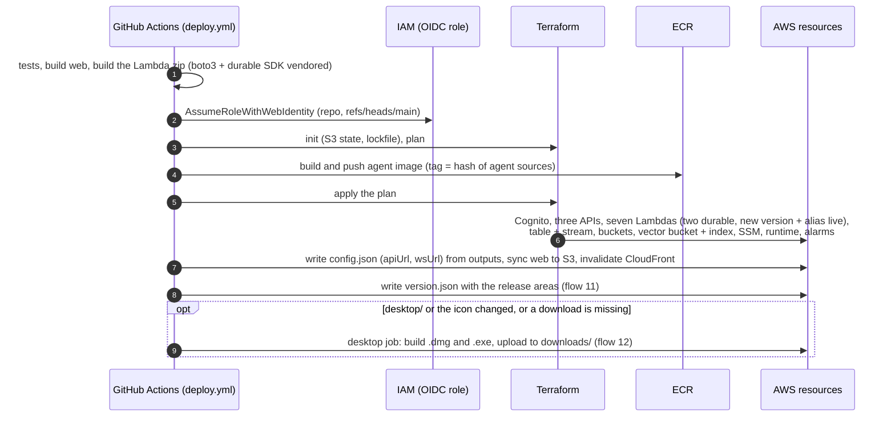

Step-by-step setup, including the one-time account settings, is in [DEPLOYMENT.md](DEPLOYMENT.md).

### 11. Updates: `version.json`, release areas and the update bar

Every deploy tells running apps that something is new, and in a word or three what it is
([CONTRACTS.md §12.2](CONTRACTS.md#122-update-banner-whats-new--reload)).

- **Build.** The web build embeds its own version (`VITE_APP_VERSION`, the short git sha).
- **Areas.** `scripts/release-areas.sh <prev-sha> <new-sha>` collects the labels. `prev-sha` is the `version` in the
  live `/version.json` in the web bucket. Rule, in order: the `Area:` lines in the commit messages between the two
  ([GIT_WORKFLOW.md](GIT_WORKFLOW.md#area-lines-what-the-update-bar-says)); otherwise the changed files mapped through
  `web/areas.json` (longest folder prefix wins, for example `web/src/routes/settings` → "Settings"); otherwise
  `["Improvements"]`. At most three labels, duplicates removed. With no live `version.json` (first deploy) the label
  is `["First release"]`.
- **Publish.** After the web files are synced, the deploy writes
  `{"version":"<short sha>","builtAt":"<ISO time>","areas":[...]}` to `/version.json` with `Cache-Control: no-store`.
  It is written **last**, so an app never sees a new version before its files are in place.
- **Detect.** The app fetches `/version.json` (bypassing every cache) on start, every 5 minutes, when the tab or window
  becomes visible, and when its service worker reports a waiting worker. A different `version` shows the update bar.
- **Reload.** The progress bar runs the [reload curve](UX_DESIGN_SYSTEM.md#the-reload-curve) while the app tells the
  waiting service worker to `skipWaiting`, waits for `controllerchange`, then reloads (at most 10 s).

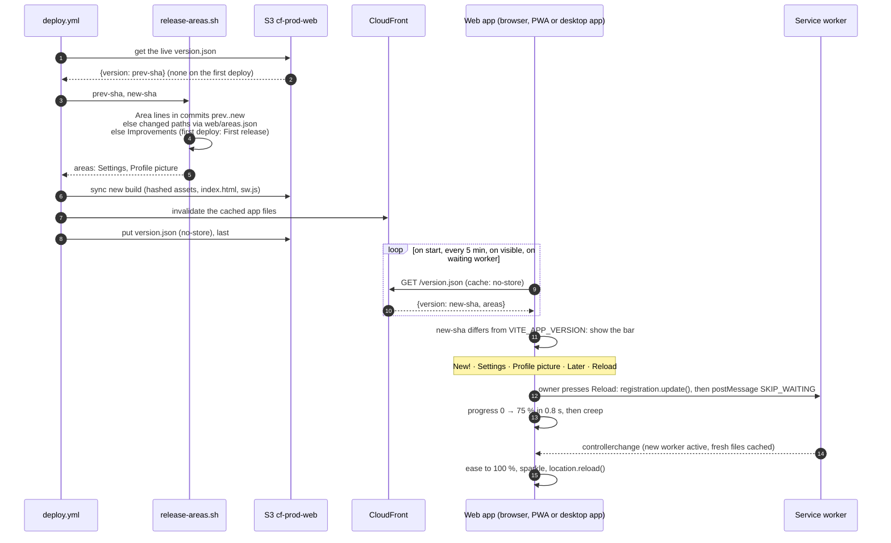

Installed apps (phone PWA, desktop PWA and the desktop app) run the same code, so they show the same bar. The desktop
app never needs its own update: it loads the site, and the site updates itself.

### 12. Get the app and the desktop wrapper

The app offers the right install for each device ([CONTRACTS.md §12.1](CONTRACTS.md#121-get-the-app-sidebar-item-on-phones-a-card-in-settings-plus-a-one-time-banner-on-home))
and the Mac and Windows downloads come from a thin Tauri v2 window ([§12.3](CONTRACTS.md#123-desktop-wrapper-desktop-tauri-v2),
[ADR-18](DECISIONS.md#adr-18-a-thin-tauri-desktop-wrapper-not-electron)).

**The wrapper** (`desktop/`) bundles no screens. It opens `app_url` in the system web view (WebKit on macOS, WebView2 on
Windows), sets the title "Clip Factory" and the app icon, keeps a 380 × 600 minimum size, remembers size and position,
opens outside links in the normal browser, appends `ClipFactoryDesktop` to the user agent and sets
`window.__CF_DESKTOP__ = true`, so the web app hides Get the app inside it. Sign-in, tokens, the service worker and the
live connection work as in a browser; tokens live in the wrapper's own web storage.

**The build** is the `desktop` job in `deploy.yml`. It runs after the web deploy, only when `desktop/**` or the app
icon changed or a download is missing from the bucket:

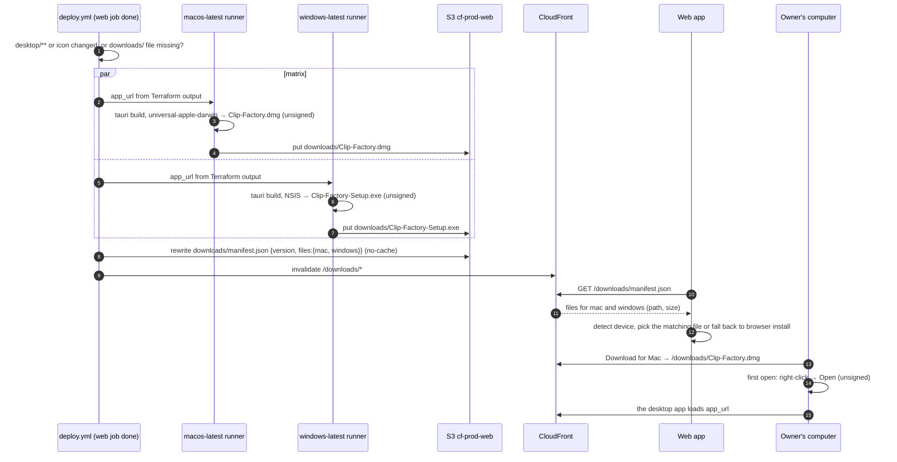

**Phones** never get a file. Android installs the PWA through the browser's own prompt. iPhone and iPad get three
picture steps to Add to Home Screen, because Apple allows no app download outside its store
([ADR-21](DECISIONS.md#adr-21-iphone-and-ipad-get-add-to-home-screen-steps-not-a-download)).

**Hiding it once installed.** The web app checks `display-mode: standalone` / `window-controls-overlay`,
`navigator.standalone` (iOS), the desktop wrapper markers, and `cf.installed=1` in local storage (set on the
`appinstalled` event).

## Failure handling

| What can fail | What happens |
|---|---|
| A pipeline step (download blocked, Transcribe error, render error) | The step is marked `failed` with a plain message, the job becomes `failed`, the agent sends `JobFailed` to the job-flow callback, the app shows **Try again**. |
| One clip fails the checklist | One fix pass; if it still fails, a spare moment replaces it. The job finishes with the clips that pass. |
| The agent container dies or the session ends | Heartbeats to the callback stop; after 15 minutes the job flow's `fail` step marks the job failed ("The agent stopped responding. Press Retry.") and stops the session. No scan, no watchdog. |
| The job flow cannot start the agent | Step `start-agent` retries 3 times with backoff on throttling, 5xx and connection errors; then the execution fails and the `cf-prod-job-flow-durable-failed` alarm fires. |
| The API cannot start a flow | Job: `failed` with "Could not start. Press Try again." Clip: stays `publishState: pending`; the next Keep starts it again (same name, so never twice). |
| A job runs longer than 8 hours | The callback times out and the job fails with the same plain message; long sources are capped by `maxSourceHours`. |
| Bedrock throttling | The SDK retries with exponential backoff; the global profile spreads load across regions. |
| The owner cancels | The API sends `{action: cancel}` to the session and stops it; the agent marks the job `canceled` and sends `Canceled`, so the flow writes nothing. |
| Publishing a post fails (phase 2) | The `publish-{platform}` step retries 3 times with backoff; then `post-failed-{platform}` marks only that post `failed`. If every queued post failed, the clip shows **Try again**. |
| Reading metrics fails for a platform | That platform is skipped after 3 attempts; the others still count. |
| Distil gets no usable answer (`max_tokens`, `refusal`, `content_filtered`) | Logged; no Learning is written; the vector is still updated. |
| S3 Vectors or Titan errors | Agent: the "What worked before" section is skipped. `/similar`: returns `[]`. Throw away: logged, the route still succeeds. |
| A durable execution fails or times out | Alarms `{fn}-durable-failed` and `{fn}-durable-timed-out` email the owner. A failed execution means a bug, because expected outcomes never raise. |
| A deploy happens during a 48-hour wait | The running execution stays on the version it started on; new executions use the new version. |
| The WebSocket drops (phone sleeps, network change, 2-hour cap) | The app reconnects with backoff 1–30 s, refetches what is on screen and polls while disconnected. No error is shown. |
| A WebSocket message cannot be delivered | `GoneException` deletes the stale connection; other errors are logged and skipped (the app refetches on reconnect). Connections also expire by TTL after 2 hours. |
| The broadcaster falls behind | Records older than 10 minutes are dropped (the app catches up on its next refetch); `cf-prod-broadcast-iterator-age` alarms when lag passes 5 minutes. |
| A webhook flood | REST per-method throttling (10/s, burst 20) answers `429`; the usage plan caps a month at 100 000 requests. |
| A presigned URL expires | URLs last 1 hour; the app refetches the clip or job and gets fresh ones. |
| Bad deploy | Revert the commit on `main`; the next deploy restores the previous state ([DEPLOYMENT.md](DEPLOYMENT.md#rollback)). |
| Data deleted by mistake | DynamoDB point-in-time recovery (35 days). |
| `version.json` cannot be read | The app shows no update bar and checks again in 5 minutes. It never blocks the app. |
| The new service worker is slow to activate | The reload bar creeps, and after 10 s the page reloads anyway. |
| `release-areas.sh` finds nothing usable | The label is "Improvements". The deploy never fails because of labels. |
| A desktop build fails | The `desktop` job fails on its own; the web deploy has already finished. The old files and `manifest.json` stay. |
| A download file is missing | `manifest.json` does not list it; Get the app falls back to the browser install. The next deploy rebuilds it. |

## Cost notes

Rough, for one owner running about 10 jobs a month on 2-hour sources. Everything else is close to free tier.

| Item | Driver | Rough monthly |
|---|---|---|
| Bedrock, Claude Fable 5.1 | Moment selection reads the transcript; checklist, captions, vision and distil are small | the largest line; a few dollars per job, depending on source length |
| Bedrock, Titan Text Embeddings V2 | A few thousand tokens per job | cents |
| Amazon Transcribe | $0.024 per audio minute | 10 × 120 min ≈ $29 |
| AgentCore Runtime | CPU and memory per second while a job runs (30–60 min) | a few dollars |
| Lambda durable functions | A handful of durable operations per job and per clip, small checkpoints, 14 days retention; no charge while waiting | cents |
| S3 Vectors | A few hundred vectors, a few queries per job | cents |
| API Gateway (HTTP, WebSocket, REST) | Requests, WebSocket messages and connection minutes while the app is open | under $1 |
| DynamoDB (incl. stream reads by Lambda), other Lambdas, SSM standard parameter | Requests | under $1 |
| S3 | Clips kept; sources expire after 14 days | under $1 |
| CloudFront | Web app, config, `version.json` checks, desktop downloads (about 10 MB each) | under $1 |
| OpenSearch Serverless | not deployed (would have a standing minimum of OCUs) | $0 |
| GitHub Actions | macOS and Windows runners for the desktop app | free (public repository) |

`maxSourceHours` (default 6) is the main cost lever: it limits how much audio is transcribed and read by Claude.

## Limits

- **YouTube may block cloud IP addresses.** Requests from AWS addresses are sometimes asked to "sign in to confirm
  you're not a bot". Two ways out: add a `cookies.txt` from a signed-in browser in Settings (stored privately at
  `private/<userId>/youtube-cookies.txt`, used only by yt-dlp), or download the video yourself and upload it. The job
  error says which one to try.
- **Twitch and Kick** VODs can be subscriber-only or deleted after a while; those fail at the resolve step with a
  plain reason.
- **Very long streams** are processed up to `maxSourceHours` (1–12). A job must finish within the 8-hour callback
  timeout (the job flow's execution limit is 8 h 30 min).
- **Uploads** are limited to 5 GB per file.
- **AgentCore sessions** have a maximum lifetime; a job that would exceed it should lower `maxSourceHours`.
- **Durable functions**: the clip flow can run for up to 3 days; execution history is kept for 14 days. Durable
  settings can only be set when a function is created, so changing them means a new function.
- **WebSocket**: connections close after 10 minutes idle (the app pings every 5) and after 2 hours (the app reconnects
  at 110 minutes); one message is at most 128 KB, and the broadcaster keeps events under 24 KB.
- **S3 Vectors**: the index settings (1024 dimensions, cosine, the four non-filterable keys) are fixed at creation; a
  change needs a new index. Filterable metadata stays under 2 KB per vector.
- **Model location**: Claude Fable 5.1 is reached only through the global profile from `eu-north-1`, so prompts may be
  processed outside the EU, and the account must be opted in to `aws_review` data retention
  ([DEPLOYMENT.md](DEPLOYMENT.md#4-bedrock-model-access-and-data-retention)).
- **Presigned URLs** last 1 hour.
- **One owner**: the data model supports more users, but sign-up is off.
- **Desktop builds are unsigned** ([ADR-19](DECISIONS.md#adr-19-unsigned-desktop-builds-for-now)): macOS and Windows
  warn on the first open; the Get the app card explains the one extra click.
- **The desktop app has the app address built in.** If `app_url` changes (for example a custom domain), the desktop
  files must be rebuilt: delete them from `downloads/` and the next deploy rebuilds them
  ([DEPLOYMENT.md](DEPLOYMENT.md#desktop-downloads)). Already installed copies keep opening the old address.
- **No iPhone download.** Apple allows no app files outside its store; iPhone and iPad use Add to Home Screen.
