# Architecture

Clip Factory Cloud is a serverless application in one AWS account and one environment (`prod`, resource prefix
`cf-prod`, region `eu-north-1`). Backend code is Python 3.13 (`api/`, `agent/`); every AWS resource is Terraform
(`infra/`). There is no server, no container service to run and no VPC.

The diagram is [architecture/aws-architecture.drawio](architecture/aws-architecture.drawio) (a PNG copy is
[architecture/aws-architecture.png](architecture/aws-architecture.png)). Names, routes, shapes and keys are defined in
[CONTRACTS.md](CONTRACTS.md), especially [§14](CONTRACTS.md#14-serverless-expansion-websocket-api-rest-api-durable-functions-s3-vectors),
[§16](CONTRACTS.md#16-clip-performance-stats-refresh-and-weekly-best-owner-request-2026-11-16) (clip numbers and the weekly best),
[§17](CONTRACTS.md#17-posting-setup-a-setup-list-per-platform-real-connect-real-posting-owner-request-2026-11-16) (posting setup, Connect and real posting),
[§18](CONTRACTS.md#18-skills-full-create-read-update-delete-every-ai-call-uses-every-skill-owner-request-2026-11-16) (skills, and every AI call using every skill)
and [§19](CONTRACTS.md#19-ask-clip-factory-grounded-in-app-help-assistant-owner-request-2026-11-16) (Ask Clip Factory, the help assistant),
and [§38](CONTRACTS.md#38-content-rewards-campaigns-owner-request-2026-11-21) (Content Rewards campaigns)
with [§39](CONTRACTS.md#39-content-rewards-the-two-ways-all-your-money-and-does-this-clip-fit-owner-request-2026-11-21) (the two ways, all your money and the fit check)
and [§41](CONTRACTS.md#41-campaign-finder-campaigns-that-match-what-you-want-owner-request-2026-11-21) (the campaign finder),
and [§46](CONTRACTS.md#46-auto-posting-the-oldest-clips-in-review-go-up-by-themselves-every-x-hours-owner-request-2026-11-22) (auto-posting);
this document explains how the pieces work together and why.


## Overview

The numbers match the numbered flows in the diagram.

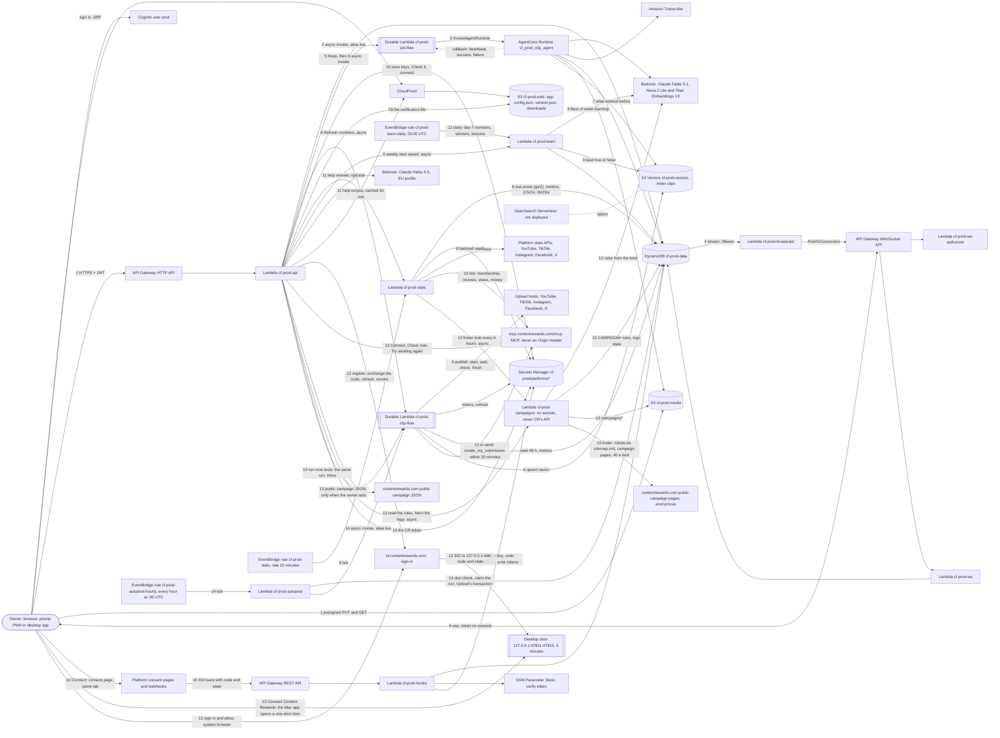

## Services and why each one

Only managed, pay-per-use services. Nothing runs while the app is idle except storage. Why each choice was made is in
[DECISIONS.md](DECISIONS.md).

| Service | Resource | Why |
|---|---|---|
| Amazon CloudFront | web distribution | HTTPS, caching for the PWA, `config.json`, `version.json` and `downloads/manifest.json` never cached. Origin Access Control keeps the bucket private. The CSP allows `wss://*.execute-api.eu-north-1.amazonaws.com` for live updates. |
| Amazon S3 | `cf-prod-web` | The built web app, `version.json` (what is new), `downloads/` (the desktop `.dmg` and `.exe` plus `manifest.json`), the public `about.html`, `legal/privacy.html` and `legal/terms.html`, and TikTok's `tiktok*.txt` verification files (written by `cf-prod-api`, never deleted by a deploy). Private; only CloudFront reads it. |
| Amazon S3 | `cf-prod-media-<accountId>` | Uploads, extracted audio, transcripts, rendered clips and covers, skills and the optional YouTube cookies. Private, SSE-S3, sources expire after 14 days. Browsers use presigned URLs only. |
| Amazon S3 Vectors | bucket `cf-prod-vectors-<accountId>`, index `clips` (1024 dimensions, cosine, float32) | The learning memory: one vector per clip, so the agent can find "what worked before" and the app can show "Like clips that did well". Paid per request and per stored vector, nothing standing. See [ADR-25](DECISIONS.md#adr-25-s3-vectors-for-the-learning-memory-opensearch-not-deployed). |
| Amazon Cognito | user pool `cf-prod-users`, client `cf-prod-web` | One owner, admin-created. Short access tokens and a rotating 30-day refresh token. |
| Amazon API Gateway, HTTP API | `/v1` routes | The app's API. Cheapest type, with a built-in JWT authorizer. CORS for the app and `localhost:5173`; a public `OPTIONS /v1/{proxy+}` route lets CORS answer the browser's preflight before the JWT authorizer. |
| Amazon API Gateway, WebSocket API | `cf-prod-ws`, stage `live` | Pushes job, clip, post and learning changes to open apps, so screens update without waiting for a poll. See [ADR-23](DECISIONS.md#adr-23-live-updates-over-a-websocket-api-polling-only-as-the-fallback). |
| Amazon API Gateway, REST API | `cf-prod-hooks`, stage `v1` | The one public, unauthenticated surface: platform webhooks and the OAuth callback that finishes Connect, with per-method throttling, a usage plan, request validation and X-Ray. See [ADR-24](DECISIONS.md#adr-24-a-separate-rest-api-for-public-platform-webhooks). |
| AWS Lambda | `cf-prod-api` | Every `/v1` route: validation, DynamoDB, presigned URLs, skills (write, upload, read, change, delete), starting the two durable flows, cancel, Keep and Throw away, similar clips, a clip's performance, Refresh numbers (claims the posts, then invokes `cf-prod-stats`), the weeks and their picks (invokes `cf-prod-learn`), the posting setup (keys to Secrets Manager, Check it, Connect start, choose, disconnect, TikTok's verification file to the web bucket), and Ask Clip Factory ([flow 17](#17-ask-clip-factory-the-help-assistant): search, compose, the optional Haiku rewrite; the help code loads only on its two routes), and Content Rewards under `/v1/contentrewards` ([flow 19](#19-content-rewards-campaigns-contracts-38-adr-62): register, Connect finish, Check it, campaigns and their Check now, the logo, Try sending again, money refresh; [flow 20](#20-content-rewards-the-fit-check-the-copy-and-all-your-money-contracts-39-adr-63): the fit check, its captions fix and the campaign copy; [flow 22](#22-campaign-finder-contracts-41-adr-65): the campaign finder's seven routes under `/v1/contentrewards/finder`, which read only stored items and start a look), and All your money (`GET /v1/money/everywhere`). |
| AWS Lambda | `cf-prod-stats` | The numbers poller ([flow 13](#13-clip-numbers-the-poller-and-refresh-numbers)): every tick it reads the posts that are due from the sparse `gsi2`, reserves each platform's budget, reads the numbers in batches and writes them to the posts and `STAT#` snapshots. The Refresh button runs the same code at once. After the platform poll, the same tick checks Content Rewards when it is switched on (membership, reviews, views, proof reminders and money, [flow 19](#19-content-rewards-campaigns-contracts-38-adr-62)); `{"action": "contentrewards"}` runs that for one owner. While the campaign finder is on, the same tick starts its look in `cf-prod-campaigns` every 6 hours ([flow 22](#22-campaign-finder-contracts-41-adr-65)). Reads `cf-prod/platforms/*`, writes only a refreshed token (`cf-prod/platforms/*/token-*`). See [ADR-30](DECISIONS.md#adr-30-one-eventbridge-rule-and-a-due-queue-for-stats-polling). |
| AWS Lambda | `cf-prod-learn` | The weekly best ([flow 14](#14-best-of-the-week)): marks the starred clips' vectors `best`, asks Claude Fable 5.1 (with the skills block) for one "Best of week" learning. See [ADR-31](DECISIONS.md#adr-31-the-weekly-best-is-an-explicit-owner-signal). |
| AWS Lambda | `cf-prod-campaigns` | Content Rewards ([flow 19](#19-content-rewards-campaigns-contracts-38-adr-62), [CONTRACTS.md §38.10](CONTRACTS.md#3810-reading-a-campaign)): reads a campaign's rules from the brand's brief with Claude (one Bedrock Converse call per read, checked field by field in code), fetches the campaign logo from a Google Drive or Dropbox link and copies the brand's picture into the media bucket (`campaigns/*`). For the campaign finder ([flow 22](#22-campaign-finder-contracts-41-adr-65)) it also reads Content Rewards' **public** campaign pages that robots.txt allows (`/robots.txt`, `/sitemap.xml`, `/c/campaigns/{uuid}`), anonymously and politely, into a shared cache, and matches each owner's wants. Started only by `cf-prod-api` and `cf-prod-stats` (async). It reads untrusted brand text and outside pages, so it has **no Secrets Manager access at all** and **never calls Content Rewards' API** (no MCP call and no `/api/…` path); the brief is already on the `CAMPAIGN#` item. See [ADR-62](DECISIONS.md#adr-62-content-rewards-the-official-sign-in-through-the-desktop-apps-loopback-door-sending-from-the-cloud-a-reminder-when-it-cant) and [ADR-65](DECISIONS.md#adr-65-campaign-finder-content-rewards-public-pages-read-politely-joining-stays-the-owners-own-tap). |
| AWS Lambda | `cf-prod-money` | Real earnings ([CONTRACTS.md §25](CONTRACTS.md#25-real-earnings-paid-programme-progress-and-platform-reported-money-owner-request-2026-11-18)): once a day reads each connected platform's account numbers and the money the platform itself reports (YouTube Analytics `estimatedRevenue` with the monetary scope; Facebook only after its live check), through the shared token manager and rate budgets, and writes `ACCTSTAT#`, `REVENUE#` and `MONEYSTATE#` items. After the platforms it reads the optional payout connections of Get paid (AdSense `payments`, Whop `payouts`) into `PAYSTATE#` and `PAYOUT#` items ([flow 24](#24-get-paid-payout-steps-honest-statuses-and-money-sent-to-the-bank-contracts-40-adr-64)), and, in the daily run, each bank link still connected, through Enable Banking, keeping only payments matched to an app (`DEPOSIT#`, [flow 25](#25-your-bank-the-connect-flow-through-bank-done-and-the-daily-read-contracts-405-adr-82)); his bank Check now invokes it with `{"action": "bank"}` (Money's Check now never reads the bank). It reads `BANK_READING` (set on `cf-prod-api` and `cf-prod-money` from one variable, on since the switch PR #172 of 22 Nov 2026): off, it reads no bank. No DeleteItem. See [ADR-47](DECISIONS.md#adr-47-only-platform-reported-money-the-estimates-are-removed) and [ADR-64](DECISIONS.md#adr-64-get-paid-payout-records-count-as-sent-to-your-bank-statuses-say-how-they-are-known-the-bank-waits-for-the-owner). |
| Amazon EventBridge | rule `cf-prod-stats`, `rate(15 minutes)` | The stats poller's schedule: one tick for the stats poller, its rate taken from the smallest interval in `config/platforms.json`. A few thousand invocations a month. See [ADR-30](DECISIONS.md#adr-30-one-eventbridge-rule-and-a-due-queue-for-stats-polling). |
| Amazon EventBridge | rule `cf-prod-autopost-hourly`, `cron(0 * * * ? *)` | Auto-posting ([flow 23](#23-auto-posting-the-hourly-tick-the-due-check-and-uploads-code-contracts-46-adr-81)): fires every hour on the hour (UTC) at the unqualified `cf-prod-autopost`, with 2 retries and an event age of 55 minutes (3,300 s, before the next tick). A run happens only when the owner's X hours are up, so the rule never changes when he saves. 24 short invocations a day. See [ADR-81](DECISIONS.md#adr-81-auto-posting-an-hourly-eventbridge-rule-a-due-check-and-uploads-own-code). |
| AWS Lambda | `cf-prod-autopost` | Auto-posting ([flow 23](#23-auto-posting-the-hourly-tick-the-due-check-and-uploads-code-contracts-46-adr-81)): on each tick, one Query of the owner registry `AUTOPOSTOWNERS`, then per owner the due check, the pick (the oldest clips in Review), the claim (one transaction) and, for each clip, **Upload's own code** (`uploads.upload_review_clip`: the clip's conditional confirm transaction and the clip flow's idempotent start). It never calls a platform itself: the clip flow posts. No S3, no Bedrock and no Secrets Manager: the campaign fit check reads only the table. |
| AWS Lambda, durable function | `cf-prod-job-flow` (alias `live`) | Starts the agent for a job and waits (no compute) for its callback; fails the job if heartbeats stop. Replaces the watchdog. See [ADR-22](DECISIONS.md#adr-22-lambda-durable-functions-for-the-job-and-clip-workflows). |
| AWS Lambda, durable function | `cf-prod-clip-flow` (alias `live`) | After Keep: makes the posts, publishes each one (start, durable waits and checks, finish; tokens from Secrets Manager), sends each campaign post to Content Rewards right after it is live (`cr-send-{platform}`, retried every minute up to 25 minutes, never failing the flow), waits 48 hours (no compute), reads metrics, writes a learning, updates the clip's vector. Reads `cf-prod/platforms/*`, writes only a refreshed token (`cf-prod/platforms/*/token-*`). Replaces the publish queue, the publisher, the scheduler and perf-check. |
| AWS Lambda | `cf-prod-ws-authorizer` | Checks the Cognito access token on `$connect` (standard library RS256 check, no extra packages). |
| AWS Lambda | `cf-prod-ws` | `$connect` stores the connection, `$disconnect` removes it, `$default` answers `ping`. |
| AWS Lambda | `cf-prod-broadcast` | Reads the DynamoDB stream and sends each change to the owner's open connections. |
| AWS Lambda | `cf-prod-hooks` | Answers webhook verification challenges, stores webhook events, and finishes Connect: checks the signed state, exchanges the code, stores the token in Secrets Manager, redirects to the setup page with a result code ([flow 16](#16-set-up-posting-connect-and-real-posting)). Also finishes Get paid's two read-only grants, YouTube `payments` and Connect Whop ([flow 24](#24-get-paid-payout-steps-honest-statuses-and-money-sent-to-the-bank-contracts-40-adr-64)). |
| Amazon DynamoDB | `cf-prod-data` + stream | Single table for all entities including WebSocket connections, webhook events, stats snapshots (`STAT#`, 90-day TTL), the weekly picks (`WEEK#`), the per-platform rate budgets (`RATE#`) and the Content Rewards items (`CRCONN`, `CRSTATE#`, `CAMPAIGN#`, `CRSUB#`, `CRMONEY`, `CROWNERS`, the finder's `CRFIND` and the shared public-page cache under pk `CRPUBLIC`, with TTL) and the auto-posting items (`AUTOPOST`, `AUTORUN#`, the `AUTOPOSTOWNERS` registry); a sparse `gsi2` holds only the posts due for a stats poll. On-demand, point-in-time recovery, TTL, stream `NEW_AND_OLD_IMAGES` feeding `cf-prod-broadcast`. See [ADR-05](DECISIONS.md#adr-05-one-dynamodb-table-single-table-design). |
| AWS Systems Manager Parameter Store | `/cf-prod/hooks/verify-token` (SecureString) | The Meta webhook verify token. Generated by Terraform as a write-only value, so it never enters the Terraform state. |
| AWS Secrets Manager | `cf-prod/oauth/state-key` (Terraform, write-only value), `cf-prod/platforms/{platform}/{app,token,pending}`, `cf-prod/platforms/contentrewards/{app,token}`, `cf-prod/platforms/adsense/token` and `cf-prod/platforms/whop/{app,token}` (all created at runtime) | The only place for the owner's platform app keys and account tokens, and the key that signs the Connect `state` ([flow 16](#16-set-up-posting-connect-and-real-posting), [ADR-34](DECISIONS.md#adr-34-oauth-with-a-signed-single-use-state-tokens-only-in-secrets-manager)). `cf-prod-api` writes all of them; `cf-prod-hooks` reads the app keys and writes tokens and pending choices; `cf-prod-clip-flow`, `cf-prod-stats` and `cf-prod-money` read `cf-prod/platforms/*` and write only the token secrets `cf-prod/platforms/*/token-*` (Terraform output `platform_token_secrets_arn` of the hooks module). With the push key, the badge keys, Ask's search key and the optional YouTube proxy, at most about 25 secrets in all ([ADR-34](DECISIONS.md#adr-34-oauth-with-a-signed-single-use-state-tokens-only-in-secrets-manager)). |
| Amazon Bedrock AgentCore Runtime | `cf_prod_clip_agent` | Runs the agent container for as long as a job needs, one isolated session per job. See [ADR-03](DECISIONS.md#adr-03-amazon-bedrock-agentcore-runtime--claude-agent-sdk-for-the-agent). |
| Amazon Bedrock | Claude Fable 5.1 (global profile), Titan Text Embeddings V2 (in-Region) | Fable: watching the whole picture as frames and the second look at each picked moment ([ADR-40](DECISIONS.md#adr-40-watch-the-whole-video-before-picking)), moment selection, facecam detection, checklist judgement, captions, learnings. Every Fable call, through the Agent SDK or Converse, gets the owner's skills block first ([flow 15](#15-skills-every-ai-call-gets-every-skill)). Titan: 1024-number embeddings of clip text for S3 Vectors (no skills: not text generation). |
| Amazon Bedrock | Claude Haiku 5.5 (EU profile `eu.anthropic.claude-haiku-5-5`) | Ask Clip Factory only: rewrites a found answer in friendlier words. Optional, capped at 2,000 answers per 30 days, EU Regions only. See [ADR-39](DECISIONS.md#adr-39-help-runs-in-cf-prod-api-with-claude-haiku-55-through-the-eu-profile). |
| Amazon Bedrock | Amazon Nova 2 Lite (EU profile `eu.amazon.nova-2-lite-v1:0`) | The agent's second, independent watcher: each 300-second part of the picture as real video. Optional at run time; the video parts stay in the EU. Gets the skills block like every call. See [ADR-40](DECISIONS.md#adr-40-watch-the-whole-video-before-picking). |
| Amazon Transcribe | batch jobs | Word-level timestamps, language detection and speaker labels (who is talking). |
| Amazon ECR | agent repository | The ARM64 agent image, tagged by a hash of its sources. |
| Amazon CloudWatch | logs, alarms | JSON logs for every function and the agent; access logs for the WebSocket and REST APIs (never the query string); alarms on Lambda errors, failed or timed-out durable executions, stream lag, REST 5xx and help model failures (metric filter `cf-prod/HelpModelFailures`, alarm `cf-prod-help-model-failures`). |
| Amazon SNS | `cf-prod-alarms` | Emails `alarm_email` when an alarm fires (optional). |
| AWS IAM | GitHub OIDC deploy role, one role per function, the API Gateway logging role | No long-lived keys anywhere; each function can touch only what it needs. |
| Amazon OpenSearch Serverless | not deployed | Shown dashed in the diagram as an option for keyword or hybrid search later ([ADR-25](DECISIONS.md#adr-25-s3-vectors-for-the-learning-memory-opensearch-not-deployed)). |
| Content Rewards (not AWS) | `id.contentrewards.com` (sign-in), `mcp.contentrewards.com/mcp` (MCP, alpha, API version `2026-10-01`), the public campaign JSON on `contentrewards.com`, and its public campaign pages (`/robots.txt`, `/sitemap.xml`, `/c/campaigns/{uuid}`) | Paid clipping campaigns ([flow 19](#19-content-rewards-campaigns-contracts-38-adr-62)). Only `cf-prod-api`, `cf-prod-clip-flow` and `cf-prod-stats` call its sign-in, MCP and JSON; only `cf-prod-campaigns` reads its public campaign pages, for the finder ([flow 22](#22-campaign-finder-contracts-41-adr-65)); never the browser or the Mac. |
| GitHub Actions (not AWS) | CI, deploy, desktop runners | Tests and deploys through OIDC; builds the desktop app on `macos-latest` and `windows-latest` ([§12.3](CONTRACTS.md#123-desktop-wrapper-desktop-tauri-v2)). |

### Lambda functions

All of them, `cf-prod-campaigns` too, share one zip (`api/dist/lambda.zip`), Python 3.13, arm64, JSON logs, X-Ray active
([CONTRACTS.md §9](CONTRACTS.md#9-lambdas-one-zip-apidistlambdazip-python-313-arm64-package-clipfactory_api)).

| Function | Started by | Memory / timeout | Durable |
|---|---|---|---|
| `cf-prod-api` | HTTP API | 512 MB / 29 s (unchanged by help) | no |
| `cf-prod-job-flow` | `cf-prod-api`, async invoke of alias `live` | 256 MB / 120 s per invocation; whole execution up to 8 h 30 min | yes, retention 14 days |
| `cf-prod-clip-flow` | `cf-prod-api`, async invoke of alias `live` | 1024 MB / 900 s per invocation (chunked uploads); whole execution up to 3 days | yes, retention 14 days |
| `cf-prod-ws-authorizer` | WebSocket `$connect` | 128 MB / 10 s | no |
| `cf-prod-ws` | WebSocket routes | 128 MB / 10 s | no |
| `cf-prod-broadcast` | DynamoDB stream (filtered) | 256 MB / 60 s | no |
| `cf-prod-hooks` | REST API | 256 MB / 28 s (the code exchange calls the platform) | no |
| `cf-prod-stats` | EventBridge rule `cf-prod-stats` (every 15 min) and `cf-prod-api` (async: Refresh numbers; `{"action": "contentrewards"}` on Connect finish and money refresh) | 256 MB / 300 s; stops starting requests after 240 s; async retries 0, event age 15 min | no |
| `cf-prod-learn` | `cf-prod-api`, async invoke on `PUT /v1/weeks/{week}/best`; EventBridge `cf-prod-learn-daily` at 05:00 UTC | 512 MB / 900 s; async retries 1, event age 1 h | no |
| `cf-prod-money` | EventBridge `cf-prod-money-daily` at 06:00 UTC and `cf-prod-api` (async, Check now, once an hour) | 256 MB / 300 s; stops starting work after 240 s; async retries 0, event age 1 h | no |
| `cf-prod-campaigns` | `cf-prod-api` and `cf-prod-stats`, async only (`{"action": "read" \| "logo" \| "brand_picture", "userId", "campaignId"}`, and the finder's `{"action": "find", "userId"?, "why"}`) | 512 MB / 120 s (a finder look stops reading at 100 s); async retries 0 | no |
| `cf-prod-autopost` | EventBridge rule `cf-prod-autopost-hourly` (every hour at :00 UTC) only; the run-now tests run the same code inline in `cf-prod-api` | 256 MB / 300 s; a new clip starts only while at least 30 s of its 240 s budget are left (`AUTOPOST_TIME_BUDGET_SECONDS`); async retries 2, event age 3,300 s | no |

### What was removed

The expansion removed these, with nothing left that refers to them ([CONTRACTS.md §14.1](CONTRACTS.md#141-what-is-removed-delete-it-from-terraform-code-tests-and-docs-nothing-may-still-reference-it)):

| Removed | Replaced by |
|---|---|
| Lambda `cf-prod-publisher` | `cf-prod-clip-flow` steps `ensure-posts` and `publish-{platform}` |
| Lambda `cf-prod-perf-check` | `cf-prod-clip-flow` steps `wait-48h`, `metrics`, `distil` |
| Lambda `cf-prod-watchdog` and its EventBridge rule (every 10 minutes) | the job-flow callback heartbeat timeout (15 minutes) |
| SQS `cf-prod-publish` and its dead-letter queue | durable execution: steps retry and checkpoint, no queue |
| EventBridge Scheduler group, role and one-time `perf-{postId}` schedules | `context.wait(48 h)` inside `cf-prod-clip-flow` |
| The DLQ alarm | alarms on `DurableExecutionFailed` and `DurableExecutionTimedOut` |
| Polling as the only way to see progress | WebSocket push; polling stays as the fallback |

The watchdog's EventBridge rule stays gone. [§16](CONTRACTS.md#16-clip-performance-stats-refresh-and-weekly-best-owner-request-2026-11-16)
adds exactly one new rule, `cf-prod-stats`, for a different job (reading numbers for many posts on a clock), see
[ADR-30](DECISIONS.md#adr-30-one-eventbridge-rule-and-a-due-queue-for-stats-polling).

## Data flows

### 1. Sign in and token lifetimes

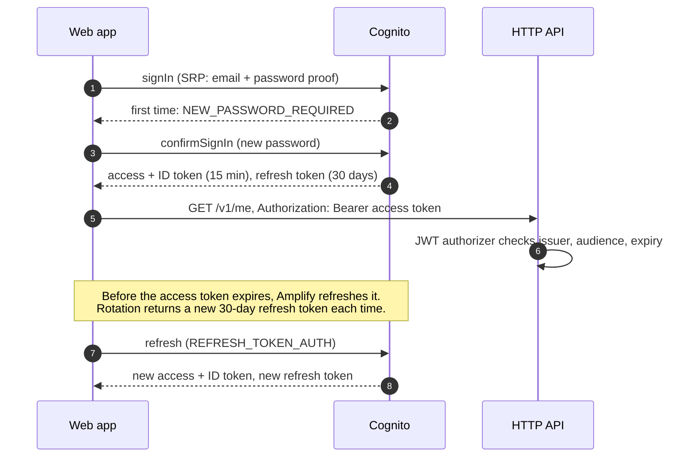

An owner who opens the app at least once every 30 days never signs in again. After 30 days without use the refresh
token expires and the sign-in screen appears. See [SECURITY.md](SECURITY.md).

### 2. Create a job and start `cf-prod-job-flow`

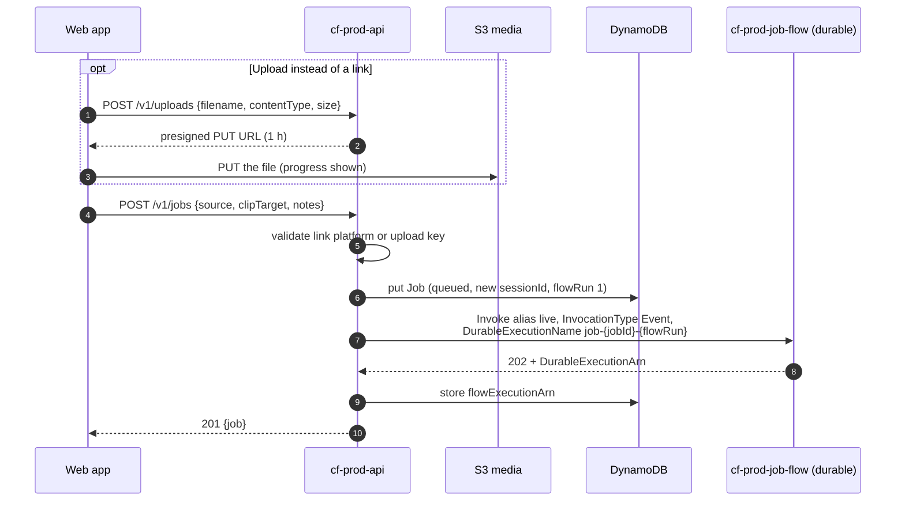

The start is idempotent: the payload has no timestamps, so starting the same name again either returns the running
execution or `DurableExecutionAlreadyStartedException`, which the API treats as "already started". **Retry** writes a
new `sessionId`, adds 1 to `flowRun` and starts `job-{jobId}-{flowRun}`. If the invoke itself fails, the job becomes
`failed` with "Could not start. Press Try again."

### 3. Job flow: the agent and its callback

`cf-prod-job-flow` replaces the watchdog. It costs nothing while it waits: the durable SDK checkpoints and the function
stops until the callback arrives.

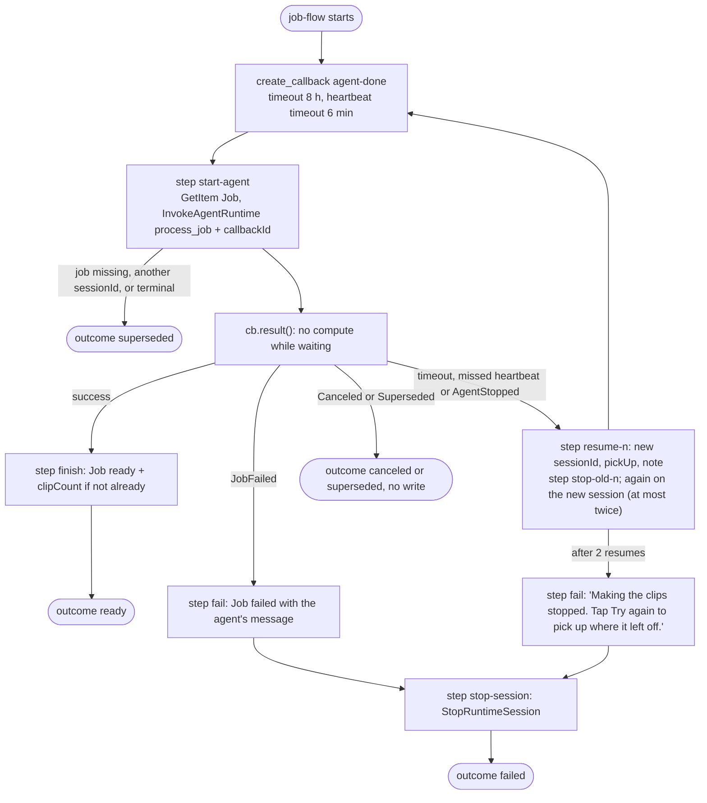

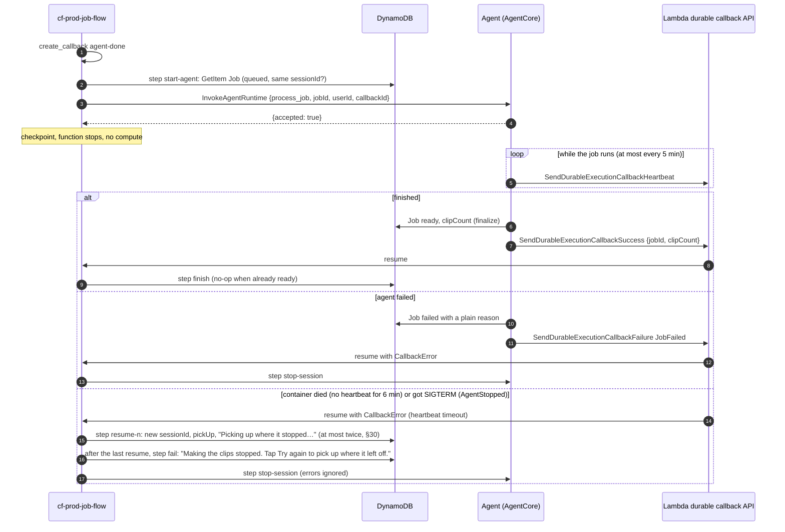

Every write by the flow is conditional on the Job's `sessionId`, so an old run can never overwrite a newer retry.
**Cancel** is handled by the API (Job `canceled`, `cancel` to the agent, `StopRuntimeSession`); the agent sends
`Canceled` and the flow writes nothing.

### 4. The agent pipeline

The agent owns the job record from the moment it accepts. Each step updates `steps[i]`, `progress` and `heartbeatAt`;
each write reaches the app through the live updates of flow 5. Details are in [AGENT.md](AGENT.md).

```mermaid
sequenceDiagram
  autonumber
  participant R as Agent (AgentCore)
  participant D as DynamoDB
  participant S as S3 media
  participant Y as Source site
  participant T as Transcribe
  participant B as Bedrock (Fable 5.1, Titan V2)
  participant N as Bedrock (Nova 2 Lite, EU)
  participant V as S3 Vectors
  R->>D: job running, load settings, every skill (no switch), latest 10 learnings
  R->>S: read each skill's file, build the skills block once for the job
  R->>Y: resolve: metadata (title, channel, duration) or S3 head for uploads
  R->>Y: download: audio only, capped at maxSourceHours
  R->>S: audio.m4a
  par in the background, while the words are written down
    R->>Y: the small picture rendition (up to 480p, no sound)
    R->>R: one ffmpeg pass: 2 fps parts of 300 s + picture change per second
    R->>S: picture/part-NNNN.mp4, picture.json
  and
    R->>T: StartTranscriptionJob (word timestamps, auto language, speaker labels)
    T->>S: transcript.json
    R->>S: words.json, speakers.json, loudness.json
  end
  par watch: both models see the whole picture
    R->>B: every 150 s: frames + that part's words (skills block first)
    B-->>R: what is seen: events with kind, strength, face, on-screen text
  and
    R->>N: every 300 s part as video (skills block first)
    N-->>R: what is seen, a second opinion
  end
  R->>S: watch/chunk-NNNN.json, watch/nova-NNNN.json, visual_log.json, signals.json
  R->>B: Titan: embed title, channel, notes, transcript start
  R->>V: QueryVectors top 8, this owner, status performed
  V-->>R: similar past clips with performance ("What worked before")
  R->>B: select: skills block + transcript windows with picture notes + loudness + hot spots + learnings + what worked before
  B-->>R: ranked moments (+ spares) with hooks and moment types
  R->>B: second look: every frame of each picked moment and spare + its words
  B-->>R: keep or not, small timing moves, an honest hook
  R->>S: moments.json
  loop each moment
    R->>Y: download only that section of video
    R->>B: one frame: where is the facecam?
    R->>R: ffmpeg: 1080x1920, hook, captions, cover
    R->>B: checklist judgement (with measured values)
    R->>S: clip.mp4, cover.jpg
    R->>D: Clip (status review)
  end
  R->>B: captions per platform
  R->>B: Titan: embed each new clip
  R->>V: PutVectors (status review)
  R->>D: job ready, clipCount
```

If the vector query fails, the agent logs `vectors.query_failed` and carries on without the section; fewer than three
`performed` hits are topped up with the owner's other clips.

**The picture is optional at every point.** The watch step never fails a job: when the small rendition cannot be
downloaded, ffmpeg fails, or a model is throttled, refuses or is not allowed, the agent logs it and picks from the
signals it has, down to exactly the words-and-loudness pipeline it was before
([AGENT.md](AGENT.md#watching-the-video), [ADR-40](DECISIONS.md#adr-40-watch-the-whole-video-before-picking)). The
fan-out (8 Fable chunks, 4 Nova parts at a time) is plain asyncio inside the one container, so cancel, the session
fence and the heartbeats work as for every other step.

### 5. Live updates over the WebSocket API

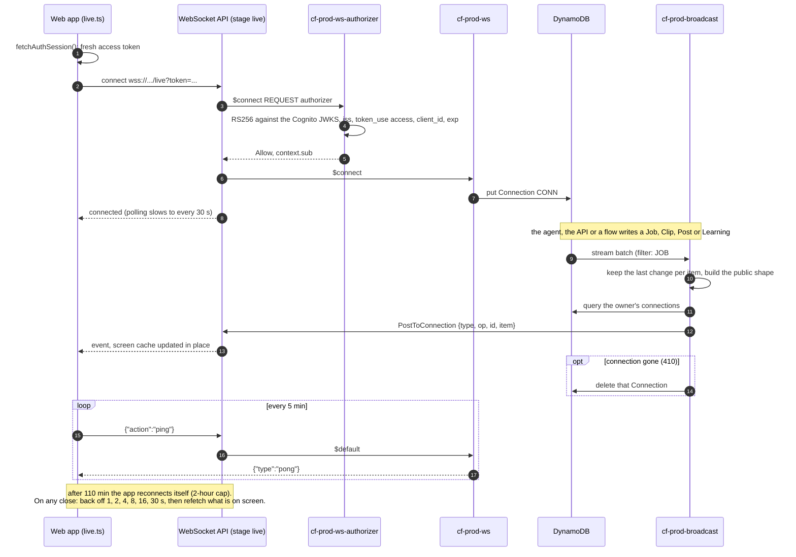

- Events carry the same public shapes as the HTTP API, so internal fields (`sessionId`, `videoKey`, `publishState`,
  `flowExecutionArn` and so on) never leave AWS. An event over 24 KB is sent as `partial: true` and the app refetches.
- The token is in the query string of the connect request, so the WebSocket access log has a fixed list of fields with
  no query and no headers, data tracing is off, and the Lambdas never log the token.
- Without a connection (mock mode, an old `config.json`, or a dropped socket) the app polls as before. Nothing on
  screen complains about a dropped socket.

### 6. Review, Keep and Throw away

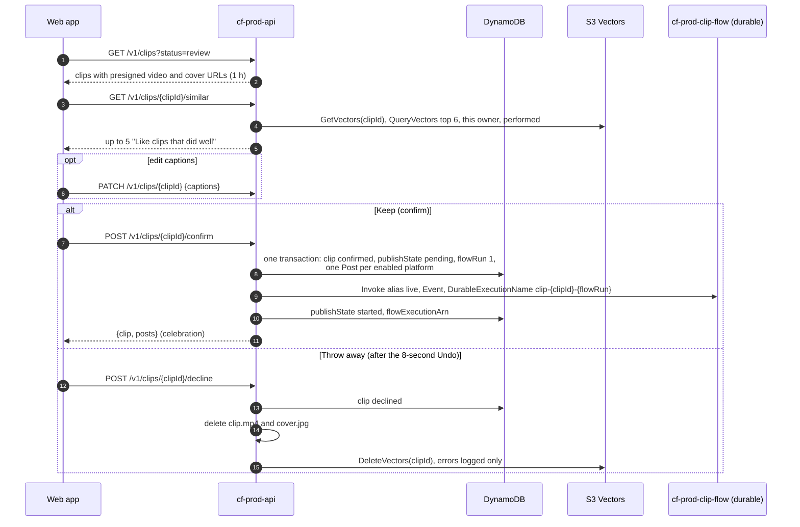

Keep is safe to press twice: a clip whose flow is `pending` is started again with the same name and payload (a no-op if
it is already running), and a `started` or `posted` clip just returns its current state. A clip that ended `failed`
shows **Try again**, which starts `clip-{clipId}-{flowRun + 1}`.

### 7. Clip flow: publish, wait 48 hours, learn

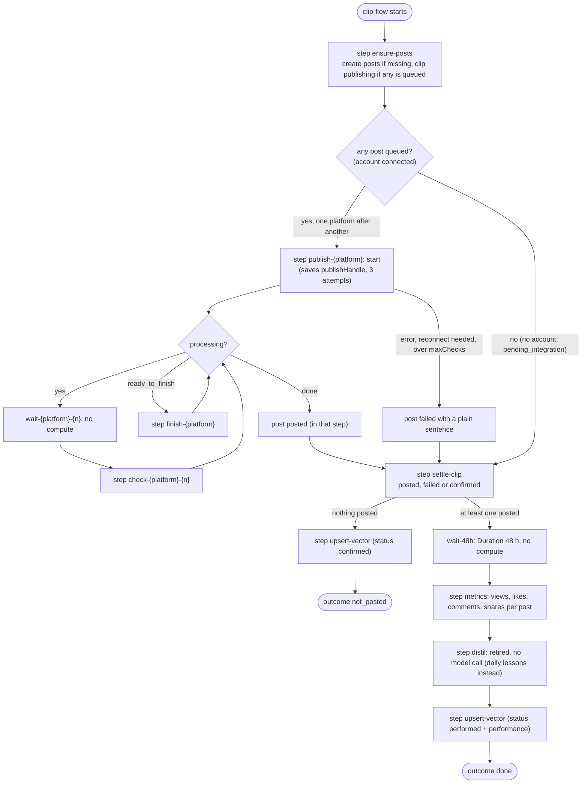

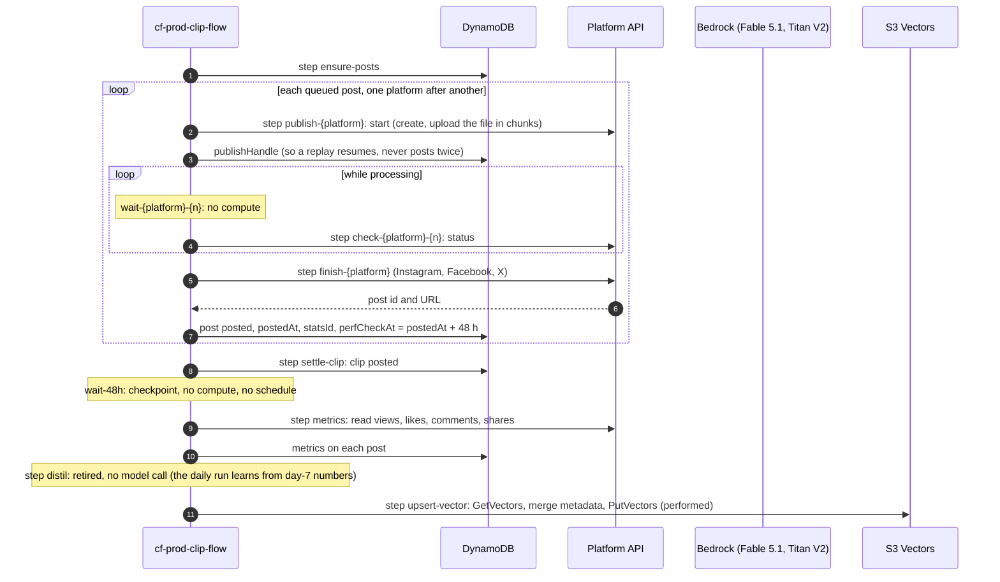

The `metrics` step reads the numbers through the same stats refresh as the poller ([flow 13](#13-clip-numbers-the-poller-and-refresh-numbers)),
so it shares the platforms' budgets. Every step is at-least-once, so each is written to be safe to repeat: posts are created only once (`postsCreated`),
a post is updated only while it is `queued`, and every platform call that creates something first saves a
`publishHandle`, so a replayed step resumes the upload instead of starting a second one. The few calls that cannot be
repeated safely on the platform side (TikTok init, Instagram `media_publish`, X post) are at-most-once: if one is
interrupted, the post fails with "We are not sure it posted. Look on {Platform} before you press Try again."
Publishing in detail is in [flow 16](#16-set-up-posting-connect-and-real-posting). A
durable execution stays pinned to the Lambda version it started on, so a deploy during the 48-hour wait never changes
a running flow.

### 8. The learning memory (S3 Vectors)

Each clip gets one vector (`key = clipId`) built from its moment type, hook, YouTube title and summary, embedded by
Titan Text Embeddings V2 (1024 numbers, normalised). Filterable metadata: `userId`, `momentType`, `platforms`,
`status` (`review`, `confirmed`, `performed`) and `scoreBucket`; stored but not filterable: `hook`, `title`, `summary`
and `performance`.

| When | Who | What happens to the vector |
|---|---|---|
| Job finishes | agent | created, status `review` |
| Before moment selection | agent | the top 8 `performed` clips of this owner like this source become "What worked before" in the prompt |
| Owner opens a clip | API | `/similar` returns up to 5 of the owner's measured clips most like it |
| Keep, nothing posted | clip-flow | status `confirmed` |
| 48 hours after posting | clip-flow | status `performed` with the summed numbers |
| Owner stars it as best of the week | `cf-prod-learn` | metadata `best = true` (unstarred: `best = false`); `best` clips come first in "What worked before" |
| Throw away | API | deleted |

Two kinds of memory work together: **learnings** are short sentences about what works in general; **vectors** find
specific past clips that resemble the one at hand, with their real numbers.

### 9. Platform webhooks (REST API)

Webhooks: nothing runs inline except storing the event. The OAuth callback on the same API is [flow 16](#16-set-up-posting-connect-and-real-posting).

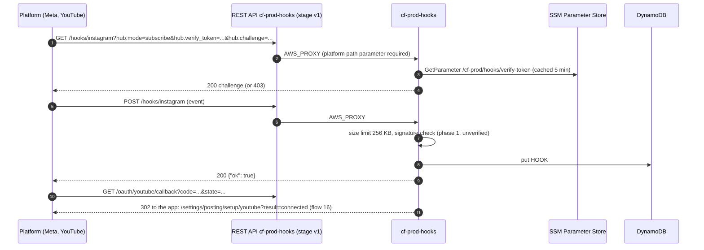

The REST access log has no query string (OAuth callbacks carry `code` and `state`). Each method is throttled to 10
requests a second (burst 20), and the `tiktok` and `x` webhooks answer `501` (not built yet); their OAuth callbacks work.

### 10. Deploy

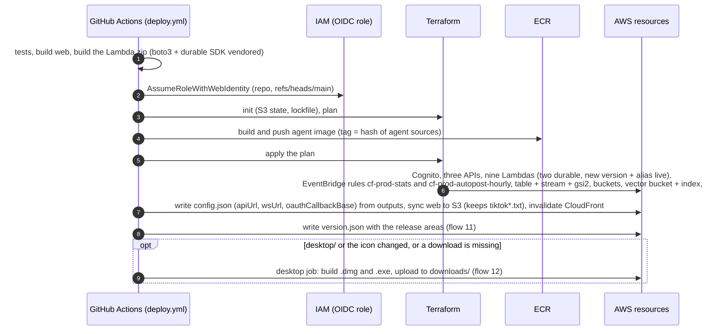

Step-by-step setup, including the one-time account settings, is in [DEPLOYMENT.md](DEPLOYMENT.md).

### 11. Updates: `version.json`, release areas and the update bar

Every deploy tells running apps that something is new, and in a word or three what it is
([CONTRACTS.md §12.2](CONTRACTS.md#122-update-banner-whats-new--reload)).

- **Build.** The web build embeds its own version (`VITE_APP_VERSION`, the short git sha).
- **Areas.** `scripts/release-areas.sh <prev-sha> <new-sha>` collects the labels. `prev-sha` is the `version` in the
  live `/version.json` in the web bucket. Rule, in order: the `Area:` lines in the commit messages between the two
  ([GIT_WORKFLOW.md](GIT_WORKFLOW.md#area-lines-what-the-update-bar-says)); otherwise the changed files mapped through
  `web/areas.json` (longest folder prefix wins, for example `web/src/routes/settings` → "Settings"); otherwise
  `["Improvements"]`. At most three labels, duplicates removed. With no live `version.json` (first deploy) the label
  is `["First release"]`.
- **Publish.** After the web files are synced, the deploy writes
  `{"version":"<short sha>","builtAt":"<ISO time>","areas":[...]}` to `/version.json` with `Cache-Control: no-store`.
  It is written **last**, so an app never sees a new version before its files are in place.
- **Detect.** The app fetches `/version.json` (bypassing every cache) on start, every 5 minutes, when the tab or window
  becomes visible, and when its service worker reports a waiting worker. A different `version` shows the update bar.
- **Reload.** The progress bar runs the [reload curve](UX_DESIGN_SYSTEM.md#the-reload-curve) while the app tells the
  waiting service worker to `skipWaiting`, waits for `controllerchange`, then reloads (at most 10 s).

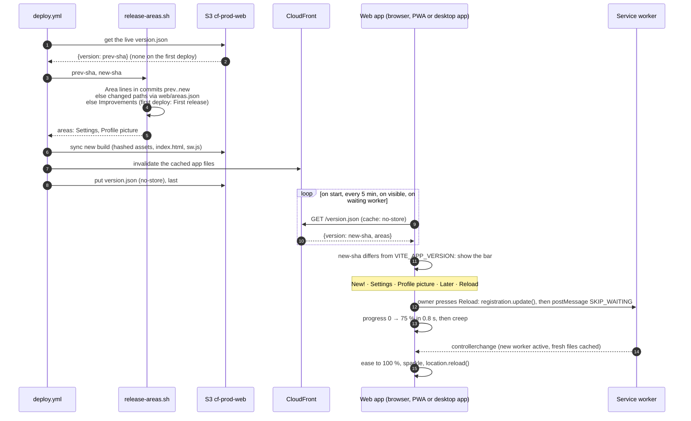

Installed apps (phone PWA, desktop PWA and the desktop app) run the same code, so they show the same bar. The desktop
app never needs its own update: it loads the site, and the site updates itself.

### 12. Get the app and the desktop wrapper

The app offers the right install for each device ([CONTRACTS.md §12.1](CONTRACTS.md#121-get-the-app-sidebar-item-on-phones-a-card-in-settings-plus-a-one-time-banner-on-home))
and the Mac and Windows downloads come from a thin Tauri v2 window ([§12.3](CONTRACTS.md#123-desktop-wrapper-desktop-tauri-v2),
[ADR-18](DECISIONS.md#adr-18-a-thin-tauri-desktop-wrapper-not-electron)).

**The wrapper** (`desktop/`) bundles no screens. It opens `app_url` in the system web view (WebKit on macOS, WebView2 on
Windows), sets the title "Clip Factory" and the app icon, keeps a 380 × 600 minimum size, remembers size and position,
opens outside links in the normal browser, appends `ClipFactoryDesktop` to the user agent and sets
`window.__CF_DESKTOP__ = true`, so the web app hides Get the app inside it. Sign-in, tokens, the service worker and the
live connection work as in a browser; tokens live in the wrapper's own web storage.

**The build** is the `desktop` job in `deploy.yml`. It runs after the web deploy, only when `desktop/**` or the app
icon changed or a download is missing from the bucket:

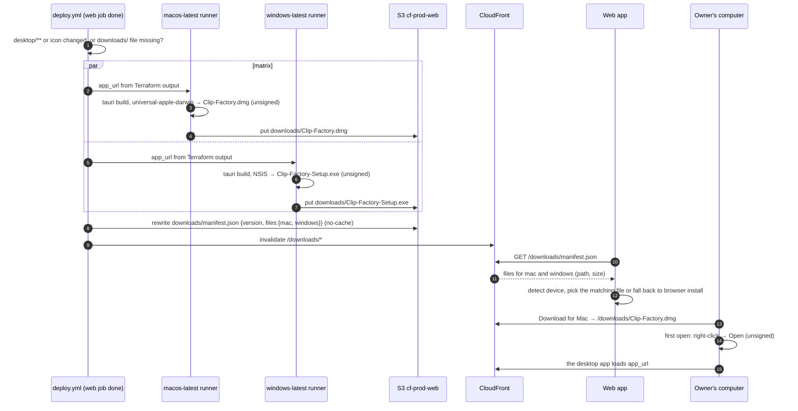

**Phones** never get a file. Android installs the PWA through the browser's own prompt. iPhone and iPad get three
picture steps to Add to Home Screen, because Apple allows no app download outside its store
([ADR-21](DECISIONS.md#adr-21-iphone-and-ipad-get-add-to-home-screen-steps-not-a-download)).

**Hiding it once installed.** The web app checks `display-mode: standalone` / `window-controls-overlay`,
`navigator.standalone` (iOS), the desktop wrapper markers, and `cf.installed=1` in local storage (set on the
`appinstalled` event).

### 13. Clip numbers: the poller and Refresh numbers

The owner sees every clip's numbers per platform on `/clips/{clipId}`
([CONTRACTS.md §16.5](CONTRACTS.md#165-poller-and-refresh-lambda-cf-prod-stats)). One code path,
`stats.refresh.refresh_posts`, reads them for three callers: the EventBridge tick (`reason "poll"`), the Refresh button
(`"manual"`) and the clip flow's `metrics` step after 48 hours (`"flow"`). All three go through the same per-platform
budget, so together they can never pass a platform's limit.

**What makes a post due.** When a post is published, its `statsDueAt` is set and it gets `gsi2pk = "STATS"`,
`gsi2sk = "{statsDueAt}#{postId}"`. That sparse index is the due-queue: only posts inside their 30-day window carry
it. After each reading the next `statsDueAt` is `readAt + interval`, where the interval depends on the platform and
the post's age ([ADR-29](DECISIONS.md#adr-29-stats-refresh-intervals-per-platform)):

| Post age | YouTube, TikTok, X | Instagram, Facebook |
|---|---|---|
| up to 48 hours | every 15 min | every 30 min |
| up to 7 days | every 30 min | every 60 min |
| up to 30 days | every 2 h | every 6 h |
| 30 days | one final reading, then the post leaves `gsi2` | same |

YouTube's slow insights (YouTube Analytics: watch time, engaged views, shares, new subscribers) are read at most every
6 hours (`insightsDueAt`), because Google needs 48–72 hours to process them. Private TikTok posts (unaudited app) have
no stats id and never enter the queue.

**The tick.**

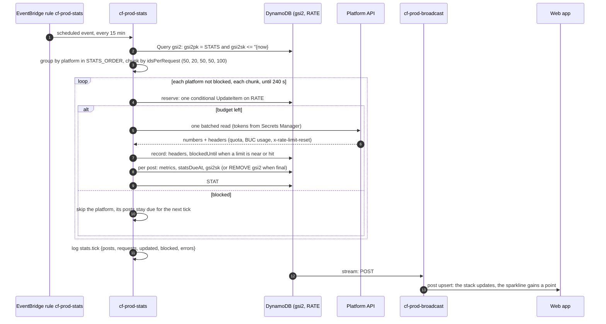

**Refresh numbers.**

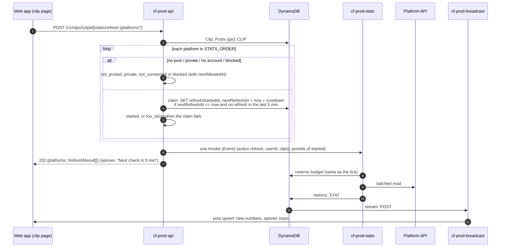

The cooldown is 5 minutes for YouTube, TikTok and X and 30 minutes for Instagram and Facebook, so pressing Refresh
again and again never spends more than the poller would. If the invoke itself fails, the API rolls the claims back and
answers `blocked` with "Could not check right now. Try again in a minute."

**Budgets** ([CONTRACTS.md §16.3](CONTRACTS.md#163-dynamodb-items)) are one item per platform (`RATE#{platform}`),
reserved with one conditional `UpdateItem` before every request, so two Lambdas at once can never both take the last
units:

| Platform | Counted as | Stop at | When a limit hits |
|---|---|---|---|
| YouTube | quota units per Pacific day (1 per `videos.list` call of up to 50 ids, 1 per Analytics report) | 7,000 of 10,000 (3,000 kept for uploads) | `quotaExceeded` / `rateLimitExceeded`: paused until 08:00 UTC |
| TikTok | requests per UTC minute | 300 of 600 | `429` / `rate_limit_exceeded`: paused 1 minute |
| Instagram, Facebook | Meta's `X-Business-Use-Case-Usage` header (call count, CPU time, total time, in %) | 75 % of any counter | throttle `80002` / `80001`: paused for Meta's `estimated_time_to_regain_access` (at least 60 min), **no retry** |
| X | requests per 15 minutes, plus an estimated spend | 1,000 of 3,500; $10 a month | `429`: paused until `x-rate-limit-reset`; monthly cap: paused until the 1st |

In phase 1 no account is connected, so every adapter answers `not_connected` and nothing reaches the network; the
poller, the queue and the budgets are already in place.

### 14. Best of the week

The owner stars the week's best clips in **Library › This week**; the picks teach the agent
([CONTRACTS.md §16.6](CONTRACTS.md#166-weekly-best-learning-lambda-cf-prod-learn),
[ADR-31](DECISIONS.md#adr-31-the-weekly-best-is-an-explicit-owner-signal), [AGENT.md](AGENT.md#best-of-the-week)).

A week is an ISO week (Monday start) in the **owner's own time zone**: the web computes `from` and `to` (local Monday
00:00 to the next Monday 00:00, as UTC instants, 167–169 hours across a clock change) and sends them with the week id.
A clip belongs to the week of its **anchor**: its earliest `postedAt`, or `decidedAt` while it is kept but not posted.

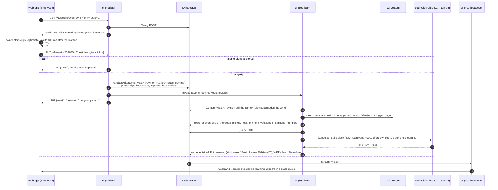

An empty set of picks deletes that week's learning and ends `skipped`. A model answer that is cut off, refused or
filtered ends `failed` ("Could not learn this time. Change a pick to try again."), and Bedrock errors are retried
twice. Because every write checks `revision`, a quick second save always wins over a slower first one.

### 15. Skills: every AI call gets every skill

The owner's rule: *"The whole AI system should use all of these skills by default, no matter what, as long as I add
them."* ([CONTRACTS.md §18](CONTRACTS.md#18-skills-full-create-read-update-delete-every-ai-call-uses-every-skill-owner-request-2026-11-16),
[ADR-32](DECISIONS.md#adr-32-every-ai-call-gets-every-skill-through-one-shared-skills-block)).

**Create, read, update, delete.** Skills live in Settings › Clip making › Skills. The owner writes one by answering
three questions (`POST /v1/skills`, the API builds the `SKILL.md`), uploads a `.md` or `.zip` (presigned PUT, then
`POST /v1/skills`), reads any skill (`GET /v1/skills`, `GET /v1/skills/{skillId}`), changes their own
(`PUT /v1/skills/{skillId}`, with a `version` check so two screens cannot overwrite each other silently) and deletes
their own (`DELETE /v1/skills/{skillId}`, sent when the 8-second Undo ends). Built-in skills ship with the code and can
only be read. There is no on/off switch: `PATCH /v1/skills/{skillId}` only answers "Skills are always used now".

Every save writes a **new object** `skills/{userId}/{skillId}/{revisionId}/SKILL.md` (or `skill.zip`) and then moves
the DynamoDB item's `key` to it, so an object never changes after it is written: a running job keeps reading the file
it started with, and readers can cache files by key.

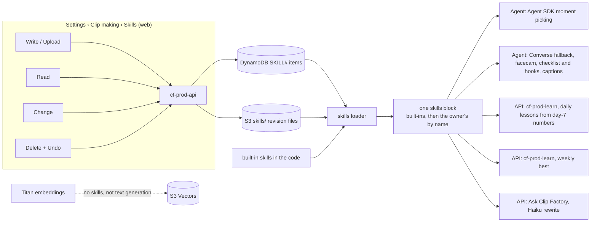

**One rule, two builders.** The agent (`agent/`) and the Lambdas (`api/`) each have the same small builder,
`skills_block(docs)`, checked against one shared reference file byte for byte. It puts every skill's `SKILL.md` text
inside `<owner_skills>`, built-ins first, then the owner's by name, at most 40,000 characters per skill and 120,000 in
total (built-ins are never the ones left out). `compose_system(block, task_system)` makes the block the **first**
part of every system prompt, followed by a Bedrock prompt-cache point when the block is 8,000 characters or more, so
the many calls of one job pay for the long, stable part once. If Bedrock refuses the cache point, it is turned off for
that process and the call is retried without it.

| Where | Model calls | How the skills are loaded |
|---|---|---|
| Agent (AgentCore Runtime) | Agent SDK moment picking; Converse: moment fallback, facecam, checklist (with the hook rewrite), captions | once per job at `analyze`; also written to `.claude/skills/` for the SDK |
| `cf-prod-learn` (weekly best, daily lessons) | `learn.converse_text` | `skill_prompt.load_skills` just before the call |
| `cf-prod-api`, Ask Clip Factory ([flow 17](#17-ask-clip-factory-the-help-assistant)) | `learn.converse_text` (Haiku 5.5, JSON schema) | `skill_prompt.load_block` per answer that reaches the model |

The Lambda loader reads the owner's `SKILL#` items with one Query and each file through a small in-memory cache keyed
by the S3 key (at most 64 files and 16 MB per container), so a warm Lambda reads S3 only after a skill changes. Both
`cf-prod-clip-flow` and `cf-prod-learn` may only `GetObject` under `skills/*` (no list); `cf-prod-learn` gets
`MEDIA_BUCKET`. A skill file that cannot be read is retried, then skipped and logged (`skills.skipped`); a failure to
read the skill items fails the step, whose normal retry runs, so no call quietly goes without skills.

**No way around it.** Each package has a test that reads its own source code and fails if a Converse, Agent SDK or
streaming model call is made anywhere except through these helpers, or without the `skills` argument. The only model
calls without skills are the Titan embeddings in `vectors.py`.

### 16. Set up posting, Connect and real posting

The owner sets up each platform once in **Settings › Posting › Set up posting**
([CONTRACTS.md §17](CONTRACTS.md#17-posting-setup-a-setup-list-per-platform-real-connect-real-posting-owner-request-2026-11-16),
the steps in [SETUP_POSTING.md](SETUP_POSTING.md)): make a developer app on the platform's website by following the
step cards, paste its keys, press **Check it**, then **Connect**. Numbered **10** in the diagram.

```mermaid
sequenceDiagram
  autonumber
  participant O as Owner (web app)
  participant A as cf-prod-api
  participant SM as Secrets Manager
  participant D as DynamoDB
  participant P as Platform (consent page, token endpoint)
  participant H as cf-prod-hooks (REST GET /oauth/{platform}/callback)
  O->>A: GET /v1/setup (steps done, gates, values to copy: redirect URI, privacy URL, ...)
  O->>A: PUT /v1/setup/{platform}/keys {clientId, clientSecret, configId?}
  A->>SM: create or put cf-prod/platforms/{platform}/app
  A->>D: SETUP#{platform}: keysSavedAt, masked hints only
  O->>A: POST /v1/setup/{platform}/check
  A->>P: key test (dummy code or client credentials)
  O->>A: POST /v1/accounts/{platform}/connect
  A->>SM: GetSecretValue cf-prod/oauth/state-key (cached 5 min)
  A->>D: OAUTH#{nonce} (TTL exp + 5 min)
  A-->>O: authorizeUrl (state = v1.nonce.exp.HMAC; PKCE challenge for YouTube and X)
  O->>P: same tab: sign in, approve
  P->>H: 302 ?code&state
  H->>H: verify HMAC, expiry, platform
  H->>D: consume OAUTH#{nonce} once (conditional delete)
  H->>SM: read app keys
  H->>P: exchange code (exact redirect URI, PKCE verifier), read profile
  H->>SM: write cf-prod/platforms/{platform}/token (or pending choices for Meta)
  H->>D: ACCOUNT#{platform} connected (name, avatar), SETUP#{platform}
  H-->>O: 302 {app_url}/settings/posting/setup/{platform}?result=connected
  D-->>O: live event "setup" (stream → cf-prod-broadcast → WebSocket)
```

**Values the owner copies.** `GET /v1/setup` serves every value a platform asks for, built from `APP_URL` and
`HOOKS_URL`: the website (`/about.html`), privacy and terms (`/legal/…`, on the app's own domain because TikTok
verifies by URL prefix and Google lists every domain, [ADR-37](DECISIONS.md#adr-37-about-privacy-and-terms-on-the-apps-own-domain)),
the data-deletion URL and one exact redirect URI per platform. TikTok's verification file is uploaded through the API
into the web bucket root and invalidated in CloudFront.

**The callback** is the only public step. It trusts nothing in the request except a state that it signed, that has not
expired and that has not been used; it always redirects to one fixed page with a code from a fixed list, never logs
the query, and stores tokens only in Secrets Manager ([ADR-34](DECISIONS.md#adr-34-oauth-with-a-signed-single-use-state-tokens-only-in-secrets-manager),
[SECURITY.md](SECURITY.md#platform-keys-and-tokens)). Meta can return several Pages or Instagram accounts: the choices
wait in a short-lived `pending` secret and the owner picks one in the app (`POST /v1/accounts/{platform}/choose`).
Instagram uses Facebook Login for Business with a **user** access token: the callback exchanges it for the
long-lived one (`fb_exchange_token`), reads `me/accounts` with each Page's `instagram_business_account`, and keeps
only the Pages that have one. One → connected at once; several → `choose`; none → `no_accounts`. The token secret then
holds the Instagram account id, the Page id and that Page's access token, which posting and numbers use.

**Gates.** What each platform still has to allow is a gate on the setup: YouTube `published_app` (the Google app must
be **In production**, or tokens die after 7 days), TikTok `app_review` and `posting_audit` (until both pass, posts are
"Only me"), Instagram and Facebook `app_live` (Reels stay visible to the owner until each Meta app is Live), X
`credits`. A platform is
**ready** when it is connected and no gate needs the owner.

**Posting.** The clip flow ([flow 7](#7-clip-flow-publish-wait-48-hours-learn)) asks `SecretsTokenProvider` for the
token (refreshed 5 minutes before expiry; TikTok and X rotate refresh tokens, so a 30-second lease serialises
refreshes and the new secret is written before use), then runs the platform's publisher
([ADR-35](DECISIONS.md#adr-35-every-upload-is-sent-as-a-file-and-posting-waits-inside-the-clip-flow)). Every upload is
sent as a file read from S3 in 8 MB ranges:

| Platform | Start | Check (durable wait between) | Finish |
|---|---|---|---|
| YouTube | resumable session on `www.googleapis.com/upload/youtube/v3/videos`, 8 MB chunks, privacy from Settings | `videos.list` processing status, every 30 s, up to 60 | – |
| TikTok | `creator_info`, then Direct Post `init` with the Post to TikTok sheet's choices, `FILE_UPLOAD` chunks | `status/fetch`, every 15 s, up to 80; the public id may come later (follow-up loop) | – |
| Instagram | publishing limit check, `REELS` container, upload to `rupload.facebook.com/ig-api-upload` | container `status_code`, every 60 s, up to 15 | `media_publish`, permalink |
| Facebook | `video_reels` start, upload to `rupload.facebook.com/video-upload` | video `status`, every 30 s, up to 40 | `video_reels` finish `PUBLISHED` |
| X | `media/upload` initialize, 4 MB appends, finalize | media status after `check_after_secs`, up to 20 | `POST /2/tweets` with links removed |

Disconnect (after an 8-second Undo in the app) revokes the token where possible, deletes the token secret and, for
YouTube, asks `cf-prod-stats` to `forget` stored YouTube numbers.

### 17. Ask Clip Factory: the help assistant

The owner asks "how do I…" or "where is…" and gets short steps plus a button that opens the page and lights up the
control ([CONTRACTS.md §19](CONTRACTS.md#19-ask-clip-factory-grounded-in-app-help-assistant-owner-request-2026-11-16),
[HELP_ASSISTANT.md](HELP_ASSISTANT.md), [ADR-38](DECISIONS.md#adr-38-bm25-over-vectors-for-help-and-the-model-is-optional),
[ADR-39](DECISIONS.md#adr-39-help-runs-in-cf-prod-api-with-claude-haiku-55-through-the-eu-profile)).

**Build time.** `web/scripts/help-corpus.mjs` turns the router, the navigation, the Settings tree, the screens and the
curated guides (`helpKb.json`) into `help-corpus.json` (committed). The Vite build also emits a content-hashed copy,
`/assets/help-corpus.<hash>.json` (cached forever), and names it in a `cf-help-corpus` meta tag in `index.html` (never
cached), so the API always finds the corpus that matches the deployed screens. `build_lambda.py` bundles the same file
into the Lambda zip as the fallback.

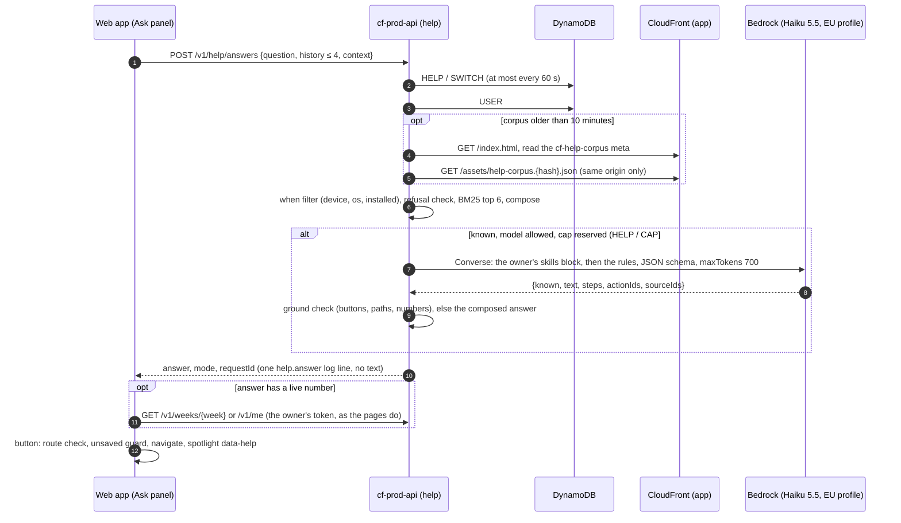

- **Without the model** the composed answer is complete; the model only rewords it. Unknown and refused questions
  never reach Bedrock. Any model problem (timeout, bad JSON, a stop reason, an invented button or number) returns the
  composed answer with `mode: "kb"`.
- **Skills**: like every model call ([flow 15](#15-skills-every-ai-call-gets-every-skill)), the help call goes through
  `learn.converse_text`, so the owner's skills block (`skill_prompt.load_block`) comes first and the help rules after
  it; the rules keep facts to the knowledge, the skills set the tone and the clip advice. If the skills cannot be read,
  the model is not called and the composed answer is used (outcome `kb_skills`).
- **In the browser**: help calls use their own quiet `fetch` (27 s timeout), so no page refetches. On a network
  error, a timeout or a 5xx the panel answers from its own copy of the corpus with the same rules; on 429 it shows a
  countdown and never retries by itself; on `help_off` the launcher disappears and the local copy is not used.

### 18. Ask as a full assistant (CONTRACTS §28, ADR-51)

```
browser ── whoami ──▶ cf-prod-ws ──▶ {connectionId}
browser ── POST /v1/help/files ──▶ cf-prod-api ──▶ presigned PUTs ──▶ cf-prod-media ask/{sub}/{fileId}
browser ── POST /v1/help/asks ──▶ cf-prod-api ── async Invoke ──▶ cf-prod-ask
cf-prod-ask ── skills, knowledge pack, APP STATE (DynamoDB reads) ──▶ Claude Opus 5.5 (Bedrock Mantle, eu-north-1)
            ◀── tool calls: web_search (Brave) · web_fetch (SSRF-guarded) · read_app_doc · read_my_clip_factory · show_app_buttons
cf-prod-ask ── PostToConnection ask.* ──▶ the owner's socket ──▶ the panel streams the answer
cf-prod-ask ── finally: delete ask/{sub}/{fileId}
```

The HTTP API keeps its 29 s limit: the answer runs in `cf-prod-ask` (150 s, async, never retried) and comes back as
events on the WebSocket the app already holds. The search key is the owner's own, in Secrets Manager
(`cf-prod/ask/search-key`). Everything Ask knows about the app is a generated pack shipped in the zip
(`api/src/clipfactory_api/ask/knowledge.json`, `ask/library/`), behind the owner's skills and cached for an hour.
When the socket, the model or the assistant switch is not there, the panel answers with §17 (above) instead.

### 19. Content Rewards campaigns (CONTRACTS §38, ADR-62)

The owner joins a paid clipping campaign on Content Rewards (CR), pastes its link into Clip Factory, and every clip
made for it follows its rules and is sent to CR inside CR's 30-minute window
([CONTRACTS.md §38](CONTRACTS.md#38-content-rewards-campaigns-owner-request-2026-11-21),
[ADR-62](DECISIONS.md#adr-62-content-rewards-the-official-sign-in-through-the-desktop-apps-loopback-door-sending-from-the-cloud-a-reminder-when-it-cant),
the owner's steps in [SETUP_POSTING.md](SETUP_POSTING.md#content-rewards)). Numbered **13** in the diagram.

CR is **not** a sixth `Platform`: it is its own connection (`CRCONN`), its own card on Set up posting, its own routes
under `/v1/contentrewards` and its own items. The five platforms, `GET /v1/setup`, the setup to-do list and the
publish chain behave exactly as before when no campaign is involved. The feature is **on** in prod
(`content_rewards_enabled = true` → `CONTENT_REWARDS=on`). It shipped switched off while its parts were built
(`false` → `CONTENT_REWARDS=off`: every `/v1/contentrewards*` route answers 503 `unavailable` and the clip flow sends
nothing); once every part of §38.19 had merged, the one-line switch PR #88 (21 Nov 2026) turned it on. Setting the
default back to `false` turns it off the same way ([DEPLOYMENT.md](DEPLOYMENT.md#content-rewards-contracts-38)).

**Who talks to Content Rewards.** Only `cf-prod-api`, `cf-prod-clip-flow` and `cf-prod-stats`, server to server.
Never the browser (CR answers 403 to any MCP request that carries an `Origin` header, and the token lives only in
Secrets Manager), never the Mac (it only carries a one-time code) and never `cf-prod-campaigns` (it reads untrusted
brand text and outside links, and has no secret access). Since §41, `cf-prod-campaigns` reads CR's **public**
campaign pages for the campaign finder ([flow 22](#22-campaign-finder-contracts-41-adr-65)): anonymous, only what
robots.txt allows, never CR's API.

| Host | Used for | By |
|---|---|---|
| `id.contentrewards.com` | OAuth: `/oauth2/register` (RFC 7591, once per install, `client_name` "Clip Factory", five loopback redirects, no secret), `/oauth2/authorize` (in the owner's system browser), `/oauth2/token`, `/oauth2/revoke` | `cf-prod-api` (register, code exchange, revoke); the three Lambdas (refresh, under the lease) |
| `mcp.contentrewards.com/mcp` | MCP JSON-RPC: `get_me`, `list_my_campaigns`, `create_my_submission`, `list_my_submissions`, `get_my_submission`, `get_my_balance`, `list_my_payouts`, `send_feedback`; headers `Api-Version: 2026-10-01`, `MCP-Protocol-Version: 2025-11-25`, `Mcp-Name`, never `Origin`; at most 2 calls a second per container | `cf-prod-api`, `cf-prod-clip-flow`, `cf-prod-stats` |
| `contentrewards.com/api/campaign/campaigns/{uuid}` | the public campaign JSON (undocumented): a preview for the card, read only when the owner acts (add, Check now, a card older than 10 minutes, a job's start), at most 6 a minute, cached on the item, never on a schedule and never to submit | `cf-prod-api` |
| `contentrewards.com/robots.txt`, `/sitemap.xml`, `/c/campaigns/{uuid}` | the campaign finder's public pages ([flow 22](#22-campaign-finder-contracts-41-adr-65)): robots.txt at most once a day, the sitemap once a look, at most 40 campaign pages a look, one at a time and at least 1 s apart, `User-Agent: ClipFactory/1`, no cookie, never an `/api/…` path | `cf-prod-campaigns` |
| `crusercontent.com`, `docs.google.com`, Google Drive, Dropbox | the brand's picture (copied once, only `https://crusercontent.com/…`, ≤ 1 MB), the Google Docs a brief links to, logo links; the Google Docs and logo links go through the `ask/fetch.py` SSRF guard on every hop | `cf-prod-campaigns` |

**Sign-in: the desktop app's one-shot door.** CR's sign-in only returns to `http://127.0.0.1` (no https), so the
Mac app listens once on the computer, and the cloud keeps everything else.

```mermaid
sequenceDiagram
  autonumber
  participant O as Owner (Mac app window)
  participant D as Desktop door (127.0.0.1, ports 47811-47815)
  participant A as cf-prod-api
  participant DB as DynamoDB
  participant SM as Secrets Manager
  participant B as System browser
  participant ID as id.contentrewards.com
  participant M as mcp.contentrewards.com
  participant S as cf-prod-stats
  O->>D: cr_connect_listen: first free port of five, closes after 5 minutes
  O->>A: POST /v1/contentrewards/connect {port}
  A->>ID: POST /oauth2/register (first time only)
  A->>SM: cf-prod/platforms/contentrewards/app (clientId)
  A->>DB: a CRSTATE item per nonce (port, redirectUri, exp, TTL)
  A-->>O: authorizeUrl (signed state, PKCE S256, one resource)
  O->>D: cr_connect_open {url} (host, S256, resource and this port checked)
  D->>B: open the URL
  B->>ID: sign in, allow
  ID-->>B: 302 to the door on 127.0.0.1 with code, state and iss
  B->>D: GET / (Host and state checked in constant time)
  D-->>B: "Done! Go back to Clip Factory. You can close this tab."
  O->>D: cr_connect_result every 500 ms: {status: done, code, state, iss}
  O->>A: POST /v1/contentrewards/connect/finish {state, code, iss} (the code lives 60 s)
  A->>DB: consume that CRSTATE item once (conditional delete)
  A->>ID: POST /oauth2/token (code, verifier derived from the state, resource)
  A->>M: get_me, tools/list: can it send?
  A->>SM: under the CRCONN lease: put cf-prod/platforms/contentrewards/token, keep the VersionId
  A->>DB: CRCONN connected or read_only, tokenVersionId, signInBy, then CROWNERS
  A-)S: async {"action": "contentrewards", "what": "campaigns"}
  A-->>O: {result, connection}: confetti or one sentence
  DB-->>O: live event "contentrewards"
```

The door is macOS only (on Windows `listen` answers `unsupported` and the page shows the "browser on a computer"
words); it binds `127.0.0.1` only, answers one good request, never sees a token and never logs or stores the code.
The PKCE verifier is derived from the signed state, never stored. A phone or a plain browser gets "Do this step on
your Mac"; after this one sign-in everything runs in the cloud, so a phone upload is sent too.

**Tokens.** CR's access token lives 10 minutes; its refresh token is single use and rotates (a reuse more than a few
seconds later ends the connection), dies after 30 days unused and lasts 90 days at most. So exactly one process ever
refreshes: the `CRCONN` lease (as in §17.6), taken only with at least 20 s of Lambda time left; the secret is always
read by the `VersionId` recorded on `CRCONN`, never a cached or "current" copy; a lost answer is retried at once with
the same refresh token; the new secret is written put-only (a refresh can never re-create a disconnected secret)
before the token is used. Connect and Disconnect take the same lease. The stats tick refreshes once a day to keep
the sign-in alive, warns 7 days before `signInBy` (card and notification) and marks `needs_reconnect` after it.

**Adding a campaign.** `POST /v1/contentrewards/campaigns {url}` parses the link (campaign, Discover, the Whop copy, a
group; invite, checkout and other CR pages are refused with a sentence), reads the public preview, writes
`CAMPAIGN#{uuid}` and starts the rules read. Membership comes from `list_my_campaigns` (pending applications are not
listed): the page's UUID is matched to CR's `cmp_` id by its TypeID encoding, else by name, organization, access and
rates; two same-name siblings are `ambiguous` and never sent automatically. Joining stays in the CR app (there is no
tool to browse, join or apply). Pure code (`contentrewards/gates.py`, ported from the local app's `ruleCheck.js`)
makes the stops, the one next step and the `uploadPlaces` every time a campaign is served.

**Reading the rules** (`cf-prod-campaigns` `read`, async). The api and the stats tick store CR's listed
`description` on the item as `brief` before they start a read, so the reader needs nothing from CR. One Bedrock
Converse call with the clip agent's model and the local app's `RULES_SCHEMA` (ported) as a forced tool; the brief,
the owner's pasted rules and up to 3 public Google Docs the brief links to go in as JSON-encoded untrusted blocks
(`<` and `>` escaped). Code then checks every field: anything that can reach a caption, the screen or a link must
appear word for word in the input; fixed disclosure words (`#Ad`, "Paid partnership"); at most 8 hashtags and 5 tags;
CR's own toggles (drafts first, a sound, the logo) can only add stops; pay, budget, status, access and platforms
come only from CR's own fields. A read that fails or runs past 3 minutes is `rules_failed` ("I couldn't read the
rules. Tap Check now, or paste them below.").

**A campaign job.** `POST /v1/jobs {campaignId, campaignAnyway}` checks the campaign again (`list_my_campaigns` and
the public JSON, at most 8 s together; CR down → the stored rules and status), copies the rules onto the job
(`Job.campaign`, internal `JobCampaign`) and the ready logo to `jobs/{jobId}/source/campaign-logo.{ext}`, so a later
change never breaks a queued job. The agent follows `job.campaign` ([AGENT.md](AGENT.md#campaign-clips)): the length,
banned content, the logo in a taller band above the picture, "Paid partnership" on screen for the first 3 seconds,
"#Ad" first and every required tag in each caption. Without a campaign every prompt and file is byte for byte as
before.

**Posting a campaign clip.** Confirm (and Try again) accept only the campaign's `uploadPlaces` (paid for, ready in
Clip Factory, not refused by CR as unlinked, TikTok only after its audit), public, never made for kids, TikTok with
Branded content (the owner's own tap). Each post gets `campaignId` (fixed forever) and the internal
`postOptions.campaign`. The publishers turn on paid partnership where the API has it (YouTube
`paidProductPlacementDetails`, X `paid_partnership`, TikTok `brand_content_toggle`; Meta has no field for this kind
of app, so the caption's `#Ad` and the words on the video carry it), and `campaign_caption` puts the disclosure and
every required item back into a caption the owner edited. No publisher has a delete or unpublish call.

**Sending** (new steps in `cf-prod-clip-flow`, [CONTRACTS.md §38.12](CONTRACTS.md#3812-submitting-a-new-step-chain-in-cf-prod-clip-flow-and-checking-folded-into-cf-prod-stats)).
CR takes a post only while it is less than 30 minutes live, so the cloud sends it the moment it is live and public:

```
ensure-posts → publish-{platform} … finish-{platform} → cr-send-{platform}      (a post with campaignId)
             → (each later post's chain) → cr-catchup-{platform}                  (while earlier ones still wait)
settle-clip  → [cr-wait-{n} (60 s, no compute) → cr-retry-{n}] n = 1…26           (while any still wait)
             → wait-48h → metrics → distil                                        (as before)
```

`submit.send` writes `CRSUB#{postId}` once (`sending`, with the `idempotency_key`, URL and CR campaign id frozen,
`deadline` = posted + 25 min, `sendBy` = posted + 30 min) and calls `create_my_submission`. Retryable answers
(the post not visible yet, CR busy, 5xx, a timeout that may still have gone through) are tried again with the same key
every minute until `deadline`; then the post goes `send_by_hand` (time is left until `sendBy`) or `missed`. A CR step
never fails the flow: any exception sets `send_by_hand` / `missed`, and `settle-clip`, the 48-hour metrics and the
vector step always run. A clip with no campaign post has exactly the old step names.

**When Clip Factory can't send** (not connected, the pilot has not granted the write scope, a campaign the owner said
he is in by hand, an error that isn't his, or the 25 minutes ran out): the owner gets a notification "Send this to
Content Rewards now (N min left)" that opens the clip with one "Copy and open" button. In the Mac app, which has no
Web Push, a green banner (`CrSendNow`) shows the same line on every page.

**Checking** (`contentrewards.poll.run_tick`, called by the `cf-prod-stats` tick after the platform poll, with at most
45 s; it never raises and one owner's failure never stops another). For each `CROWNERS` owner, in this order:
1. time only, no CR call: `send_by_hand` past `sendBy` → `missed`; a stuck `sending` → `send_by_hand`; proofs due →
   one notification each; the pilot reminder every 3 days (at most 5); a rules read older than 3 minutes → failed;
2. the daily keep-alive refresh and the 90-day warning;
3. membership (`list_my_campaigns` to the end): waiting campaigns every tick for 7 days, then every 6 hours to day
   30; joined ones every 6 hours. Newly in → "You're in!" (confetti once, a notification) and a rules read;
4. money: `get_my_balance`, then `list_my_payouts` paid rows newest first down to a watermark (the first read pages
   to the end across ticks and shows "Checking…" until done, with no celebration for old money), then the pending
   rows; `reversed` rows never count;
5. submissions due: `list_my_submissions` newest first, then `get_my_submission` for the rest; a post the owner sent
   by hand is found by its normalized link; status, flags, removal, views, the brand's note.
At most 25 CR calls per owner per tick. Check now on a campaign runs step 3 for it at once; the clip page's Check now
runs step 5 for that clip; money refresh invokes step 4 through `cf-prod-stats`.

**Live and notifications.** The broadcast filter gains `CAMPAIGN#`, `CRCONN`, `CRSUB#` and `CRMONEY`, each sent as one
`contentrewards` event (`partial: true`) after which the web refetches `GET /v1/contentrewards`; `CRSTATE#` and
`CROWNERS` never travel and internal attributes are stripped. `cf-prod-notify` takes `MODIFY` records of the same
four, under the owner's choice "Content Rewards news" (`notify.contentRewards`, on by default): you're in, send now
(high urgency, its TTL the seconds left), approved, not approved, proof, money, sign in again, the pilot reminder;
each once (`NOTIFIED#cr#{key}`).

**Money.** Only CR's own numbers (§25 extended): `get_my_balance` and `list_my_payouts`, in USD cents, formatted
only. "Paid" may stand only next to CR's paid payouts. A campaign's rate × views is a guess and is never shown or
added anywhere; CR money is never added into the MRR cards. Its paid payouts of the last 30 days are added in one
place only: the total of All your money ([flow 20](#20-content-rewards-the-fit-check-the-copy-and-all-your-money-contracts-39-adr-63)).

**Data** (additive only, [CONTRACTS.md §38.11](CONTRACTS.md#3811-data-additive-only-new-sort-keys-new-attributes-a-new-s3-prefix-new-runtime-secrets)):

| Item or place | Holds |
|---|---|
| `USER#{id}` / `CRCONN` | the connection: status, can send, linked accounts learned from CR's answers, ticked steps, the Finance answer, pilot reminders, the lease and the token's `VersionId` (internal) |
| `USER#{id}` / `CRSTATE#{nonce}` | one Connect in progress (TTL) |
| `USER#{id}` / `CAMPAIGN#{uuid}` | one campaign: CR's id and match, the public copy, the brief, pasted rules, the checked rules, membership, the logo state |
| `USER#{id}` / `CRSUB#{postId}` | one campaign post's send: the frozen key, URL and campaign, state, deadlines, CR's review, views, earned money, appeal and proof |
| `USER#{id}` / `CRMONEY` | balance, paid total and its watermark, pending, celebrations |
| `CROWNERS` / `USER#{id}` | the poller's list of owners |
| `JOB#`, `CLIP#`, `POST#`, `SETTINGS` | + `campaignId`, `campaignNote`, the internal `campaign` snapshot, `paidLabel`, `postOptions.campaign`, `notify.contentRewards` |
| media bucket `campaigns/{userId}/{uuid}/` | the logo (`logo-{rev}.{ext}`) and the brand's picture; the job's copy goes to `jobs/{jobId}/source/` |
| Secrets Manager `cf-prod/platforms/contentrewards/{app,token}` | the registration and the token, made at runtime, never in Terraform |

No table, index, Cognito pool, bucket or secret is replaced; removing a campaign or disconnecting deletes nothing on
CR or any platform.

### 20. Content Rewards: the fit check, the copy and all your money (CONTRACTS §39, ADR-63)

The owner's follow-up the same day: Connect in time order, a pleasant choice between campaign clips and normal clips,
all his money in one place, and knowing before an upload whether a clip can earn on a campaign
([CONTRACTS.md §39](CONTRACTS.md#39-content-rewards-the-two-ways-all-your-money-and-does-this-clip-fit-owner-request-2026-11-21),
[ADR-63](DECISIONS.md#adr-63-content-rewards-follow-ups-one-fit-check-in-the-api-a-new-copy-instead-of-turning-a-normal-clip-into-a-campaign-clip-one-30-day-total-that-includes-content-rewards)).
No new Lambda, table, index, bucket or secret: three routes under `/v1/contentrewards`, one under `/v1/money`, new
attributes and one api setting. It is part of **13** in the diagram.

**The two ways** live in the web. Home at `/` is frozen (no campaign field on the normal form, 5 taps to an upload,
held by click-count tests); the campaign way is Home at `/?campaign={uuid}`, reached only from a campaign (the
"Your campaigns" row chip, the card, a campaign video, the fit). The API helps with three public fields made in
`contentrewards/campaigns.py`: `CampaignSummary.nextStepKind` (the row chip says "Make campaign clips" when it is
`make_clips`), and `sourceRuleText` and `languageRuleText` (the rule lines under the link box). Every link to a setup
page carries the `?back=` of the page it came from (`gates.next_step`'s Connect button and the `not_connected` stop's
`fixHref` use `?back=/campaigns/{uuid}`); the web accepts only six exact same-origin shapes.

**The fit check** (`contentrewards/fit.py`). One pure function, computed every time it is asked from stored items only
(never Content Rewards, the public campaign JSON or the network), so it can never go stale and Confirm can trust it:

```mermaid
flowchart LR
  items[("stored items: CLIP#, JOB#, CAMPAIGN#, CRCONN, POST#, CRSUB#<br/>+ gates.stops and gates.upload_places")] --> fit["contentrewards/fit.py<br/>fit(clip, job, campaign, ...) → CampaignFit"]
  fit --> get["GET /v1/contentrewards/fit<br/>Review card, clip page (no-store)"]
  fit --> caps["POST /v1/contentrewards/fit/captions<br/>campaign_caption per platform"]
  fit --> gate["Confirm, Try again, Post now<br/>409 on a no, remake or todo item"]
  fit --> copy["POST /v1/contentrewards/campaigns/{id}/remake<br/>409 unless canRemake"]
  get --> web["web lib/crFit.ts<br/>re-checks tags, #Ad, the paid switch and the places while he types"]
```

A campaign clip (`clip.campaignId ?? job.campaignId`) is checked against its own campaign only; a normal clip against
every campaign he is in (`in` or `manual`), newest first, at most 10, and `ClipFit.suggestion` is the first one a copy
could fix with a `source` item that passed. Each rule is one item (`campaign`, `soft`, `deadline`, `length`,
`places`, `place_link`, `tags`, `ad`, `paid_switch`, `logo`, `on_screen`, `source`, `language`, `banned`, `spoken`,
`uncertain`, `brief_only`, `posted`, `one_campaign`, `send`) with a state (`ok`, `fix`, `remake`, `todo`, `no`,
`check`, `note`) and the server's own words. The verdict, in this order: any `no` → `doesnt_fit`; a wait item (a held,
paused or re-read campaign) → `wait`; a `remake`, `todo` or paid-switch `fix` → `fixable`; a `check` → `cant_tell`;
else `fits`. Tag and #Ad fixes never change it, since the publisher puts them back at upload. Only exact facts can say
no: a channel that doesn't match by name, an unknown language or a rule the reader couldn't pin down is "I couldn't
check", never a pass and never a block. The source and language checks read `job.source.channelKeys` and
`job.sourceLanguage`, which the agent writes; without them they say "I couldn't check". The web refetches the fit
(debounced 1 s) on a `contentrewards` event, a `clip` event of the clip or its copy, a `post` event of the clip and a
`setup` event; there is no new live type.

**The gate on posting.** For a clip with a campaign (and `CONTENT_REWARDS=on`), Confirm runs the fit with the merged
captions, the chosen places and the TikTok choices; any `no`, `remake` or `todo` item answers 409 `conflict` "This
clip can't earn on FaZe Clips: {its words}" (a wait item: "Not yet for FaZe Clips: {its words}"), and `_try_again`
(Try again and Post now) does the same. A clip without a campaign never calls the fit and posts byte for byte as
before. `release.release_waiting` (§33.6) no longer restarts a waiting campaign post when its account comes back: it
waits for Post now, which goes through the fit, so a campaign post never goes up days later after the campaign ended
or was held.

**The copy (remake).** A normal clip that could earn is never turned into a campaign clip in place (it has no logo and
no "Paid partnership" on the video); a new one-clip campaign job is made from the same moment:

```mermaid
sequenceDiagram
  autonumber
  participant O as Owner (Review)
  participant A as cf-prod-api
  participant DB as DynamoDB
  participant S3 as S3 cf-prod-media
  participant JF as cf-prod-job-flow
  participant AG as Agent
  O->>A: POST /v1/contentrewards/campaigns/{id}/remake {clipId, macFetch?, campaignAnyway?}
  A->>DB: fit.for_clip: canRemake, and every soft stop accepted
  A->>DB: reserve first: SET remakes.{campaignId} = {jobId, at} on the original CLIP# (conditional)
  A->>S3: HEAD the original's kept video (jobs/{jobId}/source/video.mp4, else the Mac upload)
  A->>DB: new JOB# like POST /v1/jobs (start_job): source, notes, one clip, campaignId, rules snapshot, logo copy, remakeOf, internal remake
  A-)JF: async invoke, alias live
  A-->>O: 202 {job} ("Making a FaZe Clips copy… It shows here in about 3 minutes.")
  JF->>AG: process_job: the one moment of job.remake, no analyze, watch or select
  AG->>DB: one CLIP# with campaignId and remakeOf {clipId, jobId}
  DB-->>O: live clip event: the copy shows right after its original on the same Review page
```

A second call answers 200 with the job already named, so a double tap makes one copy; a failed, canceled or deleted
job, or a declined copy, frees the reservation. A link job whose kept video is gone fetches the link again; a video file
answers 409 "This video is gone from Clip Factory. Make new clips for this campaign." The agent's side is in
[AGENT.md](AGENT.md#a-campaign-copy). The copy has its own switch, `CR_REMAKE` (Terraform `cr_remake_enabled`).
It shipped off and is **on** in prod since its switch PR #93 (21 Nov 2026). Turned off, the route answers 503 "Coming
soon." and `canRemake` is false, so no "could earn" line shows.

**All your money** (`GET /v1/money/everywhere`, `money/everywhere.py`, pure). One period for the whole card, the 30
days up to the Monthly card's `through` (today when no platform money is stored). It reads `MONEYSTATE#`,
`REVENUE#{platform}#` (YouTube, and Facebook once `moneyVerified`), the Accounts, `config/monetization.json` and, while
`CONTENT_REWARDS=on`, `CRCONN` and `CRMONEY`; it never calls a platform or Content Rewards. Platform rows sum their
reported days in the period; Content Rewards sums `CRMONEY.paidByDay` over the same days (CR's `usd` written `USD`,
cents to micros × 10,000: units, never a conversion). The total adds only reported rows, one per currency, biggest
first. TikTok, Instagram and X are `not_available` with the "Look in …" line made from the config's `paidWhere`.
`paidByDay` is filled by the money read of `cf-prod-stats` (§38.12 step 4) from the paid rows' `paid_at` day; for an
owner whose first read finished before §39, a one-time `dayScan` (at most 8 pages a tick, only rows at or older than
the watermark) fills it and never touches the paid total.

**Data** (additive only, [CONTRACTS.md §39.3](CONTRACTS.md#393-does-this-clip-fit-the-campaign-the-fit-check)):

| Item or place | New attributes |
|---|---|
| `JOB#{jobId}` | `remakeOf` (public), `remake` (internal), `sourceLanguage` (public, from Transcribe), `source.channelKeys` (public) |
| `CLIP#{clipId}` | `remakes` (public, campaign → {jobId, at}), `remakeOf` (public) |
| `CRMONEY` | `paidByDay`, `paidByDayDone`, `dayScan` (internal) |
| api env | `CR_REMAKE` from `cr_remake_enabled` (shipped `false`; default `true` since PR #93), an in-place change |

No sort key, index, table, bucket, secret or Lambda is added, and nothing that holds the owner's data is replaced.

### 21. Funded Clips: a second application inside Clip Factory (CONTRACTS §45, ADR-70 to ADR-80)

The owner's second studio: short animated story videos with recurring characters, no voice-over, posted to its own
social accounts, run as **its own application** inside the Clip Factory shell
([CONTRACTS.md §45](CONTRACTS.md#45-funded-clips-a-second-separate-workspace-owner-request-2026-11-21)). Clip Factory
(everything above) does not change: its API Lambda, route table, agent runtime and roles are untouched.

* **Its own pieces.** Lambda `cf-prod-stories-api` behind `/v1/workspaces` on the same HTTP API; AgentCore runtime
  `cf_prod_story_agent` built from `stories/agent/` (its own image, role and sessions); the durable `cf-prod-story-flow`
  for posting. Each role may write only Funded Clips' keys (`USER#*#WS#*`, `USER#*#WSREG`), the `ws/` prefix and
  `cf-prod/workspaces/*` secrets.
* **Data.** One registry partition `USER#{userId}#WSREG` and one partition per workspace `USER#{userId}#WS#{id}` in
  the same table, with sort-key prefixes no stream forwards; files under `ws/{userId}/{id}/`. Funded Clips screens poll.
* **AI.** Five agents (creative director, video analysis, storyboard, character, quality) with the owner's models and
  reasoning effort per workspace, agent, task and request (`stories/config/models.json`; effort sent as
  `output_config.effort` where the model takes it; never a silent substitute), Funded Clips' own skills and memory,
  a creative chat, and reference-video analysis. Safety topics only from `stories/config/guidance.json`.
* **Making the video.** The API invokes Funded Clips' runtime. It runs the TypeScript engine (`web/src/stories/engine`,
  copied into its image) with Deno for draw lists, rasterizes them with numpy, synthesizes effects, noises and music,
  and joins it all with ffmpeg into a 1080×1920 MP4. The browser runs the same engine for live previews.
* **Connections.** The same callback URL; a Funded Clips connect uses its own state format (`w1.`) and writes only
  `cf-prod/workspaces/{id}/{platform}/token` and a `SOCIAL#` item. Per platform the owner picks Funded Clips' own
  developer app or Clip Factory's; tokens are always separate. YouTube posts to the one channel picked in Google's
  picker. Disconnect never calls a platform's revoke.
* **Posting.** `cf-prod-story-flow` checks the destination inside every platform step, including the identity inside
  the token secret, and reuses the platform publisher library unchanged.

### 22. Campaign finder (CONTRACTS §41, ADR-65)

The owner asked whether he can find campaigns and join them by requirements he sets
([CONTRACTS.md §41](CONTRACTS.md#41-campaign-finder-campaigns-that-match-what-you-want-owner-request-2026-11-21),
[ADR-65](DECISIONS.md#adr-65-campaign-finder-content-rewards-public-pages-read-politely-joining-stays-the-owners-own-tap)).
Content Rewards' official MCP server (23 tools, API version `2026-10-01`) has no tool to browse Discover and none to
join or apply, so joining stays his own tap on **Join Campaign** (it also accepts the brand's terms, his call, and a
robot driving CR's site would break Whop's no-bots terms). The finder does the rest: he says once what he wants, Clip
Factory reads CR's **public** campaign pages a few times a day, matches them in pure code, tells him "3 new campaigns
match what you want." and gives every match an "Open on Content Rewards" button; after he joins, "I joined: add it"
adds the campaign with the link it already knows, and once CR's sign-in pilot says yes the campaign is added by
itself. It is part of **13** in the diagram.

No new Lambda, schedule, table, index, bucket, secret or grant: one page (`/campaigns/find`), seven routes under
`/v1/contentrewards/finder`, one owner item (`CRFIND`), a shared cache under pk `CRPUBLIC` (with TTL), one new action
(`find`) of `cf-prod-campaigns`, started by the existing `cf-prod-stats` tick and by the api on the owner's taps. The
normal way of making clips at `/` is untouched (§39.5's 5-tap click counts still hold), and the floating setup to-do
list keeps its five rows. The whole finder sits behind its own switch, `cr_finder_enabled` (shipped `false`; **on** in
prod since the switch PR #136, 22 Nov 2026), see **The switch** below.

**A look.** `finder.run.run(deps, user_id, why, now)` in `cf-prod-campaigns`, `why` one of `schedule` (the tick,
every 6 hours: "I look 4 times a day"), `start` (his first "Find campaigns for me"), `check_now` ("Look again now")
and `want` (a change to What you want: match only, nothing read):

```mermaid
sequenceDiagram
  autonumber
  participant T as cf-prod-stats (15-minute tick)
  participant C as cf-prod-campaigns (find)
  participant DB as DynamoDB
  participant CR as contentrewards.com (public pages)
  participant N as cf-prod-notify
  participant O as Owner (Find campaigns page)
  T->>DB: CRPUBLIC/STATE: nextRunAt past, runningUntil past?
  T-)C: async {"action": "find", "why": "schedule"}
  C->>DB: one conditional UpdateItem before any request: runningUntil = now + 150 s, lastReadAt, readsToday + 1, nextRunAt = now + 6 h
  C->>CR: GET /robots.txt (only when the stored copy is over 24 h old)
  C->>CR: GET /sitemap.xml (the /c/campaigns/{uuid} entries)
  C->>CR: GET /c/campaigns/{uuid}, at most 40, one at a time, 1 s apart, until 100 s
  C->>DB: CRPUBLIC CAMP#{uuid} (the card) and PUB#{uuid} (the public copy)
  C->>DB: per CROWNERS owner with want.on: setups and CAMPAIGN# uuids, match.find, one UpdateItem of CRFIND
  C->>DB: STATE: lastLookAt, entriesGz, sourceState, the lease cleared
  DB-->>N: MODIFY of CRFIND with a new notice key (scheduled looks only, at most one a day)
  N-->>O: "3 new campaigns match what you want." (opens /campaigns/find)
  DB-->>O: live event contentrewards, id finder: the page refetches GET /v1/contentrewards/finder
```

One look reads once for every owner (the cache is shared, so nothing about any owner is ever sent to CR) and then
matches each owner from the cache. A look that can't take the lease only matches its own owner. The lease update
counts the look **before** the first request, so a look that times out or crashes still counts and the next tick
can't start another reading look.

**What is read, and how politely** (`finder/source.py`, `robots.py`, `sitemap.py`; nothing else, ever):

| URL | When | Cap | Kept |
|---|---|---|---|
| `https://contentrewards.com/robots.txt` | at most once a day | 64 KB, 8 s | the text (≤ 8 KB) and its read time on `CRPUBLIC/STATE` |
| `https://contentrewards.com/sitemap.xml` (and at most 5 child sitemaps on the same host) | once per reading look | 4 MB, 10 s | every exact `/c/campaigns/{uuid}` entry with its `lastmod`, at most 5,000, gzipped on `STATE.entriesGz` |
| `https://contentrewards.com/c/campaigns/{uuid}` | the plan below, at most 40 a look | 2 MB, 8 s | the campaign's card (`FinderCard`, ≤ 6 KB) and the §38.10 stripped public copy (≤ 16 KB) |

Every request is a `GET`, one at a time, at least 1 s between starts, with `User-Agent: ClipFactory/1`, no cookie,
no `Authorization` and no `Referer`, through §38.10's `fetch.get` SSRF guard (https, public addresses only) allowed
only for host `contentrewards.com`, port 443 **and a path the stored robots.txt allows** (RFC 9309: the
`clipfactory` group, else `*`; longest match wins, `Allow` on a tie); at most 3 redirects, each hop checked the same
way. It never reads an `/api/…` path (not the Discover listing, not the campaign JSON, not even on Check now), the
Discover page, `?group=1` pages, invite links, anything on Whop, signed-in pages, images or reference files; the
parts of a page about other creators (`topClips`, `topEarners`, `chartPoints`, usernames) are dropped while parsing
and never stored or logged. Only this Lambda reads these pages, from AWS: never the owner's Mac, the desktop app or
his browser, so no read can be linked to his CR or Whop account.

Limits: at most 6 reading looks a UTC day, at least 30 minutes apart; "Look again now" at most once per 30 minutes
and 4 times a day per owner (it only re-matches when the reading rules say no); a change to What you want never
reads. Backoff is written the moment the answer arrives, by its own UpdateItem: 429 or 503 → stop, wait
`max(Retry-After, 1 h)`, doubled per look in a row, at most 24 h; 403 or a bot wall → stop, 24 h, `blocked` after 3
looks in a row (tried once a day); a 5xx or timeout skips that page (3 in one look → stop, 1 h); 5 unreadable pages in a
row → `unreadable` with a 6-hour wait (logged `finder.format_changed` at error); robots.txt forbidding the sitemap or
`/c/campaigns/` → `not_allowed`, nothing read until a daily read allows it again; no readable robots.txt and no
stored copy at most 7 days old → nothing read (`down`).

**Reading a page** (`finder/rsc.py`, `normalize.py`, pure). A campaign page is server-rendered; its data sits in the
`self.__next_f.push` stream as react-query's dehydrated state. Two queries matter: `["campaigns","detail",uuid]`
(the same object §38.10 reads as JSON) and `["campaigns","discover-card",uuid]` (the Discover card). A removed
campaign answers 200 with a soft-404 page (`noindex`, no detail query) and is **gone**; a page with no stream data and
no `noindex` is a **challenge** (handled like a 403); a page with stream data but no detail query is **unreadable**
(a format change, never a wrong match). `normalize.card` turns the pair into a `FinderCard`: pay and places through
§38's `campaigns.pay_from_public` (geo rates kept), the money left through `budget_from_public`, CR's own toggles
(drafts first, its own sound, logo, face on camera), open or apply, the kind of pay, up to 6 categories, the content
types, the number of rules an open campaign hides until you join, `onDiscover`, and four signals (an overlay or sound
it needs, `needed` or `maybe`; a viewer-country rule; the languages named in the name; a guess of the page's
language) read from the name and description (and an application campaign's brief); the card keeps only the signals,
never that text (the `PUB#` copy below keeps §38.10's stripped public JSON for the add).

**The plan** (`source.plan`, pure). A sitemap `lastmod` is the date a campaign was first listed and never moves, so
freshness comes from reading pages again. In order, up to 40 a look: current matches of any owner read more than 12
hours ago (at most 10), pages never read (newest listing first), then group siblings missing from the sitemap, live
campaigns read more than 2 days ago, the rest more than 14 days ago, and a gone page only when its `lastmod` changes.
That is about 155 pages a day within 160 for 4 looks; the first fill of all 766 campaign pages takes 3 to 5 days,
newest first, and the page says how many it has looked at so far.

**Matching** (`finder/match.py`, `words.py`, pure, golden cases in `api/tests/fixtures/finder/`). For each cached card
on Discover, in order, the first refusal is its reason: already his, Not for me, not on Discover, something Clip Factory
can't make (drafts first, its own sound, its own overlay, only slideshows or face videos), almost no money left (95 %
used), no paid place among his ready places (TikTok only after its audit), another kind of pay (unless he asked for it),
apply first (unless he asked for it), under his pay per 1,000 views, under his money left, another topic (only when he
picked one), another language (only when he picked one). A card can be refused only by a fact on the public page; what
the page can't tell never refuses it: the match is kept with a line "I can't tell…" and ranks after the clean ones.
Heads-ups (its own sound maybe, its own picture on top maybe, face on camera, viewers from some countries only) and
notes (cheaper in some countries, rules hidden until you join, also pays on TikTok once TikTok checks Clip Factory) ride
with the match. Ranking: clean matches first, per-view pay before other kinds, the highest rate, the most money left,
the newest launch. At most 20 matches. The defaults are chosen for him: at least $1.00 per 1,000 views, the places he
set up, some money left, anyone can join. Every rate and amount is CR's own number, formatted only and
tagged "Content Rewards' numbers"; nothing estimates what a clip would earn. The web never decides a match: it shows the
server's words.

**From a match to making clips.**

```mermaid
sequenceDiagram
  autonumber
  participant O as Owner (Find campaigns)
  participant A as cf-prod-api
  participant DB as DynamoDB
  participant CR as Content Rewards
  O->>A: PATCH …/finder/matches/{id} {"said": "opened"} (not awaited, the new tab opens at once)
  O->>CR: on CR: Join Campaign (or Apply, Submit application), his own tap
  alt Not signed in (today: CR's pilot yes is pending)
    O->>A: POST …/finder/matches/{id}/add (I joined: add it)
    A->>CR: §38.8 campaigns.add with the link it knows (one §38.10 public read: his own action)
    A->>DB: CAMPAIGN#{uuid} (addedBy finder), his answer through apply_said, CRFIND.added
    O->>A: POST …/campaigns/{id}/read {"pastedRules"} when he pasted the rules
  else Signed in (connected or read_only)
    O->>A: back on the page (visibilitychange or focus): POST …/finder/joined
    A->>CR: list_my_campaigns (cached 2 minutes)
    A->>DB: adopt: PutItem CAMPAIGN#{uuid} membership unknown, then the membership check: a MODIFY to in
    DB-->>O: You're in! (notification and confetti, as for any campaign), then the rules read
  end
```

The add accepts only a stored match, an opened one or a hidden one. When CR's public JSON is down it builds the
campaign from the cached `PUB#` copy if that is at most 24 hours old, with the card's "as of" set to when that copy
was read. Adopting takes only campaigns he opened from the finder in the last 48 hours, never a stored match he
didn't open and never one he added and then removed (`CRFIND.added` remembers it, as §38.8's delete never brings a
campaign back); the match to CR's list uses §38's `ids.match_campaign` (TypeID, else name; never `ambiguous`), at
most 5 adds a call. The tick adopts the same way within 15 minutes when the page is closed (`contentrewards/poll.py`
step 3 reads `list_my_campaigns` when there is a candidate, inside its 25 calls). Open campaigns hide their rules
until he joins, so a match can still meet a §38.4 stop later; the rules are read right after the join and the fit
check (flow 20) guards every upload.

**Ask Content Rewards.** While signed in, one glass tap sends CR one fixed feature request through MCP
`send_feedback` (`kind: "idea"`, `about_tool: "list_my_campaigns"`, the literal `finderapi.ASK_MESSAGE`: no personal
data, URL or token) from `cf-prod-api`, at most once per 30 days. It asks for official tools to search Discover and to
join or start an application with the creator's consent.

**Live and notifications.** The broadcast maps `CRFIND` to `{type: "contentrewards", op: "upsert", id: "finder",
partial: true}` (no new live type); the web's finder store refetches its route on that event (1 s debounce).
`cf-prod-notify` sends "3 new campaigns match what you want." (tag `crfind`, TTL 24 h) on a `MODIFY` of `CRFIND`
whose `notice.key` changed, under the existing "Content Rewards news" choice, deduped by `NOTIFIED#cr#finder:{key}`.
The look sets a notice only on a scheduled look, never on a start, Check now or a change, never more than once a
day, and only for matches first shown after his last notice and his last visit. `GET /v1/contentrewards` gains
`finder: {on, started, newCount, matches}` whenever the finder is switched on, so Home's chips and the Campaigns
entry card need no extra call.

**Data** (additive only, [CONTRACTS.md §41.5](CONTRACTS.md#415-api-data-the-job-live-and-mock-mode)):

| Item | Holds |
|---|---|
| `USER#{id}` / `CRFIND` | his finder: the api writes `want`, `seenAt`, `hidden`, `opened`, `added`, `lookingSince`, `checkNow`, `askedAt`; the look writes only `matches`, `matchedAt`, `matchedWant`, `shown`, `notice`, `skipped`, `looked`, `categories`, `sourceState`, by UpdateItem with `attribute_exists(pk)` (a look never creates the item) |
| `CRPUBLIC` / `CAMP#{uuid}` | one public campaign page's card, its state (`ok`, `gone`, `unreadable`), `lastmod`, `readAt`, `fails`; TTL 60 days after the read |
| `CRPUBLIC` / `PUB#{uuid}` | the §38.10 public copy of an `ok` campaign, so adding or adopting a match needs no scheduled read of CR's JSON |
| `CRPUBLIC` / `STATE` | the reader: robots.txt, the sitemap entries, the lease, the next look, the backoff and the day's reads |
| `USER#{id}` / `CAMPAIGN#{uuid}` | + `addedBy: "finder"` (internal) |

`CRPUBLIC` items hold no owner data and never travel (the broadcast takes only `USER#` keys). Nothing that holds the
owner's data is replaced or destroyed.

**The switch.** The finder is **on** in prod since the switch PR #136 (22 Nov 2026). Every finder route answers 503
`unavailable`, the tick never starts a look and `cf-prod-campaigns` answers `off`, unless `CR_FINDER=on` on
`cf-prod-api`, `cf-prod-stats` and `cf-prod-campaigns`, set by Terraform `cr_finder_enabled` (the modules default
`false`; `envs/prod` shipped `false` and defaults `true` since PR #136). Turned off, the web hides the Campaigns entry
card, Home's chips and the "Find another campaign" mapping on 404 or 503, and the page says "Find campaigns is coming
soon to Clip Factory." Once the five parts of §41.6 had merged, the switch PR #136 turned it on; setting it back to
`false` turns the whole finder off again (the stored items stay), and is done the same day if Content Rewards or Whop
asks Clip Factory to stop reading ([DEPLOYMENT.md](DEPLOYMENT.md#campaign-finder-contracts-41)).

### 23. Auto-posting: the hourly tick, the due check and Upload's code (CONTRACTS §46, ADR-81)

The owner turns on **Post my clips by themselves** in Settings › Posting › Auto-posting, picks **Post every** (1 to 24
hours) and **Clips each time** (1 to 5), and the oldest clips in Review go up by themselves
([CONTRACTS.md §46](CONTRACTS.md#46-auto-posting-the-oldest-clips-in-review-go-up-by-themselves-every-x-hours-owner-request-2026-11-22),
[ADR-81](DECISIONS.md#adr-81-auto-posting-an-hourly-eventbridge-rule-a-due-check-and-uploads-own-code)). It is off for
everyone until he turns it on, and nothing before it changes: Upload, Use my settings, TikTok's sheet, Post it
yourself and the campaign rules work as before.

* **One rule, a due check.** `cf-prod-autopost-hourly` fires every hour at :00 UTC. The tick's slot is
  `floorHour(event.time)`, the event's own time, so a retried delivery is the same slot. While on, `nextRunAt =
  max(nextFullHour(onAt), lastRunAt + everyHours h)`, and a slot runs when `slot ≥ nextRunAt`. So runs fall exactly
  `everyHours` apart on whole hours (5 h: 00, 05, 10, 15, 20, 01, 06 …), across midnight and month ends; a save counts
  from the next full hour, without a redeploy; a run that finds nothing still moves `lastRunAt`. A schedule the app
  rewrites was not used: EventBridge Scheduler needs `iam:PassRole`, which the `cf-prod-*` role boundary forbids, and
  neither it nor a rule's `rate()` says when the next run is.
* **The pick** (`autopost/pick.py`): the owner's clips in `review`, oldest job first, then `rank`, then `clipId`. A clip
  waits for him, with its reason, while its job is still being made, its video is missing, an important check failed,
  or it is a campaign clip Content Rewards can't take from Clip Factory by itself yet. A clip another run planned in
  the last 15 minutes is skipped.
* **Places and options.** Every place whose setup is ready except TikTok (TikTok's rules want the creator's own pick
  for each post; each auto-posted clip keeps Post it yourself), in STATS_ORDER, with My settings
  (`post_preset.upload_options`: never made for kids); a campaign clip gets the campaign versions, exactly as Upload
  builds them.
* **Never twice.** The claim is one `TransactWriteItems`: Put `AUTORUN#{runId}` (`state: "planned"`, its clips) on
  `attribute_not_exists(pk)` and move `AUTOPOST.lastRunAt` to the slot. A second delivery, a retry after a crash or an
  overlapping invocation looks for the run item first, before the due check (the claim has already moved `lastRunAt`),
  finds it and resumes its own list (never a new pick). Each clip then goes through
  **Upload's own code**, `uploads.upload_review_clip` (the review branch of `POST /v1/clips/{clipId}/confirm` moved into
  one function the route now calls): the clip's conditional transaction (`status = review` and
  `attribute_not_exists(postsCreated)`, [flow 6](#6-review-keep-and-throw-away)) and the flow start
  `clip-{clipId}-{flowRun}`, which is a no-op when it is already running.
* **Posting** is the clip flow's, unchanged ([flow 7](#7-clip-flow-publish-wait-48-hours-learn)): one place after
  another, Upload's retries, a failed place never stops the others, and the live link saved on each post.

```mermaid
sequenceDiagram
  autonumber
  participant E as EventBridge rule cf-prod-autopost-hourly
  participant L as cf-prod-autopost
  participant D as DynamoDB (AUTOPOSTOWNERS, AUTOPOST, AUTORUN#, CLIP#, POST#)
  participant C as cf-prod-clip-flow (durable)
  participant X as Platform API
  E->>L: scheduled event, every hour at :00 UTC (slot = floorHour(event.time))
  L->>D: one Query: AUTOPOSTOWNERS (every owner who saved autoPost)
  loop each owner (one owner's failure is logged and skipped)
    L->>D: settings.autoPost
    alt off
      L->>L: off: nothing written
    else on
      L->>D: get AUTORUN#{runId} (runId = slot#scheduled), before the due check
      alt the run item is there (the same event again, a retry after a crash, an overlap)
        L->>L: done → stop; planned → resume its own clips (never a new pick)
      else no run item, and slot < nextRunAt (AUTOPOST lastRunAt)
        L->>L: not_due: nothing written
      else due
        L->>D: pick: Query CLIP# in review, oldest job first, then rank (the waiting rules, §46.5)
        L->>D: claim: one TransactWriteItems: Put AUTORUN#{runId} planned (attribute_not_exists)<br/>+ Update AUTOPOST SET lastRunAt = slot (absent or older)
        alt cancelled because the run item exists (an overlap won the claim)
          L->>D: read AUTORUN#{runId}: done → stop; planned → resume its own clips
        else cancelled only on AUTOPOST
          L->>L: not_due
        end
      end
      loop each planned clip of the new or resumed run, while 30 s of the 240 s budget are left
        alt Practice
          L->>L: would_send: nothing written, the clip stays in Review
        else live or private test
          L->>D: Upload's code: one transaction, clip confirmed + one Post per place<br/>if status = review and attribute_not_exists(postsCreated)
          L->>C: Invoke alias live, Event, DurableExecutionName clip-{clipId}-{flowRun}
          L->>D: publishState started (a failed condition: read the clip, sent or skipped with the reason)
        end
      end
      L->>D: AUTORUN#{runId} done: each clip's outcome and reason, the run's note
    end
  end
  loop each place of each sent clip, one after another
    C->>X: publish-{platform}: start, check, finish (Upload's retries)
    C->>D: post posted with its url, or failed with a plain sentence
  end
```

**Test runs with nothing public.** `POST /v1/autopost/run` with `{"kind": "practice"}` or `{"kind": "private"}` runs
the same `run_once` inline in `cf-prod-api`, with Upload's existing grants (cf-prod-api's infrastructure is
unchanged), at most once a minute (`AUTOPOST.lastNowAt`), whether auto-posting is on or off, and never moves the
schedule. A practice run plans and records, and sends nothing. The private test run sends the first clip that would
go next, with the internal `postOptions.test = "private"` that no route body can set: YouTube uploads it private,
Facebook finishes it as a draft (`video_state=DRAFT`), Instagram uploads and checks it to `FINISHED` and never calls
`media_publish`, and X is left out. None of these posts joins the stats poller (`gsi2` is only for public posts).

**Data** (additive only, [CONTRACTS.md §46.10](CONTRACTS.md#4610-data-additive-new-sort-keys-and-attributes-only)):

| Item or place | Keys and attributes |
|---|---|
| Auto-post state | `USER#{userId}` / `AUTOPOST`: `lastRunAt`, `lastRunId`, `lastNowAt` |
| Run | `USER#{userId}` / `AUTORUN#{runId}`: `runId`, `at`, `kind`, `mode`, `state`, `clips`, `note`, `ttl` (180 days); listed newest first, 10 |
| Owner registry | `AUTOPOSTOWNERS` / `USER#{userId}`: `userId`, `since`; written by every settings save that carries `autoPost` |
| `CLIP#{clipId}` | `autoRun`, `autoAt`, `autoTest` (internal; public `auto`) |
| `POST#{postId}` | `autoRun` (internal; public `auto: true`), `postOptions.test` (internal; public `test`) |
| Settings | `autoPost: {on, everyHours, perRun, practice, onAt}`; an owner who never saved it reads it off |

The page reads `GET /v1/autopost` on open, on focus, every 60 seconds while open and after every change; clip and
post changes reach Review and Library live as before (the stream forwards `CLIP#` and `POST#`, and nothing new). No
table, index, secret, bucket, Cognito or `cf-prod-api` resource changes; the plan adds only the new module and two
alarms.

### 24. Get paid: payout steps, honest statuses and money sent to the bank (CONTRACTS §40, ADR-64)

The owner asked for a step-by-step payout setup per place, "the same system" as Set up posting, a status that tells
him money can reach him (or that it can't although he may earn), what he earned per place, and what reached his bank
([CONTRACTS.md §40](CONTRACTS.md#40-get-paid-set-up-payouts-see-if-you-can-get-paid-and-what-reached-your-bank-owner-request-2026-11-21),
[ADR-64](DECISIONS.md#adr-64-get-paid-payout-records-count-as-sent-to-your-bank-statuses-say-how-they-are-known-the-bank-waits-for-the-owner),
the owner's steps in [SETUP_POSTING.md](SETUP_POSTING.md#get-paid)). No new Lambda, table, index, bucket, role or
Terraform-made secret: seven routes under `/v1/getpaid` (plus `{"grant": "payments"}` on the YouTube connect route),
new sort keys, two stream filters changed in place and one api setting. It isn't drawn in the overview diagram
(`cf-prod-money` isn't either); the diagram below shows it.

**What it reads.** Only two places report payout facts to an app, so only they get a connection:

| Place | Signals | Sent to the bank |
|---|---|---|
| YouTube | `MONEYSTATE#youtube` (§25: in the Partner Program or not, and its goals); after "Allow payment reading", AdSense Management API v2 with `adsense.readonly`: the account `state` (`READY`, `NEEDS_ATTENTION`, `CLOSED`), `alerts` of type `payment-hold`, `youtube-unpaid` | every `youtube-yyyy-MM-dd` payment (Google's own text, `amountText`) |
| Content Rewards | `CRCONN`, `CRMONEY` (§38.7); after "Connect Whop", Whop's `GET /users/me` (the ID check) and `GET /payouts/methods` (saved methods) | Whop's `GET /payouts`, `completed` = sent |
| TikTok, Instagram, Facebook, X | the Account and the follower and Premium counts §25 already stores | not available (no API) |

Everything else is the owner's ticks on `GETPAID.stepsDone` (Content Rewards' stay on `CRCONN.stepsDone`), always
labelled "you said". Get paid is not part of Set up posting: no tick goes to `SETUP#`, and the "n of 5" ring and the
five-row to-do list are unchanged.

```mermaid
flowchart LR
  subgraph grants["Optional read-only grants (cf-prod-hooks)"]
    g1["POST /v1/accounts/youtube/connect {grant: payments}<br/>→ Google, adsense.readonly only"] --> cb1["/oauth/youtube/callback<br/>getpaid.grants.save_payments_grant()"]
    g2["PUT /v1/getpaid/whop/key, POST /v1/getpaid/whop/connect<br/>→ Whop, OAuth 2.1 + PKCE, public client"] --> cb2["/oauth/whop/callback<br/>getpaid.grants.save_whop_grant()"]
  end
  cb1 --> sec[("Secrets Manager<br/>cf-prod/platforms/adsense/token<br/>cf-prod/platforms/whop/{app,token}")]
  cb2 --> sec
  cb1 --> conn[("PAYCONN#adsense, PAYCONN#whop")]
  cb2 --> conn
  money["cf-prod-money (06:00 UTC daily, Check now)<br/>money run, then payouts.collect.run()"] --> sec
  money --> state[("PAYSTATE#youtube, PAYSTATE#contentrewards<br/>PAYOUT#youtube#…, PAYOUT#contentrewards#…")]
  state --> view["getpaid/view.py load()<br/>status.card() · sent.sent_line()"]
  conn --> view
  ticks[("GETPAID.stepsDone, CRCONN, CRMONEY,<br/>ACCOUNT#, MONEYSTATE#, MONEYPREFS")] --> view
  view --> api["GET /v1/getpaid · GET /v1/getpaid/{place}<br/>GET /v1/money/everywhere (sent)"]
  state -- "stream: PAYSTATE#, PAYOUT#, PAYCONN#, GETPAID" --> live["cf-prod-broadcast → getpaid event<br/>cf-prod-notify → hold / sent"]
```

**The status** (`getpaid/status.py`, pure: `card(place, inputs, now) -> GetPaidCard`). One status per place, the first
that applies: on hold › not allowed yet › can get paid ✓ › not set up (from a signal) › checking › not set up yet
(from ticks) › can get paid (you said it's done) › Clip Factory can't check › not started. A signal always beats a
tick; "Live" is never shown. A `PAYSTATE#` is used only when **fresh**: its `PAYCONN#` is `connected`, `firstReadDone`
is set and `lastCheckedAt` is within 48 hours; otherwise nothing (no hold, no "no hold", no account state) comes from
it. Sent `PAYOUT#` rows still tick YouTube's five payout steps, dated, because they record real money. A connected
reading with no first read is `checking` for 26 hours at most (or until `lastError`); then the status comes from his
ticks and `seen` says "Clip Factory couldn't check … yet". `next` is the one next step (on the place page the only
vermilion; never a step that costs money, `x-premium`), `HOLD_FIX` names a hold's fix, and the ring counts only the
numbered `earn` and `payout` steps. `STEPS` holds the same ids and roles as the web's guides
(`api/tests/fixtures/getpaid_steps.json`).

**Sent to the bank** (`getpaid/sent.py`, pure). `parse_amount(text)` reads Google's formatted amount on every view:
the currency only from a 3-letter code or €, £ or ₹ (never "kr", "$" or "¥" alone), the decimal mark from the
number's own shape. An unread row is shown as Google wrote it and never added up. `sent_line(place, rows, conn,
state)` builds each place's line; `sent_totals(lines)` sums per currency on the server, in the places' order, never
across currencies and never converted. Whop's amount is its own `destination_amount` in `destination_currency` (else
`net_amount` in `currency`), turned into micros on write (a unit change); `requested`, `in_review` and `processing`
are "on its way", `failed`, `canceled` and `denied` "didn't go through", `reversed` "came back". These are "Sent to
your bank by Google/Whop", never "Reached your bank", which is kept for bank-booked credits
([flow 25](#25-your-bank-the-connect-flow-through-bank-done-and-the-daily-read-contracts-405-adr-82)). The web only
formats.

**The reads** (`payouts/collect.py`, in `cf-prod-money`; no new schedule). After the five platforms, the daily run
and Check now call `payouts.collect.run(deps, user_id, now)` inside its own try, so it can never stop the money run,
and skip it with less than 20 s of the time budget left. AdSense (when connected): `accounts.list`, then per account
(at most 2) `alerts.list?languageCode=en` and `payments.list`: at most 5 calls a run. Whop (when connected, with
`Api-Version-Date: 2026-11-20`): `GET /users/me`, `GET /payouts/methods`, `GET /payouts` from `payoutsMark` minus 30
days (at most 5 pages). Each source on its own: an error sets that `PAYSTATE#`'s `lastError` and keeps everything;
429 and 5xx wait for the next run. The first read after a grant fills old payments quietly. Google's refresh token
doesn't rotate (no lease); Whop's rotates on every use, so it refreshes under the `PAYCONN#whop` lease with a put-only
write checked against `tokenVersionId`.

**The grants.** "Allow payment reading" is its own connection, `PAYCONN#adsense`, because the AdSense Google account
can be another one: the authorize URL of §17.4 with the AdSense permission only and no `include_granted_scopes`; the
callback hands the code to `getpaid.grants.save_payments_grant()`, which exchanges it itself (never
`providers.exchange()`, whose YouTube check would fail on an AdSense-only token), checks `adsense.readonly`, calls
`GET /v2/accounts` once and only then writes the secret and `PAYCONN#adsense`. "Stop payment reading" deletes the
secret and makes no call to Google's revoke (it would also end YouTube's connection). "Connect Whop" uses the owner's
own Whop app (`whop-key`, a public client) behind `WHOP_CONNECT` (Terraform `whop_connect_enabled`, default off; the
routes answer 503 "Coming soon." while off). Both callbacks redirect to the place page with a fixed `result`.

**Live and notifications.** `cf-prod-broadcast`'s `TYPES` gain `GETPAID`, `PAYCONN#`, `PAYSTATE#` and `PAYOUT#`, each
sent as `{type: "getpaid", op: "upsert", id: "getpaid", partial: true}` (no item rides along); the web's
`lib/getPaid.ts` refetches `GET /v1/getpaid` (debounced 1 s) on `getpaid`, `setup` and `contentrewards` events and
after a Content Rewards step tick, and on Money also `GET /v1/money/everywhere`. `cf-prod-notify` (stream filter +
`PAYSTATE#`, MODIFY only) sends "Your YouTube money is on hold. Tap to see why.", "Whop can't send your money. Tap to
see why." and "Money sent to your bank: …" once each, only after the first read and only while `notify.getPaid` is on.

**Data** (additive only, [CONTRACTS.md §40.7](CONTRACTS.md#407-api-data-checking-live-and-notifications)):

| Item | Written by |
|---|---|
| `GETPAID` (`stepsDone`, at most 80) | api (`PATCH /v1/getpaid/steps`) |
| `PAYCONN#adsense`, `PAYCONN#whop` | hooks (grants), api (key, stop), money (lease, `needs_reconnect`) |
| `PAYSTATE#youtube`, `PAYSTATE#contentrewards` | money |
| `PAYOUT#youtube#{yyyy-mm-dd}#{last 4 of the publisher id}`, `PAYOUT#contentrewards#{yyyy-mm-dd}#{payoutId}` | money |
| Settings `notify.getPaid` (default `true`) | api |
| api env `WHOP_CONNECT` from `whop_connect_enabled` (default `false`), an in-place change | Terraform |

Nothing deletes a `PAYOUT#` or `PAYSTATE#` item (the money role has no DeleteItem); a stopped connection keeps them.
The prod plan stays 0 to destroy and 0 to replace; nothing that holds the owner's data or connections changes. The
bank part, what really reached his bank, is [flow 25](#25-your-bank-the-connect-flow-through-bank-done-and-the-daily-read-contracts-405-adr-82).

### 25. Your bank: the connect flow through /bank-done and the daily read (CONTRACTS §40.5, ADR-82)

The last part of the owner's Get paid ask, "a total of my exact number that I've gotten into my bank account or
accounts, but in total for each of those platforms", can only come from his bank. He chose option A on 22 Nov 2026:
Enable Banking's free restricted mode, on his own Control Panel app and his own personal accounts, with BankID
([CONTRACTS.md §40.5](CONTRACTS.md#405-your-bank-what-really-reached-it-read-through-enable-banking-owners-choice-a-2026-11-22),
[ADR-82](DECISIONS.md#adr-82-your-bank-enable-banking-restricted-mode-read-once-a-day-keep-only-matched-app-money),
the owner's steps in [SETUP_POSTING.md](SETUP_POSTING.md#your-bank), the protections in
[SECURITY.md](SECURITY.md#your-bank-contracts-405)). No new Lambda, table, index, bucket, role, route on the public API
or Terraform-made secret: eleven routes under `/v1/getpaid/bank` in `cf-prod-api`, `bank` on the existing callback in
`cf-prod-hooks`, the read inside `cf-prod-money`, new sort keys, two runtime secrets, two Deny statements, two stream
filters changed in place and one setting, `BANK_READING`, on `cf-prod-api` and `cf-prod-money`, both from Terraform
`bank_reading_enabled`. It was built off and is **on** since the switch PR #172 (22 Nov 2026). While it is off, `GET
/v1/getpaid/bank` answers `{"on": false}`, the other routes 503, `cf-prod-money` reads no bank, and every screen
keeps "Clip Factory can't see your bank. Look in your bank's app to see what arrived." Only `cf-prod-hooks`' callback
doesn't read it (see the end of this flow).

The code is split by side, so the api and the reader meet only through items, secrets and golden files: `bank/`
(`keys.py`, `eb.py`, `grants.py`, `view.py`, `answers.py`) and `routes/bank.py` for setup, connect, the view and his
answers; `bankread/` (`client.py`, `filter.py`, `match.py`, `collect.py`) for reading. Both sign the same JWT (RS256,
`kid` = his app ID, one hour) with the private key in `cf-prod/platforms/bank/app`, read fresh each time, and call only
`https://api.enablebanking.com`.

**Setup.** "Make my bank key" (`POST /v1/getpaid/bank/key`) claims `BANKOWNER` (the first owner only; anyone else
gets 403) and makes an RSA-4096 key pair, a 10-year self-signed certificate and, once, a 32-byte `hashKey`, straight
into the secret; `BANKCONN.app` gets `status "key_made"`. He pastes the public part into a new Production app on
Enable Banking, then the app ID into Clip Factory (`PUT /v1/getpaid/bank/app`; the .pem upload is the one exception,
[SECURITY.md](SECURITY.md#your-bank-contracts-405)). The check (`POST /v1/getpaid/bank/app/check`, also run by Save and
"I linked them") calls `GET /application` and stores `BANKCONN.app.check` (`ok`, `not_active`, `redirect_missing`,
`sandbox`, `key_wrong`, `not_found`); a `down` answer sets only `app.downAt`, so an outage never un-ticks a step. The
steps tick from stored items only (`BANKCONN.stepsDone` for his green answers, the check, any `BANKLINK#`), and
`bank/view.py` picks `next`, the page's one vermilion.

**Connect** (once per bank, up to 4, and again every 90 to 180 days):

```mermaid
sequenceDiagram
  autonumber
  participant O as Owner (web app)
  participant A as cf-prod-api
  participant SM as Secrets Manager
  participant D as DynamoDB
  participant EB as Enable Banking (api.enablebanking.com and its pages)
  participant B as His bank (BankID)
  participant H as cf-prod-hooks (REST GET /oauth/bank/callback)
  O->>A: GET /v1/getpaid/bank/banks
  A->>EB: GET /aspsps?country=SE&psu_type=personal&service=AIS (cached 1 h)
  O->>A: POST /v1/getpaid/bank/connect {bank} (or {linkId} to reconnect)
  A->>SM: read cf-prod/platforms/bank/app (fresh), sign the JWT
  A->>D: OAUTH#{nonce} (platform bank, linkId, reconnect, bank, country, maxDays, psuHeaders, history)
  A->>EB: POST /auth {access: valid_until ≤ 180 days, balances false}, psu_type personal, state, redirect_url
  A-->>O: authorizeUrl (https only)
  O->>EB: same tab (the Mac app: the system browser)
  EB->>B: his bank's page, BankID
  B->>EB: allowed
  EB->>H: 302 ?code&state (or ?error)
  H->>D: verify and consume OAUTH#{nonce} once
  H->>SM: read cf-prod/platforms/bank/app (fresh), sign
  H->>EB: POST /sessions {code}
  H->>H: keep uid and identification_hash of each non-ORGA account, drop the rest in memory
  H->>SM: create or put cf-prod/platforms/bank/token_{linkId}
  H->>D: BANKLINK#{linkId} connected (one at for connectedAt), BANKCONN.lastConnect
  H-->>O: 302 {APP_URL}/bank-done?result=bank_connected (no-store, no-referrer)
  O->>O: /bank-done is public and makes no API call, signed in it forwards to /settings/posting/getpaid/bank?result=…
  O->>A: POST /v1/getpaid/bank/check {first: true} (once per link)
```

* **The way back.** BankID can bring him back in another browser, or in the Mac app's system browser, so the callback
  never depends on a cookie and always lands on the public page `/bank-done?result={code}` (`BankDone.tsx`, shown by
  `App.tsx` before the sign-in gate). Signed in, it forwards to the bank page with `?result`, which the page removes
  at once; not signed in, it says "Done! Go back to Clip Factory. You can close this tab." (or that the bank didn't
  connect), with no button, link or data. Every result once the state was read also lands on
  `BANKCONN.lastConnect {result, linkId, bank, reconnect, at}`, so a waiting bank page reads the view again on focus or
  on the live `bank` event and shows what happened.
* **Results.** `bank_connected`, `bank_denied`, `bank_no_accounts`, `bank_business_only` (only `ORGA` accounts:
  the session is closed and nothing is written), `bank_expired` (a bad, old or reused state writes nothing),
  `bank_key_wrong`, `bank_error`. The callback has a 25 s deadline (`POST /sessions` gets `min(15 s, remaining − 3
  s)`) and always answers the 302, `bank_error` when time ran out.
* **A reconnect** keeps the link's id: the new session's secret carries the old session id in `closeLater`, and the
  next `GET /v1/getpaid/bank` closes it at Enable Banking (at most 5 s) before answering, so a slow close can never
  push the callback past its deadline.

**The read** (`bankread.collect.run`, in `cf-prod-money`):

```mermaid
flowchart LR
  daily["cf-prod-money 06:00 UTC<br/>run_user(…, bank=True), after the payout reads"] --> lease
  now["POST /v1/getpaid/bank/check (his Check now:<br/>15 min, 12 a day) → AsyncInvoker.bank_check<br/>{action: bank, psu: ip, ua, lang, at}"] --> drop{"event older<br/>than 120 s?"}
  drop -- "yes: unattended, psu dropped" --> lease
  drop -- "no: attended" --> lease
  lease["claim BANKCONN.readLease (300 s)"] --> link["each BANKLINK# connected, no limitUntil<br/>secrets fresh, connectedAt must match"]
  link --> eb["GET /sessions/{id}<br/>GET /accounts/{uid}/transactions?transaction_status=BOOK<br/>(PSU headers all or none; ≤ 3 unattended in 24 h)"]
  eb --> filter["filter.py (memory): CRDT + BOOK, amount in minor units,<br/>hint, hintFrom, payerKey and depositId (HMAC with hashKey)"]
  filter --> match["match.py: payout record › Whop trace code › Google test (drop)<br/>› not app money (drop) › learned payer › own PayPal move › ask › drop"]
  payouts[("PAYOUT#youtube#…, PAYOUT#contentrewards#…<br/>BANKPAYERS")] --> match
  match --> dep[("DEPOSIT#{date}#{depositId}<br/>matched / needs_you (ttl 180 d)")]
  match --> state[("BANKLINK#: readThrough, reads, lastError,<br/>failingSince, ends; BANKCONN.lastNotice")]
  dep -- "stream: BANKCONN, BANKLINK#, DEPOSIT#, BANKPAYERS" --> live["cf-prod-broadcast → one bank event per owner<br/>cf-prod-notify → reached / ask / expiring / ended"]
  dep --> view["bank/view.py → GET /v1/getpaid/bank<br/>Reached your bank per place and per currency"]
```

* **When.** Only the daily run (`bank=True`, in its own try, skipped with less than 20 s left) and his bank Check now
  (`{"action": "bank"}`, 240 s) read the bank. Money's own Check now (`{"action": "refresh"}`) never does, because
  each tap there would spend one of the bank's unattended reads. A link's first read is `strategy=longest` from today
  − 400 days only when it is his own (the bank page sends it right after BankID, while banks still give full history);
  a first read without him uses `default` from today − 89 days. Later reads
  use `default` from `readThrough` − 10 days; the overlap gives the same `depositId`s, so nothing counts twice. Short
  on time, a read stops after a whole page and keeps `resume` for the next run.
* **Least data.** Only seven fields of each transaction are looked at, in memory, and the rest of the page is gone
  when it is done. Only `matched` rows and the rows waiting for his tap are written; "not app money" keeps only its id
  and day. No name, account number, IBAN, balance, debit or bank text is stored ([SECURITY.md](SECURITY.md#your-bank-contracts-405)).
* **Matching** is pure and ordered: a Google or Whop payout with the same currency and exact amount within 10
  workdays (a candidate whose hint fits wins a tie; one payout pairs with one deposit), Whop's trace code (10 or more
  characters, as whole words, 15 workdays, any amount), Google's tiny test payment dropped by per-currency ceilings,
  his "not app money" payers, a payer he confirmed, money moved from his own linked PayPal, then a question card for
  any other hint. Stored `needs_you` rows are matched again each run, on the condition that he hasn't answered
  meanwhile. Only a platform word in the bank's payer name is ever learned.
* **Ends and errors** come from Enable Banking's `error` code: an expired session ends the link (`consent_over` or
  `ended_early`), a revoked one is `stopped_at_bank`, a bank's "too many" pauses it 6 hours, and every unknown answer
  sets `lastError` and `failingSince` (shown as "Can't read Swedbank" after 26 hours). Every write to a `BANKLINK#` is
  conditional on `status "connected"` and the `connectedAt` the read started with, so a Stop or a reconnect during a
  read wins; Forget re-checks `BANKCONN.forgottenAt` before each batch of writes. The reader deletes nothing.
* **The numbers.** `bank/view.py` (pure, golden cases) sums `matched` rows per place and per currency, plus "In total"
  per currency; nothing is added across currencies or converted, a place with nothing is named in `notYet`, and
  `meta` ("Instagram and Facebook together") is its own place, also shown in Instagram's and Facebook's lines. It is
  never added to "Sent to your bank" (flow 24) or the 30-day total.

**Stop and Forget.** "Stop reading Swedbank" (`DELETE /v1/getpaid/bank/links/{linkId}`) closes the session at Enable
Banking and deletes `token_{linkId}`, or keeps it with `closePending` when the close failed; the link becomes `stopped`
and its deposits stay. "Forget my bank" (`DELETE /v1/getpaid/bank`) claims the read lease, stops every link, deletes
every `DEPOSIT#`, `BANKPAYERS` and every `BANKLINK#` whose session is closed, and keeps the bank key, the app ID and `BANKCONN.app`, so
Connect works again without the Enable Banking steps.

**Live and notifications.** `cf-prod-broadcast`'s `TYPES` gain `BANKCONN`, `BANKLINK#`, `DEPOSIT#` and `BANKPAYERS`,
each sent as `{type: "bank", op: "upsert", id: "bank", partial: true}`, folded to one message per owner and kind, so a
run's many deposits send one event; the web's `lib/bank.ts` reads the view again (debounced 1 s). At the end of a run
with news the reader writes `BANKCONN.lastNotice`, and `cf-prod-notify` (stream filter + `BANKCONN`, MODIFY only)
sends each message once under `notify.getPaid`: money reached your bank, a payment may be from an app, a link ends in 7
days, a link ended. None for a link's first read (`quiet`).

**Data** (additive only, [CONTRACTS.md §40.5.11](CONTRACTS.md#40511-data-secrets-live-notifications-infra-the-switch-and-mock-mode)):

| Item | Written by |
|---|---|
| `BANKOWNER` (its own partition, conditional put) | api (the first key) |
| `BANKCONN` (`stepsDone`, `app`, `manual`, `lastConnect`, `readLease`, `lastNotice`, …) | api; hooks (`lastConnect` only); money (`readLease`, `lastNotice`, `lastRunAt` only) |
| `BANKLINK#{linkId}` | hooks (connect), api (stop, forget, closing, the first-read claim), money (read state, ends) |
| `DEPOSIT#{yyyy-mm-dd}#{depositId}` | money (new rows, matches again), api (his answers, forget) |
| `BANKPAYERS` (`rules`, `notIncome`: keyed hashes to places) | api (his answers only) |
| Secrets `cf-prod/platforms/bank/app`, `cf-prod/platforms/bank/token_{linkId}` (runtime, never Terraform) | api; hooks (the callback) |
| `NoBankSecrets` Deny on `cf-prod-clip-flow` and `cf-prod-stats`; the realtime and notify stream filters | Terraform, in place |
| `BANK_READING` on `cf-prod-api` and `cf-prod-money`, from `bank_reading_enabled` (prod default `true` since the switch PR #172) | Terraform, in place |

The prod plan stays 0 to destroy and 0 to replace: role policies, two stream filters and the two functions'
environment change in place, and nothing that holds the owner's data or connections is touched. The switch reaches
the api and the reader: off, `cf-prod-money` reads no bank at all. Only the callback in `cf-prod-hooks` doesn't read
it, so it still saves a connect that was started before the switch went off (nothing reads that link while it is
off). Turning it off is `bank_reading_enabled = false` in `infra/envs/prod/variables.tf`, a one-line PR that
`deploy.yml` applies. If Enable Banking says no, he taps "Stop reading" on each bank first, while it is still on:
that also closes each link at Enable Banking (the money found stays).

## Failure handling

| What can fail | What happens |
|---|---|
| A pipeline step (download blocked, Transcribe error, render error) | The step is marked `failed` with a plain message, the job becomes `failed`, the agent sends `JobFailed` to the job-flow callback, the app shows **Try again**. |
| The picture cannot be fetched or prepared (no rendition that fits the disk, the download blocked or timed out, ffmpeg failed), or `CF_DEEP=off` | Logged (`picture.prep_failed`); the Watch step is `skipped` with "Could not watch the video this time. Picking from the words and the sound."; the job goes on as before the picture was watched. |
| Fable is throttled or refuses a request for its images | A throttled chunk is tried again after growing pauses and the calls in flight are halved, so a busy account slows the watching down instead of losing chunks (`deep.slow_down`); a request refused for its images or size is split into smaller ones and the accepted size is kept for the rest of the job (`bedrock.image_limit`). |
| Some or all Fable chunks still fail while watching (busy past six tries, a refusal, a bad answer, the deadline, the runaway guard) | Listed in `visual_log.failed`; Nova's events and the picture-change score still cover them. The step says "Watched most of the video (N of M parts)." only for parts neither model watched. |
| Nova 2 Lite is denied, missing or failing | That track stops at the first such answer; nothing else changes and the owner sees nothing. |
| Both watchers fail | The picture-change score still reaches the picker: "Saw where the picture moves fast. Picking with that, the words and the sound." |
| Transcribe refuses speaker labels | The job is started once more exactly as before; no `speakers.json`. |
| The second look fails for a moment, or `pickedFor` cannot be built | The moment is kept as picked; the clip card shows no "Why:" line. |
| One clip fails the checklist | One fix pass; if it still fails, a spare moment replaces it. The job finishes with the clips that pass. |
| The agent container dies, runs out of memory, freezes or the session ends | Heartbeats to the callback stop (or SIGTERM sends `AgentStopped`); after 6 minutes the job flow resumes the job on a new session from its saved moments and clips, as long as each attempt moves it forward (up to 6; two in a row without progress is "stuck"); then it marks it failed ("Making the clips stopped. Tap Try again to pick up where it left off."), and Try again picks up. Deploys wait for running jobs when the agent changes. No scan, no watchdog (CONTRACTS §30). |
| The job flow cannot start the agent | Step `start-agent` retries 3 times with backoff on throttling, 5xx and connection errors; then the execution fails and the `cf-prod-job-flow-durable-failed` alarm fires. |
| The API cannot start a flow | Job: `failed` with "Could not start. Press Try again." Clip: stays `publishState: pending`; the next Keep starts it again (same name, so never twice). |
| A job runs longer than 8 hours | The callback times out and the job fails with the same plain message; long sources are capped by `maxSourceHours`. |
| Bedrock throttling | The SDK retries with exponential backoff; the global profile spreads load across regions. |
| The owner cancels | The API sends `{action: cancel}` to the session and stops it; the agent marks the job `canceled` and sends `Canceled`, so the flow writes nothing. |
| Publishing a post fails | `publish-`, `check-` and `finish-{platform}` retry 3 times on retryable errors; then only that post is `failed` with the platform's friendly sentence ("YouTube says slow down…", "Your X credits ran out…"). If every queued post failed, the clip shows **Try again**. Raw platform messages go to the logs only. |
| A platform token is dead (revoked, expired, password changed) | The post fails with "Connect {Platform} again in Settings › Posting › Set up posting, then press Try again."; the account becomes `needs_reconnect`, the setup page shows a vermilion **Connect again**, and the stats poller skips that platform. |
| A platform takes too long to process a video | After `maxChecks` YouTube and TikTok posts are marked posted (the platform finishes alone); Instagram, Facebook and X fail with "{Platform} could not finish this video. Press Try again." |
| A step that cannot be repeated is interrupted (TikTok init, Instagram publish, X post) | The post fails with "We are not sure it posted. Look on {Platform} before you press Try again." instead of risking a double post. |
| Two refreshes of a rotating token at once (TikTok, X) | A 30-second lease on the account item lets one refresh; the other waits and re-reads the new secret. The new token is written before it is used. |
| The Connect callback fails | The owner lands on the platform's setup page with one plain sentence and the step to redo (`denied`, `expired`, `keys_wrong`, `redirect_wrong`, `missing_permissions`, `no_channel`, `no_accounts`, `no_pages`, `platform_down`, `error`). |
| X credits run out | The X gate turns to "Your X credits ran out. Buy more in console.x.com › Billing › Credits, then press Try again."; the app's own $10 monthly cap stops X earlier. |
| Reading metrics fails for a platform | That platform is skipped after 3 attempts; the others still count. The clip flow's `metrics` step uses the shared stats refresh and falls back to the stored numbers when a platform is blocked. |
| A platform limit is near or hit (stats) | The platform's `RATE#` budget gets `blockedUntil` (YouTube: 08:00 UTC; TikTok: 1 min; Meta: Meta's own wait, at least 60 min after a throttle; X: `x-rate-limit-reset` or the 1st of next month at the $10 cap). The poller skips it, its posts stay due, Refresh answers "Next check in …". A Meta throttle is never retried. |
| A stats read fails (5xx, network) | Retried twice (1 s, 4 s), except Meta throttles; then `statsError` holds a plain sentence on the post and it waits its normal interval. No tight loop, no raise. |
| The tick has more due posts than fit in 240 s | It stops starting requests at 240 s; the rest stay due and go first on the next tick. |
| Two ticks or a tick and a Refresh run at once | Budgets are conditional writes, so they cannot overspend together; a post read twice simply gets the newer numbers. |
| `cf-prod-learn` fails or is superseded | A newer save wins (the `revision` check); a failed invoke or model answer leaves "Could not learn this time. Change a pick to try again."; vector errors are logged and never stop the learning. |
| A skill file cannot be read (agent or Lambda) | Retried 3 times, then skipped and logged `skills.skipped`; the agent's `analyze` step says "1 skill could not be read". Reading the skill items themselves failing fails the step, and its normal retry runs. |
| The skills are too long for one call | Each is cut to 40,000 characters, all together to 120,000; a skill that does not fit is shortened or left out and named (`skills.block` log). Built-ins are never left out. |
| Bedrock refuses the prompt-cache point | Cache points are turned off for that process (`bedrock.cache_point_off`) and the call is retried without one. |
| Two screens save the same skill | The second save gets `409` ("This skill was changed somewhere else"); the app offers Use the newest or Save mine anyway. |
| Distil gets no usable answer (`max_tokens`, `refusal`, `content_filtered`) | Logged; no Learning is written; the vector is still updated. |
| S3 Vectors or Titan errors | Agent: the "What worked before" section is skipped. `/similar`: returns `[]`. Throw away: logged, the route still succeeds. |
| A durable execution fails or times out | Alarms `{fn}-durable-failed` and `{fn}-durable-timed-out` email the owner. A failed execution means a bug, because expected outcomes never raise. |
| A deploy happens during a 48-hour wait | The running execution stays on the version it started on; new executions use the new version. |
| The WebSocket drops (phone sleeps, network change, 2-hour cap) | The app reconnects with backoff 1–30 s, refetches what is on screen and polls while disconnected. No error is shown. |
| A WebSocket message cannot be delivered | `GoneException` deletes the stale connection; other errors are logged and skipped (the app refetches on reconnect). Connections also expire by TTL after 2 hours. |
| The broadcaster falls behind | Records older than 10 minutes are dropped (the app catches up on its next refetch); `cf-prod-broadcast-iterator-age` alarms when lag passes 5 minutes. |
| A webhook flood | REST per-method throttling (10/s, burst 20) answers `429`; the usage plan caps a month at 100 000 requests. |
| A presigned URL expires | URLs last 1 hour; the app refetches the clip or job and gets fresh ones. |
| Bad deploy | Revert the commit on `main`; the next deploy restores the previous state ([DEPLOYMENT.md](DEPLOYMENT.md#rollback)). |
| Data deleted by mistake | DynamoDB point-in-time recovery (35 days). |
| `version.json` cannot be read | The app shows no update bar and checks again in 5 minutes. It never blocks the app. |
| The new service worker is slow to activate | The reload bar creeps, and after 10 s the page reloads anyway. |
| `release-areas.sh` finds nothing usable | The label is "Improvements". The deploy never fails because of labels. |
| A desktop build fails | The `desktop` job fails on its own; the web deploy has already finished. The old files and `manifest.json` stay. |
| The help model is slow, failing or not yet subscribed | Timeouts (3 s connect, 10 s read, no retry) and a 24 s deadline end the call; the owner gets the composed answer. Ten failures in an hour raise `cf-prod-help-model-failures`. |
| The help model's answer is not grounded | Unknown action ids are dropped; an unknown bold button name, path or number sends back the composed answer (outcome `kb_ungrounded`). |
| The deployed help corpus cannot be fetched or is invalid | The last good copy stays in use, else the copy bundled in the zip. |
| The help API is unreachable or answers 5xx | The panel answers locally from the same corpus and shows "Copy the help code". |
| Too many help questions | `429` with `Retry-After`; the panel counts down and never retries by itself. |
| The help assistant must stop now | Kill switch `HELP` / `SWITCH` (60 s), no deploy ([DEPLOYMENT.md](DEPLOYMENT.md#ask-clip-factory-kill-switch)). |
| A download file is missing | `manifest.json` does not list it; Get the app falls back to the browser install. The next deploy rebuilds it. |
| Content Rewards is switched off, or the api is older than §38 | Every `/v1/contentrewards*` route answers 503 `unavailable` (an old api: 404). The web hides every Content Rewards card on 404 and says "Coming soon" on 503 `unavailable` only; the clip flow sends nothing. |
| Content Rewards is slow or down during a send (5xx, `service_unavailable`, a 504 that may still have gone through, the post not visible yet) | The same `idempotency_key` is sent again every minute (inside the step while there is time) until 25 minutes after posting, so a submit never runs twice; then the post goes `send_by_hand` with the minutes left, or `missed`. The flow itself never fails. |
| A Content Rewards step raises (a client bug, a Secrets error) | `submit.send` catches it: the post goes `send_by_hand` (`not_sent_by_app`) while there is time, else `missed`, logged at error. Each CR step is also wrapped like `distil`, so `settle-clip`, the 48-hour metrics and the vector step still run. |
| CR's pilot has not granted the write scope | `CRCONN read_only`: campaigns and money are read, every campaign post goes `send_by_hand` with a reminder, and the setup card offers the ready email; every 3 days (at most 5) a notification asks him to try Connect again. |
| The CR refresh token is dead (`invalid_grant`, 401), or 90 days have passed | `CRCONN needs_reconnect`: a card and a notification "Sign in to Content Rewards again on your Mac, so your clips keep getting sent."; sends go `send_by_hand` meanwhile. A daily keep-alive refresh keeps the 30-day unused limit from ending it. |
| Two Lambdas want to refresh the CR token at once | The `CRCONN` lease lets one refresh; the others wait up to 5 s and re-read the secret by its `VersionId`. A lost answer is retried once at once with the same refresh token; a Disconnect during a refresh throws the result away. |
| CR answers `permission_denied` to the connection itself | `CRCONN.blocked`, Check it says "Content Rewards stopped Clip Factory for now. You send clips yourself until it's fixed."; cleared by the next good call. |
| CR answers an unknown or "bug on our side" error | Logged at error; `send_feedback` to CR at most once per code per day (no personal data, URLs or tokens); the post goes `send_by_hand`. |
| Too many of the owner's clips wait for the brand | The campaign gets the hard stop `held` (Make clips and Upload refused with the sentence); the poller clears it when fewer are pending, or after 24 hours. |
| The rules read fails, or takes over 3 minutes | `rulesState: failed`, the hard stop "I couldn't read the rules. Tap Check now, or paste them below." |
| The public campaign JSON fails | The page's Open Graph line fills the name and pay; when both fail the add answers `platform_down`. A 404 means the campaign ended. |
| The CR campaign can't be matched for sure (two siblings with the same name) | `idMatch: ambiguous`: never sent automatically, the owner sends by hand with the reminder. |
| The desktop door can't open (every port of 47811–47815 busy) | The `no_port` card: "Clip Factory couldn't start the sign-in. Quit Clip Factory, open it again, then tap Connect Content Rewards." |
| The fit, its captions route or All your money answer 404 (an api before §39) or 503 (switched off) | The web hides the fit block, the "could earn" line and All your money; the old campaign strip stays and the normal way is untouched. |
| A campaign clip has a `no`, `remake` or `todo` fit item at Confirm, Try again or Post now | 409 `conflict` with the first such item's words (a wait item: "Not yet for FaZe Clips: …"); nothing is posted, and the card shows the same words with Upload off. |
| A campaign post waits for a platform to come back | It is not released by itself; it waits for Post now, which checks the fit again. |
| The copy is tapped twice, or two copies start at once | The conditional reservation on the original clip makes one job; the other call answers 200 with it. A failed, canceled or deleted copy job (or a declined copy) frees it for a new try; a job that can't be made removes its reservation at once. |
| The original's video is gone (past 14 days) | A link job fetches the link again; a video file answers 409 "This video is gone from Clip Factory. Make new clips for this campaign." |
| Content Rewards' paid money by day isn't read yet (an owner from before §39) | Its row of All your money says "Checking Content Rewards…" until the day scan ends; the paid total and the campaign money never change. |
| The campaign finder is switched off, or the api is older than §41 | Every `/v1/contentrewards/finder…` route answers 503 `unavailable` (an old api: 404); the web hides the Campaigns entry card, Home's finder chips and the "Find another campaign" mapping, and `/campaigns/find` says "Find campaigns is coming soon to Clip Factory."; the tick starts no look and `cf-prod-campaigns` answers `off`. |
| Content Rewards' pages answer 429 or 503 during a look | The look stops reading at once; `backoffUntil` is written right then (at least 1 hour or `Retry-After`, doubled for each look in a row, at most 24 hours); matching uses the cache. |
| Content Rewards answers 403 or a bot wall | The look stops; 24 hours' wait; after 3 looks in a row `sourceState: blocked` (tried once a day) and the page says "Content Rewards isn't letting Clip Factory look right now. Tap Look on Content Rewards yourself."; the stored matches stay, "as of" their read. |
| Content Rewards' robots.txt stops allowing the sitemap or campaign pages | `sourceState: not_allowed`: nothing is read until a daily read of robots.txt allows it again; the page says "Content Rewards asked apps not to read its campaign pages." |
| Content Rewards changes its page format | Five unreadable pages in a row: `sourceState: unreadable`, a 6-hour wait, `finder.format_changed` logged at error; never a wrong match. |
| One campaign page fails (5xx, timeout) | It is skipped (`fails + 1`) and read again on a later look; three in one look stop the look for 1 hour. |
| A finder look times out or crashes | The lease update counted it before the first request, so the next tick 15 minutes later reads nothing (the 30-minute gap and the 6 a day still hold); one owner's matching failure is logged and the next owner goes on. |
| "I joined: add it" while Content Rewards' public JSON is down | The campaign is made from the cached public copy when it is at most 24 hours old ("as of" that read); else the add answers `platform_down` and the match keeps its button. |
| A joined campaign isn't listed by `list_my_campaigns` yet | The campaign card says "Checking that you joined… This can take a few minutes." for 15 minutes, with "I joined, but it still says not joined" at once; then §38.4's own checks. |
| An auto-posting tick is delivered twice, retried after a crash, or two invocations overlap | Both have the same slot and `runId`; the claim transaction lets one write the run, and the other finds `AUTORUN#{runId}` and resumes its own list (`done`: nothing more). Each clip's confirm is conditional on `review` and `attribute_not_exists(postsCreated)`, and the flow start has a fixed name, so every clip is confirmed once and its flow started once. |
| An auto-posting tick arrives late, or is lost | A late tick keeps its own slot (`event.time`); a lost one is caught up by the next tick, which is due because the X hours are up: one run, never two. Event age 3,300 s keeps a retry from running into the next tick. |
| The owner throws a clip away or taps Upload while a run is sending it | One transaction wins. The run's conditional write fails, it reads the clip and records "You threw it away first." or "You uploaded it yourself."; nothing is posted twice. Throw away's request goes only when its 8-second Undo ends, so when the run's write comes first the clip posts, the decline gets 409 and the app shows its calm note ("This clip was already uploaded or thrown away somewhere else, so there is nothing more to do."). |
| A place fails at 3 a.m. | The clip flow's normal retries (up to 3 tries on "did not answer", none where a retry could post twice); that post is `failed` with its plain sentence, shows in **Didn't work** and in Library with **Try again**, and the other places of the clip still post. |
| An auto-posting run runs out of time | A new clip starts only while at least 30 s of the 240 s budget are left; the rest are `skipped` with "Out of time. It goes next run." and stay in Review. |
| One owner's run fails inside a tick | Logged and skipped; the other owners in `AUTOPOSTOWNERS` still run. Lambda errors raise the new auto-posting alarms. |
| The owner turns auto-posting off while a run is sending | Clips already handed to the clip flow keep posting, as after Upload; no new run starts. |
| A test run is tapped again within a minute | 409 "A test run just started. Wait a minute." (`AUTOPOST.lastNowAt`); the first one shows in Recent. |
| Your bank is switched off (`BANK_READING` off), or the api is older than §40.5 | `GET /v1/getpaid/bank` answers `{"on": false}` (or 404) and every screen keeps "Clip Factory can't see your bank. Look in your bank's app to see what arrived."; the other bank routes answer 503 "Coming soon.", and `cf-prod-money` reads no bank (daily or Check now); stored deposits, payers and links stay. It is on since the switch PR #172 (22 Nov 2026); to also close each link at Enable Banking, he taps "Stop reading" on each bank before it goes off. |
| Enable Banking doesn't answer the app check | `down`: "Enable Banking didn't answer. Try again in a few minutes."; the stored check is kept (only `app.downAt` is set), so no step un-ticks. |
| BankID brings him back in another browser, or in the Mac app's system browser | The callback needs no cookie and lands on the public `/bank-done`: "Done! Go back to Clip Factory. You can close this tab."; the waiting bank page reads `BANKCONN.lastConnect` on focus or on the live `bank` event. |
| The callback's state is bad, old or reused, or Enable Banking is slow | `bank_expired` writes nothing; any other failure is `bank_error`; the 302 to `/bank-done` always comes inside the 25 s deadline. |
| His bank shares only a business account | The callback closes the session (best effort) and writes nothing: `bank_business_only`, "That bank only shared a business account. …". |
| A bank says it was read too often (`ASPSP_RATE_LIMIT_EXCEEDED`) | No read of that link for 6 hours (`limitUntil`); "Swedbank asked Clip Factory to wait. It looks again later.". |
| A bank or Enable Banking fails a read (5xx, a timeout, an unknown code) | `lastError` "Swedbank didn't answer. Clip Factory tries again tomorrow." and `failingSince`; after 26 hours "Can't read Swedbank", after 3 days a Reconnect. Stored deposits stay. |
| The bank link ends (180 days, or early), or is revoked at the bank | The link becomes `ended` or `stopped_at_bank` with the one vermilion "Reconnect Swedbank"; a notice 7 days before the end, and one when it ends. Its deposits stay. |
| The daily run and a Check now meet, or Forget comes during a read | `BANKCONN.readLease` lets one read through (the other is skipped, `bank.read_busy`); Forget is refused while a read holds it, and a read stops writing once `forgottenAt` is later than its start. |
| A reconnect while a warm container still has the old session | Bank secrets are always read fresh, and a read acts only when the secret's `connectedAt` equals the link's, so the old session never ends the new link (`bank.stale_secret`). |
| Closing a session at Enable Banking fails (Stop, Forget, a reconnect) | The secret stays with `closePending`, and the next `GET /v1/getpaid/bank`, Stop or Forget tries again (at most 5 s); nothing else waits for it. |
| A payout's bank text names no app | It can't be told from his other money, so it is dropped in memory and never counted; the place keeps "Nothing from Instagram reached your bank yet.", and a new hint word is a one-line PR. |
| `bankread.collect.run` raises | It runs in its own try at the end of `run_user`, so the money and payout reads of that run are already written. |

## Cost notes

Rough, for one owner running about 10 jobs a month on 2-hour sources. Everything else is close to free tier.

| Item | Driver | Rough monthly |
|---|---|---|
| Bedrock, Claude Fable 5.1 | Moment selection reads the transcript; checklist, captions, vision and distil are small. Every call also carries the skills block (up to 120,000 characters); its prompt-cache point makes the repeats within a job much cheaper | the largest line; a few dollars per job, depending on source length and skills |
| Bedrock, Titan Text Embeddings V2 | A few thousand tokens per job | cents |
| Bedrock, the deep analysis ("Watch the video") | Fable watching the whole picture and the second look, Nova 2 Lite as second watcher; scales with source length. No cap (the owner's decision); see the per-job table in [ADR-40](DECISIONS.md#adr-40-watch-the-whole-video-before-picking) | about $41 per 2-hour source ($28–56; $45–72 if Bedrock holds Fable to 20 images a request): 10 × $41 ≈ $410 (an estimate until the first jobs' `bedrock.usage` logs) |
| Amazon Transcribe | $0.006 per audio minute ($0.0001 per second, AWS price list for eu-north-1; speaker labels cost nothing extra) | 10 × 120 min ≈ $7 |
| AgentCore Runtime | CPU and memory per second while a job runs (30–60 min) | a few dollars |
| Lambda durable functions | A handful of durable operations per job and per clip, small checkpoints, 14 days retention; no charge while waiting | cents |
| S3 Vectors | A few hundred vectors, a few queries per job | cents |
| API Gateway (HTTP, WebSocket, REST) | Requests, WebSocket messages and connection minutes while the app is open | under $1 |
| DynamoDB (incl. stream reads by Lambda), other Lambdas, SSM standard parameter | Requests | under $1 |
| EventBridge rule + `cf-prod-stats` | about 2,900 ticks a month (every 15 min), each a few seconds; post writes and 90-day `STAT#` snapshots | cents |
| EventBridge rule + `cf-prod-autopost` | 24 short invocations a day (about 730 a month), almost all "not due"; a few writes per run (`AUTORUN#` items expire after 180 days). The posts themselves cost what Upload's cost | cents |
| YouTube, TikTok, Instagram, Facebook APIs | Free within their quotas; the budgets stay well under them | $0 |
| X API | Pay per use: $0.015 per post; about $0.005 per post read, a post read again on the same UTC day free, so about $0.15 per post over its 30 days | posts and reads together capped at $10 by the app ([DEPLOYMENT.md](DEPLOYMENT.md#x-api-credits-for-clip-numbers)) |
| AWS Secrets Manager | At most about 30 secrets ([ADR-34](DECISIONS.md#adr-34-oauth-with-a-signed-single-use-state-tokens-only-in-secrets-manager): the state key, the push key, an app and a token secret per platform, Instagram's and Facebook's short-lived pending choice, Content Rewards' app and token, Get paid's AdSense token and Whop app and token, Your bank's key and one session per bank link (at most 4), the four badge keys, Ask's search key and the optional YouTube proxy) at $0.40 each, plus API calls (cached 5 minutes) | about $12 at most |
| `cf-prod-learn` | One small Fable 5.1 call per changed set of weekly picks | cents |
| Bedrock, Claude Haiku 5.5 (help) | Only questions that found a match: about 1 to 2.5k input and 150 to 400 output tokens each; capped at 2,000 answers per 30 days | cents at normal use; a few dollars at the cap |
| S3 | Clips kept; sources expire after 14 days | under $1 |
| CloudFront | Web app, config, `version.json` checks, desktop downloads (about 10 MB each) | under $1 |
| OpenSearch Serverless | not deployed (would have a standing minimum of OCUs) | $0 |
| GitHub Actions | macOS and Windows runners for the desktop app | free (public repository) |
| Content Rewards | `cf-prod-campaigns` (one small Lambda), one Bedrock call per campaign rules read (about $0.02), a few CR calls a tick (free), two more secrets | about $1 a month plus $0.02 a campaign read |
| Your bank | Enable Banking's restricted mode is free; one read a day per bank plus his Check nows (a few small calls each, inside `cf-prod-money`'s daily run), and a few deposit writes; its up to 5 secrets are in the Secrets Manager line | cents |
| Campaign finder | at most 6 looks a day of `cf-prod-campaigns` (512 MB, at most about 100 s each, about 9,000 GB-seconds a month), about 155 public pages a day (about 40 MB in, free), a few hundred small DynamoDB writes a day, no model call | cents a month |

`maxSourceHours` (default 6) is the main cost lever: it limits how much audio is transcribed and read by Claude, and
how much picture the two models watch. There is no cost ceiling on a job (the owner's decision of 2026-11-17); the
only switch is `CF_DEEP=off` (Terraform `deep_analysis_enabled = false`), which turns the watching off entirely.

## Limits

- **YouTube may block cloud IP addresses.** Requests from AWS addresses are sometimes asked to "sign in to confirm
  you're not a bot". The agent sends a PO token from its bgutil sidecar and uses `default,mweb` clients; the Cut step
  makes one extraction for all clips and falls back to one full download cut locally (CONTRACTS §29, ADR-52). Ways
  out for the owner: fresh `cookies.txt` from a private window (Settings › YouTube help; stored privately at
  `private/<userId>/youtube-cookies.txt`, used only by yt-dlp), **Use a video file** on the failed job, or the
  optional proxy secret. The job error says which one to try.
- **Twitch and Kick** VODs can be subscriber-only or deleted after a while; those fail at the resolve step with a
  plain reason.
- **Very long streams** are processed up to `maxSourceHours` (1–12). A job must finish within the 8-hour callback
  timeout (the job flow's execution limit is 8 h 30 min).
- **Uploads** are limited to 5 GB per file.
- **The agent container** is 2 vCPU and 8 GB (AgentCore's default; the Terraform resource cannot change it), so the
  picture for watching is small (768×432, 2 fps), its download must leave 3 GB of disk free, and a tall, long upload
  is decoded at its keyframes only when a timed probe shows the full decode would not finish in time. The second, larger download per link (the small picture) raises the chance of
  YouTube's bot check; when it is blocked only the watching is skipped.
- **AgentCore sessions** have a maximum lifetime; a job that would exceed it should lower `maxSourceHours`.
- **Durable functions**: the clip flow can run for up to 3 days; execution history is kept for 14 days. Durable
  settings can only be set when a function is created, so changing them means a new function.
- **WebSocket**: connections close after 10 minutes idle (the app pings every 5) and after 2 hours (the app reconnects
  at 110 minutes); one message is at most 128 KB, and the broadcaster keeps events under 24 KB.
- **S3 Vectors**: the index settings (1024 dimensions, cosine, the four non-filterable keys) are fixed at creation; a
  change needs a new index. Filterable metadata stays under 2 KB per vector.
- **Model location**: Claude Fable 5.1 is reached only through the global profile from `eu-north-1`, so prompts may be
  processed outside the EU, and the account must be opted in to `aws_review` data retention
  ([DEPLOYMENT.md](DEPLOYMENT.md#4-bedrock-model-access-and-data-retention)).
- **Presigned URLs** last 1 hour.
- **One owner**: the data model supports more users, but sign-up is off.
- **Desktop builds are unsigned** ([ADR-19](DECISIONS.md#adr-19-unsigned-desktop-builds-for-now)): macOS and Windows
  warn on the first open; the Get the app card explains the one extra click.
- **The desktop app has the app address built in.** If `app_url` changes (for example a custom domain), the desktop
  files must be rebuilt: delete them from `downloads/` and the next deploy rebuilds them
  ([DEPLOYMENT.md](DEPLOYMENT.md#desktop-downloads)). Already installed copies keep opening the old address.
- **No iPhone download.** Apple allows no app files outside its store; iPhone and iPad use Add to Home Screen.
- **Numbers are not live to the second.** YouTube's `viewCount` is cached and can trail YouTube Studio by minutes;
  since 31 March 2025 Shorts views count every play and replay. YouTube Analytics lags 48–72 hours, Meta says its
  numbers can be up to 48 hours late, and Meta's `reach` and skip rate are estimates. Each app counts views its own
  way, which the page says next to the total.
- **TikTok numbers need TikTok's audit.** An unaudited app can post only privately, and private posts have no public
  id and no numbers.
- **X's private numbers last 30 days.** Impressions, link clicks and watch-through percentages (`non_public_metrics`)
  are only given for posts younger than 30 days; after that only public numbers are read.
- **Facebook metrics are changing.** Graph API v25.0 retires `post_impressions_unique`, `total_video_impressions*` and
  `total_video_views_unique` when v26.0 ships, so they are never read; reach comes from
  `post_total_media_view_unique`, guarded (absent if it errors). The Graph version lives in `config/platforms.json`.
- **Help knows the app, not the world.** Ask Clip Factory answers only from the corpus built from the app; anything
  else gets "I don't know that one yet." It never reads the owner's clips itself; numbers come from the browser.
- **Help model first use.** Haiku 5.5 is billed through AWS Marketplace; on an account that has never used it the
  first calls may fail, and a new output schema can take Bedrock about 90 s to compile once. Both fall back to the
  plain answer ([DEPLOYMENT.md](DEPLOYMENT.md#4-bedrock-model-access-and-data-retention)).
- **Snapshots last 90 days** (TTL); the latest totals stay on the post for as long as the clip exists.
- **Each platform's app belongs to the owner** ([ADR-33](DECISIONS.md#adr-33-posting-setup-bring-your-own-keys-with-a-guided-list-per-platform)),
  so the platforms' limits for new apps apply: TikTok posts stay "Only me" until TikTok approves the app and its
  posting audit (it may refuse a tool used by one person); Facebook Reels may stay visible only to the owner until the
  Meta app is Live (Meta may ask for App Review first; unconfirmed); YouTube's Google app must stay **In production**,
  and Google deletes OAuth clients unused for 6 months; X charges per post.
- **Clips kept before a platform was connected** are not posted automatically after Connect
  ([roadmap](ROADMAP.md#phase-2-social-integrations)).
- **Auto-posting never posts to TikTok** (TikTok's rules want the creator's own pick of who can see each post; he
  uses **Post it yourself**), and campaign clips wait for his Upload while Content Rewards can't take clips from Clip
  Factory by itself. A run fires on whole hours only, so a save counts from the next full hour. YouTube takes at most
  100 uploads a day (its `videos.insert` bucket); the page warns past 100 clips a day. That a Facebook draft Reel stays
  hidden from everyone but the Page's admins, and that the hourly rule fires within the first minute, are checked at
  the first private test run and the first hours of practice
  ([CONTRACTS.md §46.14](CONTRACTS.md#4614-not-verified-live)).
- **Content Rewards' sign-in is an alpha and a pilot.** Until CR lets the owner's account in, there are two cases. If
  the sign-in works without `my_submissions:write` (`read_only`), Clip Factory reads campaigns and money and reminds
  him to send each clip himself. If CR refuses the sign-in (`not_allowed`), there is no `CRCONN` connection: nothing
  is read, membership is "Check it yourself" (he looks for **Submit clip** and pastes the rules), every clip is sent
  by hand, and Money says "Connect Content Rewards to see your campaign money." The API version is pinned
  (`2026-10-01`) and unknown fields are tolerated; what is still unverified until the first real Connect is in
  [CONTRACTS.md §38.21](CONTRACTS.md#3821-not-verified-live-each-is-checked-at-the-owners-first-connect-or-first-campaign-post).
- **Content Rewards Connect needs the Mac app** (CR only returns to `127.0.0.1`; the door is macOS only), and a sign-in
  again at least every 90 days. Joining or applying stays in the CR app (no tool for it), and the campaigns' reference
  files (logos, footage) are not in the API, so the owner adds the logo.
- **The campaign finder reads public pages, not an official API.** Content Rewards has no tool for apps to search
  Discover or to join, so the finder reads the public campaign pages its robots.txt allows, a few times a day, and
  depends on their format (a change shows "I can't read Content Rewards' campaign pages right now") and on Content
  Rewards keeping them open to crawlers (a robots.txt change or a block stops it by itself; "Look on Content Rewards
  yourself" always works). Open campaigns hide their rules until he joins, so the finder matches on pay, places, money
  left, category, open or apply and what the public page shows; the full rules are read right after the join. The first
  full look takes 3 to 5 days, and money left on a match is usually under a day old (re-read once it is 12 hours old, at
  the next look; "as of" shown). Joining stays his own tap on Content Rewards. What is still unverified is in
  [CONTRACTS.md §41.6](CONTRACTS.md#416-who-builds-what-the-switch-tests-not-verified-live).
- **30 minutes to send.** CR takes a post only in its first 30 minutes live; Clip Factory stops trying at 25 and the
  reminder covers the rest. TikTok campaign clips wait for TikTok's audit (private posts can't earn); Instagram and
  Facebook carry the disclosure only in the caption and on the video; campaigns that want drafts first or the brand's
  own sound are refused.
- **A new app address breaks Connect.** The redirect URIs and website addresses pasted on the platforms contain the
  CloudFront and REST API hosts; after a custom domain or a rebuilt REST API, redo the "return address" steps (Check it
  reports `redirect_wrong`).
