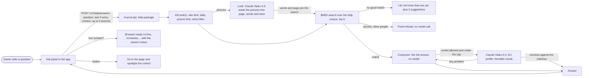

# Ask Clip Factory (the help assistant)

**Ask Clip Factory** answers "how do I…" and "where is…" questions inside the app, in short steps a child can follow,
and then takes you there: it opens the right page and lights up the right button. The full specification is
[CONTRACTS.md §19](CONTRACTS.md#19-ask-clip-factory-grounded-in-app-help-assistant-owner-request-2026-11-16); this page
explains how it works and how to keep it up to date. Why it is built this way:
[ADR-38](DECISIONS.md#adr-38-bm25-over-vectors-for-help-and-the-model-is-optional) and
[ADR-39](DECISIONS.md#adr-39-help-runs-in-cf-prod-api-with-claude-haiku-55-through-the-eu-profile).

## How it works

1. **The knowledge comes from the app's own code.** `web/scripts/help-corpus.mjs` reads the router, the navigation, the
   whole Settings tree, the screens (headings, button labels, `aria-label`s, tips, toasts, empty states, `data-help`
   anchors) and adds the hand-written guides in `web/src/features/help/helpKb.json`. The result,
   `web/src/features/help/help-corpus.json`, is committed. A UI change updates the assistant in the same deploy.
2. **Search, not guessing.** Both the API and the browser rank the corpus with the same BM25 rules (title and keywords
   count most, synonyms like "delete" → **Throw away**, "videos" → clips and "my clips" → Library, small typos
   forgiven; "help" is a stopword, so a bare "help" gets the suggestions). A hand-written guide within 10% of the best
   generated page on the same route wins the tie (`GUIDE_TIE = 0.9` in both `retrieve.py` and `retrieve.ts`). If
   nothing matches well enough, it says "I don't know that one yet." and never makes something up.
3. **It always works without the model.** The composer builds a complete answer from the best match: one or two
   sentences, at most 6 numbered steps with the app's own button names, and up to 2 buttons. The model only rewrites
   that answer in friendlier words, and its answer is thrown away (silently) if it names a button, page or number the
   matches do not contain, writes a link or a domain, or repeats a price the owner typed (outcome `kb_ungrounded`).
4. **It uses the owner's skills.** Like every AI call in Clip Factory
   ([CONTRACTS.md §18.6](CONTRACTS.md#186-every-ai-call-uses-every-skill-one-shared-rule)), the model's instructions
   start with every skill (through the shared `skill_prompt.load_block` and `learn.converse_text`), and the grounding
   rules follow. When the two disagree, the grounding rules win: the skills set the tone and the clip advice, and facts
   about the app come only from the corpus. If the skills cannot be read, the model is not asked and the composed
   answer is shown (outcome `kb_skills`).
5. **Live numbers come from the browser.** "How many views did my best clip get this week?" is answered with a
   placeholder that the panel fills by reading the same APIs the pages use, with the owner's own token. The assistant
   itself never reads clips, posts or weeks.
6. **Actions, not just text.** A button navigates (asking first if a caption edit or pasted link is not saved yet) and
   draws a bone ring around the control for 2.4 seconds.
7. **Private.** Questions and answers are never stored and never logged. Each request logs one outcome line with a
   request id, which the "Copy the help code" link copies when something goes wrong.
8. **Pictures** ([CONTRACTS.md §26](CONTRACTS.md#26-pictures-in-ask-owner-request-2026-11-19), ADR-48). The owner can
   add, paste or drop up to 4 pictures. The browser shrinks each to a clean JPEG (at most 1568 px and 600 KB, no
   EXIF or GPS). One "look" call reads them into a page, up to 12 labels and one sentence (`seen`); search runs on the
   question plus those labels, and the rewrite is grounded exactly as before. Pictures are never stored or logged;
   later questions carry only `seen`.

## The log line

Each `POST /v1/help/answers` writes one JSON line, `event: "help.answer"`, with `requestId`, `outcome`, `mode`
(`kb` or `model`), the number of candidates and, after a model call, `usageIn` and `usageOut` (token counts; the log
filter drops any field whose name contains "token"). Never the question or the answer. A question with pictures adds
`pictures` (how many), `picKB` (their size in KB) and `look` (`read`, `off`, `limit`, `cap`, `deadline`, `timeout`,
`error`, `bad_output` or `stop_<reason>`); never the pictures, what was read from them (`words`, `seen`) or their
base64.

| Outcome | Meaning |
|---|---|
| `kb`, `model` | Answered from the composer, or rewritten by the model |
| `unknown`, `refused` | No good match, or a question about secrets or other people (no model call) |
| `kb_cap` | The 2,000 model answers for these 30 days are used up |
| `kb_deadline` | Too little time left in the request to start a model call |
| `kb_skills` | The owner's skills could not be read, so the model was not asked |
| `kb_model_error`, `kb_model_timeout` | The model failed or was slow (these feed the alarm `cf-prod-help-model-failures`) |
| `kb_ungrounded` | The model's answer named a button, page, step or number the matches do not contain, wrote a link or domain, or repeated a price the owner typed |
| `kb_bad_output` | The model's answer was not valid JSON or did not fit the schema |
| `kb_stop_<reason>` | The model stopped early (`max_tokens`, `refusal`, `content_filtered`) |
| `model_unknown` | The model judged that the matches do not answer the question, so the owner sees "I don't know that one yet." |
| `off`, `rate_limited`, `bad_request`, `unavailable`, `error` | Turned off, too many questions, a bad body, the corpus could not be loaded, or an unexpected error |

## What it knows (curated guides)

| Topic | Guides (ids in `helpKb.json`) | Button |
|---|---|---|
| About the app | `what-is-clip-factory` | Go to Home, lights up the link box |
| Making clips | `make-clips-link`, `make-clips-upload` | Go to Home, lights up **Paste**, **Make clips** or the upload box |
| Jobs | `job-progress`, `job-failed`, `jobs-running` | Open Jobs; `job-failed` lights up the failed row in the Jobs list (`failed-job`) and **Try again** |
| Review | `review-keep`, `review-upload-to`, `review-throw-away`, `review-captions`, `review-waiting`, `clip-posting-failed` | Open Review, lights up **Upload**, **Throw away** or the captions |
| Library | `library-where` ("where are my clips / videos") | Open Library, lights up Library in the navigation |
| Clip numbers | `clip-performance`, `refresh-numbers`, `this-week-best`, `best-clip-week-views` | Open Library or This week, lights up the **Best this week** star |
| Posting | `posting-setup-{youtube,instagram,facebook,tiktok,x}`, `tiktok-private`, `where-clips-go`, `x-costs` ("What X charges for numbers"), `accounts-connected` | Open Set up posting `/settings/posting/setup` (lights up the platform's card `setup-{platform}`), that platform's steps `/settings/posting/setup/{platform}`, X setup (lights up **What X costs**), or Where clips go; `tiktok-private` opens Library |
| Get paid ([CONTRACTS §40](CONTRACTS.md#40-get-paid-set-up-payouts-see-if-you-can-get-paid-and-what-reached-your-bank-owner-request-2026-11-21)) | `getpaid-setup` ("How do I set up getting paid?"), `getpaid-status` ("What does Can get paid mean?"), `getpaid-sent` ("How much was sent to my bank?"), `getpaid-youtube`, `getpaid-tiktok-sweden`, `getpaid-x-clips`, `getpaid-whop`, and `money-payouts` ("Where do I add my bank account to get paid?") | Open Get paid (lights up the list, `getpaid-list`), a place's page (`getpaid-place`, its status `getpaid-status`, its payments `getpaid-sent`, the Whop card `getpaid-whop`), or Money's Get paid card (`getpaid-card`). |
| Clip making settings | `skills-add`, `skills-write`, `skills-edit`, `skills-delete`, `skills-what`, `clip-count`, `youtube-cookies` | Open Skills, Clips or YouTube help |
| Look and feel | `sounds-click`, `sounds-error`, `sounds-off`, `motion-and-background` | Open Sounds, Motion or Background |
| App | `get-app-desktop` (Mac and Windows), `get-app-browser` (Linux, ChromeOS and unknown desktops: install from the browser), `get-app-iphone`, `get-app-android`, `updates`, `sign-out` | Get the app, Open Updates, Open Account |

Every Settings tree, branch and setting also gets a generated doc, so "where do I change the background?" works
without a guide. Guides marked `"extends": "§17"` (the five `posting-setup-*` ones) point at Settings › Posting ›
Set up posting and the platform's own steps page. A setting that lives on a platform's setup page (an apple with an
`href`, such as **What X costs**) becomes a doc on that page.

Guides with a `when` filter are shown only where they fit: the Mac and Windows download only on desktops that have not
installed the app, the install-from-the-browser steps on other desktops, the iPhone steps only on iOS, the Android steps only on Android. There are no roles or plans: there
is one owner, and everything else is visible.

## Add or change a guide

1. Edit `web/src/features/help/helpKb.json`: a stable kebab-case `id`, `title`, `keywords` (everyday words a child
   would type), `answer` (≤ 400 characters), `steps` (≤ 6, the UI's exact button names), `actions` (≤ 2, each with a
   `to` path that exists and optional `highlight` ids).
2. Add at least one question for it to `web/src/features/help/helpEvals.json` (`{ "q": "...", "expect": "<id>" }`).
3. Run `npm test` in `web/`. The generator refreshes the corpus first; the evals run in both the web and the API
   tests: `api/tests/test_help_evals.py` reads the same `helpEvals.json` from the repository, on top of its own
   `api/tests/fixtures/help/evals.json` ([TESTING.md](TESTING.md#ask-clip-factory)).
4. Plain words, no em or en dashes, no keys or infrastructure words (the sensitive-word filter drops them and a test
   fails).

## Add an anchor (so a button can light something up)

Give the control a stable `data-help` attribute, for example `data-help="make-clips"`. Settings apples already carry
their apple id. Then use the id in a guide's `highlight`. The generator fails if a `highlight` names an anchor that
does not exist, and drops a button whose `to` does not match a route.

## The panel

The look and the exact numbers are in [UX_DESIGN_SYSTEM.md](UX_DESIGN_SYSTEM.md#ask-clip-factory) and
[CONTRACTS.md §19.8](CONTRACTS.md#198-web-websrcfeatureshelp). The parts that are easy to get wrong:

- **Desktop panel is non-modal, the phone sheet is modal.** On phones the sheet is `aria-modal="true"`, the page and
  the launcher are `inert`, and Tab stays inside the sheet.
- **The chat is kept** when the panel closes and reopens (in memory only) until **Start over**. On wide screens the
  panel closes by itself when it would cover the control an answer button lit up.
- **The Ask field** spans the full width of the panel and grows from one line to four. A round icon-only paper-plane
  **Send** button sits inside its right end, off while the field is empty. Sending makes the plane fly off up and to
  the right (520 ms) and a new one fade back in (240 ms); the question bubble does not wait for it. With reduced motion
  the plane only fades. The motion is reusable by any button (`useLaunch` / `<Flight>` in
  `web/src/components/PaperPlane.tsx`, `web/src/styles/fly.css`).
- **The launcher stays calm and out of the way**: it has one home spot (phones: above the tab bar at the right; wide
  screens: bottom right) and never moves; nothing about it changes while the page scrolls or a finger is down. Once
  the page has been still (260 ms), if it would make a control hard to tap (covering over 30 % of it, or leaving no
  44 px part of it free; a big card or row link it rests on the edge of does not count) it fades out where it stands,
  letting taps through; it fades back in only after 700 ms of stillness with its spot clear, and holds each state for
  at least a second, so it never blinks. Every page keeps extra room under its last control. Only what shows counts: a
  tab scrolled out of its row or a line cut off by a scroller is no obstacle. The buttons of the setup to-do list
  count like any other control, so with the list open at the top right the launcher stays in its corner under it.
- **Spotlight**: a very tall target (over 60 % of the window) rings only its heading, 80 px from the top.
- **Go Home** is left out of the "I don't know" answer while you are already on Home.

## The model and its fallback

| Item | Value |
|---|---|
| Model | Claude Haiku 5.5 through the EU inference profile `eu.anthropic.claude-haiku-5-5` (from `config/models.json`, key `helpModel`) |
| Where it runs | EU Regions only (eu-central-1, eu-north-1, eu-south-1, eu-south-2, eu-west-1, eu-west-3) |
| Call | One Converse request, JSON schema output, `maxTokens` 700, thinking off, no tools, no streaming |
| Timeouts | 3 s to connect, 10 s to read, no retry (`max_attempts` 1: one attempt takes at most 13 s, two would outlive the 29 s Lambda); no call starts with less than 14 s left |
| Instructions | The owner's skills block first (CONTRACTS §18.6), then the help rules, which win on facts |
| When it is skipped | No match, a refusal, the kill switch says `model: false`, the skills could not be read, or 2,000 model answers in the current 30 days |
| What the owner sees on failure | The composed answer; never an error |
| Pictures (the look call) | Same model and profile, image blocks before the text, `maxTokens` 300, thinking off, JSON schema `{page, words, seen}`; 2 s to connect, 6 s to read, no retry; needs 12 s left; one more unit of the cap. `HELP_LOOK_MODEL_ID` can name another model (empty by default) |

The first call after a schema change can wait for Bedrock to compile the schema and fall back to the plain answer;
that is expected. If this AWS account has never used Haiku 5.5, open it once in the Bedrock console
([DEPLOYMENT.md](DEPLOYMENT.md#4-bedrock-model-access-and-data-retention)).

## Turning it off

- **Deploy flag:** `HELP_ENABLED` on `cf-prod-api` (`"true"` in prod). Off means the launcher disappears.
- **Kill switch, no deploy:** the DynamoDB item `HELP` / `SWITCH`. `enabled: false` turns the assistant off within
  60 seconds (open apps hide the launcher at their next status check, at most 5 minutes, and stop answering locally
  too). `model: false` keeps answering from search only. `pictures: false` turns pictures off (no look call; the
  picture button goes at the app's next status check). In Terraform, `help_enabled` (default true) and
  `help_monthly_cap` (default 2000) are optional variables of `infra/envs/prod`. The command is in
  [DEPLOYMENT.md](DEPLOYMENT.md#ask-clip-factory-kill-switch).

## Limits

| Limit | Value | What the owner sees |
|---|---|---|
| Questions | 6 a minute, 60 an hour | "Let's take a short break. You can ask again in {n} seconds." with a countdown |
| Question length | 300 letters | The counter appears from 250 |
| History sent | last 4 turns | Follow-ups like "and the error sound?" still work |
| Model answers | 2,000 per 30 days | Answers come from search only until the window ends |
| Pictures | 4 per question, 600 KB and 1568 px each after the browser shrinks them | "You can add 4 pictures. Take one away first." |
| Picture questions | 40 per owner per day (`HELP_PICTURE_QUESTIONS_PER_DAY`) | "You sent lots of pictures today. Ask me in words, or try again tomorrow." |

## Live numbers

| Metric | Read by the browser from |
|---|---|
| `best_clip_week_views`, `week_total_views`, `week_clips` | `GET /v1/weeks/{week}` |
| `review_waiting`, `jobs_running`, `clips_posted` | `GET /v1/me` |
| `latest_job` | `GET /v1/jobs?limit=1` |
| `clip_views` | `GET /v1/clips/{clipId}/performance` (only when asked on a clip page) |
| `skills_on` | `GET /v1/skills` |
| `accounts_connected` | `GET /v1/accounts` |

A failed read says "I couldn't get that number right now." and offers the button to the page that shows it.

## The assistant (Ask as a full helper, CONTRACTS §28, ADR-51)

Since §28, Ask answers **any** question (Clip Factory, Terraform, food, a file the owner drops in), not only the help
corpus. The §19 path above (corpus + Haiku rewrite, `POST /v1/help/answers`) stays as the fallback.

**How Ask thinks.** Claude Opus 5.5 on Claude in Amazon Bedrock (the `bedrock-mantle` Messages API, in-Region
`eu-north-1`), adaptive thinking at effort `medium`, streamed. Every request has the same cached prefix: the tools
(sorted), then the system blocks in this order: the owner's skills (§18.6, always first), the knowledge pack
(`api/src/clipfactory_api/ask/knowledge.json`, about 47k tokens: the app map from the help corpus, the owner manual,
every setup step of the five guides, every place in Settings, the app's routes and the library index) and the Ask
rules (`ask/prompt.py`, with the one 1-hour cache breakpoint; rule 11 names the model, so "which model are you?" gets
Claude Opus 5.5). The owner's live state (`ask/state.py`: jobs with error codes, setup per platform with steps done of
the total and the next step's id and title, settings, skills, follows, this week's numbers, money) goes after his
question as a mid-conversation `system` message, rebuilt every question under one shared 1.5 s deadline. It holds no
words written by others or by a model (clip hooks, error text, account names): those come only through
`read_my_clip_factory`, as data. So "I made the Meta app, what now?" is answered from his real setup: the next step,
its number and its exact title. A refusal on Opus 5.5 is retried on Opus 4.8 by the SDK's
`BetaRefusalFallbackMiddleware` (Bedrock has no server-side `fallbacks`).

**Tools (all read only).** `web_search` (Brave Search API, 8 results, 4 s), `web_fetch` (only URLs from this
answer's search results, an earlier answer's sources or URLs the owner typed; https, public addresses only, re-checked
on every redirect, one 10 s deadline for the whole fetch, 2 MB), `read_app_doc` (one library section by id, long ones
in parts), `read_my_clip_factory` (the owner's own data by section) and `show_app_buttons` (at most two buttons from
the app map, routes checked on the server too; the §19.8 spotlight is unchanged). Caps per answer: 6 of each, 2
button calls. The calls of one turn run at the same time. Nothing writes, posts, deletes, connects or sends.

**Transport.** The panel sends `{"action":"whoami"}` on the open WebSocket to learn its connection id, uploads any
files to `ask/{sub}/{fileId}` with presigned PUTs (`POST /v1/help/files`), then `POST /v1/help/asks` answers 202 and
starts `cf-prod-ask` with an async Invoke. The answer streams back as `ask.*` events on the socket (first words in
about 2 to 4 s; a "Still working…" status every 10 s of silence). Stop is `POST /v1/help/asks/{askId}/stop`. If the
socket is not open within 4 s, or nothing arrives, the panel answers with the §19 path and stops the answer on the
server.

**Files.** Pictures (re-encoded to JPEG in the browser, markable in the editor), PDF (≤ 100 pages), text-like files
and docx/xlsx/pptx/odt/ods (text pulled out in the worker). Old Office files, archives, audio and video are refused when
added, with a note that says what to do. Files are deleted by the worker as soon as it has read them (and again when
the answer ends, whatever happened), by the API and the panel when a question does not start, and by the bucket's
`ask-1-day` rule as a safety net (up to 2 days). Nothing about a file is logged but its kind and size.

**Owner steps.**

1. Bedrock model access (only if Bedrock asks): Bedrock console in Stockholm › Model access › turn on Claude Opus
   5.5 and Claude Opus 4.8, then try each once in the playground.
2. Web search: Settings › App & account › Ask › **Get a search key** (Brave Search API, the **Search** plan, $5 of free
   credit a month), paste it, **Save key**. Until then Ask says "I can't search the web yet." once and answers from
   what it knows.

**Turning it off.** `HELP`/`SWITCH` gains `assistant`, `web` and `files` (absent = true). `assistant: false` sends the
panel to the §19 path; `web: false` takes the search tool away; `files: false` refuses files. **Take key away**
reaches a warm worker within a minute (the key is cached 60 s).

### The `help.ask` log line

One line per answer from `cf-prod-ask`: `requestId`, `askId`, `outcome`, `stop`, `ms`, `firstWordsMs`, `iterations`,
`toolsSearch`, `toolsFetch`, `toolsDoc`, `toolsMe`, `toolsButtons`, `files`, `filesImage`, `filesPdf`, `filesPlain`,
`filesOffice`, `fileKb`, `usageIn`, `usageOut`, `cacheRead`, `cacheWrite`, `model` (`opus-5-5`, or `opus-4-8` after a
fallback), `web` (`on`/`no_key`/`off`, or `error` when a saved key could not be read) and `knowledgeVersion`. `cf-prod-api` logs `help.ask_start` with the start
outcome. Never logged: the question, history, answer, file names or contents, URLs, search queries, the search key or
a presigned URL.

| Outcome | Meaning |
|---|---|
| `ask_ok` | Answered to the end. |
| `ask_budget` | The 110 s budget ended it ("I ran out of time. Ask me to go on."), or a round hit its output limit ("That was a long answer, so I stopped there. Ask me to go on."). Near the 64,000-output-token budget the last round has no tools and finishes normally (`ask_ok`). |
| `ask_stopped` | The owner tapped Stop. |
| `ask_gone` | The socket closed; the model stream was ended at once. |
| `ask_refused` | The model (and the Opus 4.8 fallback) declined; the panel shows "I can't help with that one." |
| `ask_refused_secret` | The typed question asked to be shown his own stored password, key, token or cookie contents ("show me my API key"): a fixed answer, no model call, its files deleted. Questions about what a token is or how to store keys are answered. |
| `ask_skills` | The skills could not load, so no model call; the panel used the §19 answer. |
| `ask_model_error` | Bedrock answered with an error (no access yet, throttled, 5xx). |
| `ask_model_timeout` | Bedrock did not answer in time. |
| `ask_bad_body` | The start body was not valid (400). |
| `ask_rate_limited` | Over 6 a minute, 60 an hour or 400 a day (429 with `Retry-After`). |
| `ask_off` | The kill switch or `ASK_ENABLED` is off (403 `help_off`). |
| `ask_error` | Anything else; the worker caught it. |

## Routes the assistant can link to

Generated by `node web/scripts/help-corpus.mjs` from `web/src/lib/router.ts` and `web/src/lib/settingsTree.ts`. CI runs
the generator with `--check` and fails when this table is out of date. Do not edit between the markers by hand.

<!-- help-routes:start -->
| Route | Path |
|---|---|
| home | `/` |
| jobs | `/jobs` |
| job | `/jobs/{jobId}` |
| review | `/review` |
| library | `/library` |
| library | `/library?view=week` |
| money | `/money` |
| campaigns | `/campaigns` |
| campaign | `/campaigns/{campaignId}` |
| clip | `/clips/{clipId}` |
| cr_setup | `/settings/posting/setup/contentrewards` |
| settings | `/settings` |
| settings | `/settings/clip-making/clips` |
| settings | `/settings/clip-making/skills` |
| settings | `/settings/clip-making/learned` |
| settings | `/settings/clip-making/streamers` |
| settings | `/settings/clip-making/youtube` |
| settings | `/settings/posting/setup` |
| settings | `/settings/posting/getpaid` |
| settings | `/settings/posting/where` |
| settings | `/settings/posting/my-settings` |
| settings | `/settings/posting/money` |
| settings | `/settings/look-and-feel/sounds` |
| settings | `/settings/look-and-feel/motion` |
| settings | `/settings/look-and-feel/background` |
| settings | `/settings/app/get-the-app` |
| settings | `/settings/app/notifications` |
| settings | `/settings/app/updates` |
| settings | `/settings/app/ask` |
| settings | `/settings/app/account` |
| get_app | `/get-app` |
<!-- help-routes:end -->

The API side has `GET /v1/help` and `POST /v1/help/answers` (§19), plus the assistant's `POST /v1/help/files`,
`DELETE /v1/help/files/{fileId}`, `POST /v1/help/asks`, `POST /v1/help/asks/{askId}/stop`, `PUT /v1/help/search-key` and
`DELETE /v1/help/search-key` (§28), all behind the Cognito JWT like every other `/v1` route.
