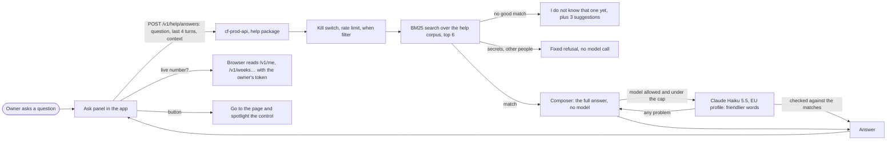

# Ask Clip Factory (the help assistant)

**Ask Clip Factory** answers "how do I…" and "where is…" questions inside the app, in short steps a child can follow,
and then takes you there: it opens the right page and lights up the right button. The full specification is
[CONTRACTS.md §19](CONTRACTS.md#19-ask-clip-factory-grounded-in-app-help-assistant-owner-request-2026-11-16); this page
explains how it works and how to keep it up to date. Why it is built this way:
[ADR-38](DECISIONS.md#adr-38-bm25-over-vectors-for-help-and-the-model-is-optional) and
[ADR-39](DECISIONS.md#adr-39-help-runs-in-cf-prod-api-with-claude-haiku-55-through-the-eu-profile).

## How it works

1. **The knowledge comes from the app's own code.** `web/scripts/help-corpus.mjs` reads the router, the navigation, the
   whole Settings tree, the screens (headings, button labels, `aria-label`s, tips, toasts, empty states, `data-help`
   anchors) and adds the hand-written guides in `web/src/features/help/helpKb.json`. The result,
   `web/src/features/help/help-corpus.json`, is committed. A UI change updates the assistant in the same deploy.
2. **Search, not guessing.** Both the API and the browser rank the corpus with the same BM25 rules (title and keywords
   count most, synonyms like "delete" → **Throw away**, small typos forgiven). A hand-written guide within 10% of the
   best generated page on the same route wins the tie. If nothing matches well enough, it says
   "I don't know that one yet." and never makes something up.
3. **It always works without the model.** The composer builds a complete answer from the best match: one or two
   sentences, at most 6 numbered steps with the app's own button names, and up to 2 buttons. The model only rewrites
   that answer in friendlier words, and its answer is thrown away (silently) if it names a button, page or number the
   matches do not contain.
4. **It uses the owner's skills.** Like every AI call in Clip Factory
   ([CONTRACTS.md §18.6](CONTRACTS.md#186-every-ai-call-uses-every-skill-one-shared-rule)), the model's instructions
   start with every skill (through the shared `learn.converse_text`), and the grounding rules follow, so the tone and
   clip advice follow the skills while facts about the app come only from the corpus. If the skills cannot be read,
   the model is not asked and the composed answer is shown.
5. **Live numbers come from the browser.** "How many views did my best clip get this week?" is answered with a
   placeholder that the panel fills by reading the same APIs the pages use, with the owner's own token. The assistant
   itself never reads clips, posts or weeks.
6. **Actions, not just text.** A button navigates (asking first if a caption edit or pasted link is not saved yet) and
   draws a sage ring around the control for 2.4 seconds.
7. **Private.** Questions and answers are never stored and never logged. Each request logs one outcome line with a
   request id, which the "Copy the help code" link copies when something goes wrong.

## The log line

Each `POST /v1/help/answers` writes one JSON line, `event: "help.answer"`, with `requestId`, `outcome`, `mode`
(`kb` or `model`), the number of candidates and, after a model call, `usageIn` and `usageOut` (token counts; the log
filter drops any field whose name contains "token"). Never the question or the answer.

| Outcome | Meaning |
|---|---|
| `kb`, `model` | Answered from the composer, or rewritten by the model |
| `unknown`, `refused` | No good match, or a question about secrets or other people (no model call) |
| `kb_cap` | The 2,000 model answers for these 30 days are used up |
| `kb_deadline` | Too little time left in the request to start a model call |
| `kb_model_error`, `kb_model_timeout` | The model failed or was slow (these feed the alarm `cf-prod-help-model-failures`) |
| `kb_ungrounded`, `kb_bad_output` | The model's answer named something the matches do not contain, or was not valid JSON |
| `model_unknown` | The model judged that the matches do not answer the question, so the owner sees "I don't know that one yet." |
| `off`, `rate_limited`, `bad_request`, `unavailable`, `error` | Turned off, too many questions, a bad body, the corpus could not be loaded, or an unexpected error |

## What it knows (curated guides)

| Topic | Guides (ids in `helpKb.json`) | Button |
|---|---|---|
| Making clips | `make-clips-link`, `make-clips-upload` | Go to Home, lights up **Paste**, **Make clips** or the upload box |
| Jobs | `job-progress`, `job-failed`, `jobs-running` | Open Jobs, lights up **Try again** |
| Review | `review-keep`, `review-throw-away`, `review-captions`, `review-waiting`, `clip-posting-failed` | Open Review, lights up **Keep**, **Throw away** or the captions |
| Clip numbers | `clip-performance`, `refresh-numbers`, `this-week-best`, `best-clip-week-views` | Open Library or This week, lights up the **Best this week** star |
| Posting | `posting-setup-{youtube,instagram,facebook,tiktok,x}`, `tiktok-private`, `where-clips-go`, `x-costs` | Open Set up posting (lights up the platform's card), that platform's steps, or Where clips go |
| Clip making settings | `skills-add`, `skills-what`, `clip-count`, `youtube-cookies` | Open Skills, Clips or YouTube help |
| Look and feel | `sounds-click`, `sounds-error`, `sounds-off`, `motion-and-background` | Open Sounds, Motion or Background |
| App | `get-app-desktop`, `get-app-iphone`, `get-app-android`, `updates`, `sign-out` | Get the app, Open Updates, Open Account |

Every Settings tree, branch and setting also gets a generated doc, so "where do I change the background?" works
without a guide. Guides marked `"extends": "§17"` (the five `posting-setup-*` ones) point at Settings › Posting ›
Set up posting and the platform's own steps page. A setting that lives on a platform's setup page (an apple with an
`href`, such as **What X costs**) becomes a doc on that page.

Guides with a `when` filter are shown only where they fit: the Mac and Windows download only on desktops that have not
installed the app, the iPhone steps only on iOS, the Android steps only on Android. There are no roles or plans: there
is one owner, and everything else is visible.

## Add or change a guide

1. Edit `web/src/features/help/helpKb.json`: a stable kebab-case `id`, `title`, `keywords` (everyday words a child
   would type), `answer` (≤ 400 characters), `steps` (≤ 6, the UI's exact button names), `actions` (≤ 2, each with a
   `to` path that exists and optional `highlight` ids).
2. Add at least one question for it to `web/src/features/help/helpEvals.json` (`{ "q": "...", "expect": "<id>" }`).
3. Run `npm test` in `web/`. The generator refreshes the corpus first; the evals run in both the web and the API
   tests ([TESTING.md](TESTING.md#ask-clip-factory)).
4. Plain words, no em or en dashes, no keys or infrastructure words (the sensitive-word filter drops them and a test
   fails).

## Add an anchor (so a button can light something up)

Give the control a stable `data-help` attribute, for example `data-help="make-clips"`. Settings apples already carry
their apple id. Then use the id in a guide's `highlight`. The generator fails if a `highlight` names an anchor that
does not exist, and drops a button whose `to` does not match a route.

## The model and its fallback

| Item | Value |
|---|---|
| Model | Claude Haiku 5.5 through the EU inference profile `eu.anthropic.claude-haiku-5-5` (from `config/models.json`, key `helpModel`) |
| Where it runs | EU Regions only (eu-central-1, eu-north-1, eu-south-1, eu-south-2, eu-west-1, eu-west-3) |
| Call | One Converse request, JSON schema output, `maxTokens` 700, thinking off, no tools, no streaming |
| Timeouts | 3 s to connect, 10 s to read, no retry; no call starts with less than 14 s left |
| When it is skipped | No match, a refusal, the kill switch says `model: false`, the skills could not be read, or 2,000 model answers in the current 30 days |
| What the owner sees on failure | The composed answer; never an error |

The first call after a schema change can wait for Bedrock to compile the schema and fall back to the plain answer;
that is expected. If this AWS account has never used Haiku 5.5, open it once in the Bedrock console
([DEPLOYMENT.md](DEPLOYMENT.md#4-bedrock-model-access-and-data-retention)).

## Turning it off

- **Deploy flag:** `HELP_ENABLED` on `cf-prod-api` (`"true"` in prod). Off means the launcher disappears.
- **Kill switch, no deploy:** the DynamoDB item `HELP` / `SWITCH`. `enabled: false` turns the assistant off within
  60 seconds (open apps hide the launcher at their next status check, at most 5 minutes, and stop answering locally
  too). `model: false` keeps answering from search only. The command is in
  [DEPLOYMENT.md](DEPLOYMENT.md#ask-clip-factory-kill-switch).

## Limits

| Limit | Value | What the owner sees |
|---|---|---|
| Questions | 6 a minute, 60 an hour | "Let's take a short break. You can ask again in {n} seconds." with a countdown |
| Question length | 300 letters | The counter appears from 250 |
| History sent | last 4 turns | Follow-ups like "and the error sound?" still work |
| Model answers | 2,000 per 30 days | Answers come from search only until the window ends |

## Live numbers

| Metric | Read by the browser from |
|---|---|
| `best_clip_week_views`, `week_total_views`, `week_clips` | `GET /v1/weeks/{week}` |
| `review_waiting`, `jobs_running`, `clips_posted` | `GET /v1/me` |
| `latest_job` | `GET /v1/jobs?limit=1` |
| `clip_views` | `GET /v1/clips/{clipId}/performance` (only when asked on a clip page) |
| `skills_on` | `GET /v1/skills` |
| `accounts_connected` | `GET /v1/accounts` |

A failed read says "I couldn't get that number right now." and offers the button to the page that shows it.

## Routes the assistant can link to

Generated by `node web/scripts/help-corpus.mjs` from `web/src/lib/router.ts` and `web/src/lib/settingsTree.ts`. CI runs
the generator with `--check` and fails when this table is out of date. Do not edit between the markers by hand.

<!-- help-routes:start -->
| Route | Path |
|---|---|
| home | `/` |
| jobs | `/jobs` |
| job | `/jobs/{jobId}` |
| review | `/review` |
| library | `/library` |
| library | `/library?view=week` |
| clip | `/clips/{clipId}` |
| settings | `/settings` |
| settings | `/settings/clip-making/clips` |
| settings | `/settings/clip-making/skills` |
| settings | `/settings/clip-making/youtube` |
| settings | `/settings/posting/setup` |
| settings | `/settings/posting/where` |
| settings | `/settings/look-and-feel/sounds` |
| settings | `/settings/look-and-feel/motion` |
| settings | `/settings/look-and-feel/background` |
| settings | `/settings/app/get-the-app` |
| settings | `/settings/app/updates` |
| settings | `/settings/app/account` |
| get_app | `/get-app` |
<!-- help-routes:end -->

The API side has exactly two routes, `GET /v1/help` and `POST /v1/help/answers`, both behind the Cognito JWT like
every other `/v1` route.
