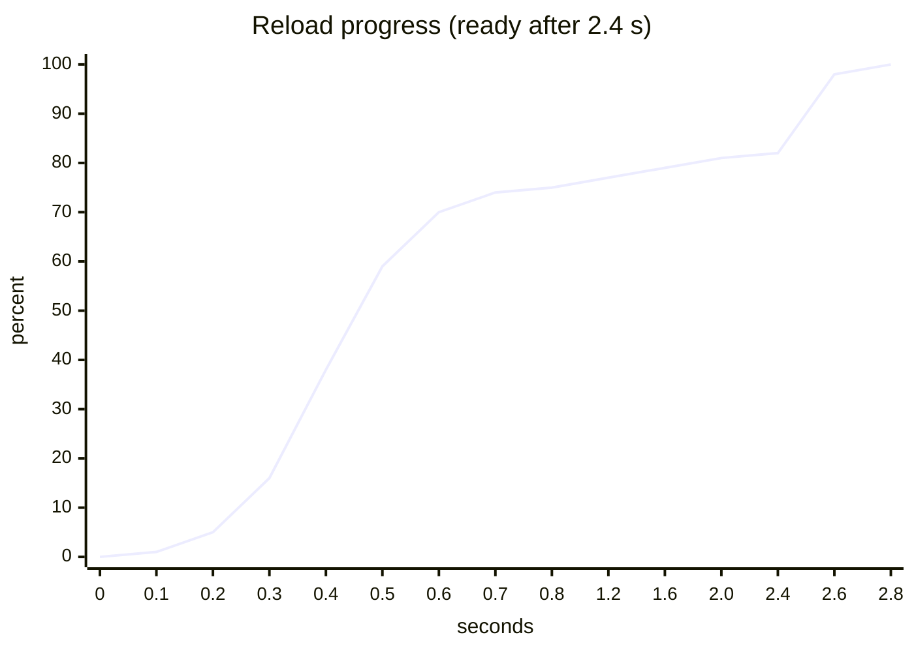

# UX design system

How Clip Factory Cloud looks, moves and sounds. The summary is in [CONTRACTS.md §11](CONTRACTS.md#11-design-system-summary-details-in-docsux_design_systemmd);
this file is the full reference. The code lives in `web/`; tokens are CSS custom properties on `:root`.

## Principles

1. **One action stands out.** Each screen has at most one tomato call-to-action. Everything else is quiet.
2. **Glass, never solid.** Every surface lets the backdrop show through.
3. **Nothing ever overflows.** Text wraps or truncates inside its box at every width from 320 px.
4. **Delight on the moments that matter.** Confirm, a finished job, a new skill. Not on every click.
5. **Plain English a child can follow.** Labels say what happens in everyday words: "Keep", "Throw away",
   "Make clips", never "Submit". See the [kid-proof checklist](#kid-proof-checklist).

## Colour tokens

| Token | Value | Use |
|---|---|---|
| `--sage` | `#9CAF88` | Hero cards, active navigation, success, the backdrop |
| `--sage-deep` | `#6F8560` | Text and icons on light glass that must read as sage |
| `--offwhite` | `#F7F5EF` | Base of most glass tints, light text on sage |
| `--tomato` | `#E8412C` | **Every primary CTA**, focus ring accent, the headline swash, the review badge |
| `--tomato-deep` | `#C7321F` | CTA pressed state |
| `--ink` | `#1E2A1B` | Body text, icons |
| `--ink-soft` | `rgba(30, 42, 27, 0.68)` | Secondary text |
| `--danger` | `#B3261E` | Error text (never used for buttons; destructive buttons are outlined) |

Glass tints are these colours at low alpha:

| Token | Value |
|---|---|
| `--glass-offwhite` | `rgba(247, 245, 239, 0.42)` |
| `--glass-sage` | `rgba(156, 175, 136, 0.38)` |
| `--glass-tomato` | `rgba(232, 65, 44, 0.86)` (CTAs stay readable, still slightly translucent) |
| `--glass-edge` | `rgba(255, 255, 255, 0.55)` |
| `--glass-shadow` | `0 8px 32px rgba(30, 42, 27, 0.14)` |

Contrast: body text is `--ink` on glass over the default backdrop (≥ 7:1). White text on tomato CTAs is ≥ 4.5:1 at
14 px semibold and up. Never put text directly on the moving backdrop.

## The liquid glass recipe

```css
.glass {
  background: var(--glass-offwhite);
  -webkit-backdrop-filter: blur(22px) saturate(160%);
  backdrop-filter: blur(22px) saturate(160%);
  border: 1px solid var(--glass-edge);
  border-radius: var(--radius-l);
  box-shadow: var(--glass-shadow), inset 0 1px 0 rgba(255, 255, 255, 0.6);
}
/* Refractive edge: a soft highlight along the top-left, like light catching curved glass. */
.glass::before {
  content: ""; position: absolute; inset: 0; border-radius: inherit; pointer-events: none;
  background: linear-gradient(135deg, rgba(255,255,255,.45), rgba(255,255,255,0) 40%);
  mix-blend-mode: soft-light;
}
@supports not ((backdrop-filter: blur(1px)) or (-webkit-backdrop-filter: blur(1px))) {
  .glass { background: rgba(247, 245, 239, 0.92); }
}
```

Variants: `.glass--sage` (hero, active nav), `.glass--strong` (dialogs and sheets, alpha 0.62 so long text stays
easy to read), `.glass--cta` (tomato).

**The backdrop.** A fixed layer behind the app with three large blurred blobs (sage, off-white, a little tomato) that
drift slowly (60-second loop, paused with reduced motion). The owner can choose a background image in Settings; it
replaces the blobs and the glass shows it through.

**About the phone's wallpaper.** The owner asked to see the phone's background through the app. Browsers and
installed PWAs cannot see the operating system's wallpaper, so the glass shows the app backdrop or the owner's chosen
image instead. Choosing the same photo as the phone's wallpaper gives the same effect.

## Typography

| Role | Font | Size (clamp) | Weight / style |
|---|---|---|---|
| Display | Times New Roman, Tinos, serif | `clamp(2.25rem, 6vw, 4rem)` | 400 italic, tight leading 1.05 |
| H1 | Times New Roman | `clamp(1.75rem, 4vw, 2.5rem)` | 400, often italic |
| H2 | Inter | 1.25rem | 600 |
| Body | Inter | 1rem (16 px, never smaller on phones, so iOS does not zoom inputs) | 400, leading 1.5 |
| Small / meta | Inter | 0.8125rem | 500 |
| Numbers (stats) | Inter, `font-variant-numeric: tabular-nums` | 2rem | 600 |

The tomato **swash**: a hand-drawn SVG underline under one or two italic words of a display headline ("Make it
*viral*"). Used once per screen at most.

Inter loads from Google Fonts with `display=swap`; Tinos is the metric-compatible fallback for Times New Roman where
it is missing (Android, Linux).

## Layout and spacing

- Spacing scale (px): 4, 8, 12, 16, 24, 32, 48, 64. Tokens `--space-1` … `--space-8`.
- Radii: `--radius-s` 10 px (inputs, chips), `--radius-m` 16 px (cards), `--radius-l` 24 px (panels), pills 999 px.
- Content max width 1200 px, centred. Gutters 16 px on phones, 24 px on tablets, 32 px on desktop.
- Grid: one column on phones; cards in rows of 2 from 768 px, 3 from 1100 px (`repeat(auto-fill, minmax(min(100%, 300px), 1fr))`).
- Breakpoints: phone < 768 px, tablet 768–1099 px, desktop ≥ 1100 px.

**Layout inspiration** (the "Sorrel" reference): a big serif italic headline on a sage hero card, pill buttons beside
it, a row of cards below, and a rating-style stat block (for example "8 clips waiting · 3 jobs running · 24 posted").
The person in the reference image is not used.

## Navigation

| Width | Navigation |
|---|---|
| < 768 px | Bottom glass tab bar, **icons only**, no words. Each icon has an `aria-label` and a tooltip on long-press. Five items: Home, New job, Review (with badge), Insights, Settings. Respects `env(safe-area-inset-bottom)`. Each target ≥ 48 × 48 px. "Get the app" is not a tab: it is the Settings › App & account › Get the app branch and a one-time banner on Home. |
| ≥ 768 px | Left glass sidebar with icons and names. A hamburger (three stripes) at the top collapses it to icons only; the choice is remembered on that device. Collapsed items show their name as a tooltip. A **Get the app** item (download icon) sits at the bottom of the sidebar, apart from the main items, and disappears once the app is installed. |

The active item uses `--glass-sage` and a small tomato dot. The current page has `aria-current="page"`.

## Settings tree

The owner's picture: "there is a field which is the entire settings, then we have apple trees which has multiple
trees, and each tree has multiple branches, and each branch has multiple apples, but they also have leaves ... so that
it is all organized." Settings is built exactly like that, and every setting has one place in it. The contract is
[CONTRACTS.md §15](CONTRACTS.md#15-settings-as-a-tree-and-choosing-your-click-sounds-owner-request-2026-11-16).

| Word | What it is on screen | Example |
|---|---|---|
| **Field** | All of Settings, the page at `/settings` | Settings |
| **Tree** | One of four big groups, its own page | Look & feel |
| **Branch** | A section inside a tree, its own page | Sounds |
| **Apple** | One thing you can change: a switch, a picker, a button | Click sound |
| **Leaf** | One short line of help under an apple or a branch | "Sounds only play when you tap, never when you scroll." |

### The map

Every tree and every branch is a real address, so a link, the browser's Back button and a bookmark all work. Branch
addresses sit under their tree: `/settings/look-and-feel/sounds`.

```
Settings                                   /settings
├── Clip making                            /settings/clip-making
│   ├── Clips          How many clips, Longest video
│   ├── Skills         every skill (on/off, view, delete with Undo), Add a skill (.md or .zip)
│   └── YouTube help   YouTube cookies: add, remove
├── Posting                                /settings/posting
│   ├── Accounts       YouTube, Instagram, Facebook, TikTok, X (Coming soon)
│   └── Where clips go the platforms to post to (at least one)
├── Look & feel                            /settings/look-and-feel
│   ├── Sounds         Sounds on/off, Click sound, Error sound, Try it
│   ├── Motion         Reduce motion
│   └── Background     Background picture (this device only)
└── App & account                          /settings/app
    ├── Get the app    the install card for this device
    ├── Updates        this version, Check for updates
    └── Account        signed-in email, Sign out
```

Branch slugs: `clips`, `skills`, `youtube`, `accounts`, `where`, `sounds`, `motion`, `background`, `get-the-app`,
`updates`, `account`. Old addresses keep working: `/settings#skills` style anchors redirect to their branch, `/get-app`
shows the same install card, and `/settings?account=…&status=…` (the OAuth return) still shows its message.

**Where a new setting goes.** Pick the tree by *what the owner is doing* (making clips, posting them, how the app
looks and sounds, the app itself), then the branch by *the thing it changes*. A new setting never sits loose on the
field or on a tree page; if no branch fits, add a branch. A branch with one apple is fine. Every apple gets a leaf
unless its name already says it all.

### What each level looks like

| Level | Layout |
|---|---|
| **Field** `/settings` | Serif title "Make it *yours*." (the word *yours* in italic) with the lede "How your clips are made, where they go, and how the app looks and sounds.", then a **Find a setting** search box, then the four trees as big glass cards in the card grid: icon, name, one line (for example "How your clips are made."), then how many apples it holds and its branch names ("… settings · Clips, Skills, YouTube help"). |
| **Tree** | Breadcrumb, the tree's title, its branches as glass cards: icon, name, one line. |
| **Branch** | Breadcrumb, the branch's title, its apples as rows grouped in glass panels. Each row: the label on the left, the control on the right (below it on narrow phones), the leaf under the label in `--ink-soft` small text. |

- **Breadcrumb on every level:** `Settings › Look & feel › Sounds`, each part a link, the last one `aria-current="page"`.
  It truncates from the left on narrow screens, never wraps the page sideways.
- **Back:** phones get a big secondary **Back** pill (arrow icon + "Back", 48 px tall) at the top of every tree and
  branch page; it goes one level up, not browser-back, so it never leaves Settings by surprise.
- **One tomato button per screen at most.** Most branches have none: switches and pickers save by themselves. The
  Sounds branch's tomato button is "Try it: Sign in".
- **Saving:** every apple saves the moment it changes (optimistic, like the Sound switch); a failed save puts the
  control back (it reloads the saved settings), plays the error sound and shows the app's friendly error message for
  what went wrong (`friendlyMessage`), in a tomato toast. The owner just taps again to retry.

### Phone and desktop

| Width | How you move through the tree |
|---|---|
| < 1024 px | **Drill down.** The field shows the trees; tap a tree to see its branches; tap a branch to see its apples. Back and the breadcrumb go up. One level on screen at a time. |
| ≥ 1024 px | **Folder panel.** A left glass panel inside Settings (beside the app sidebar) shows the whole tree; the content of the chosen level sits on the right. |

**The folder panel** (≥ 1024 px):
- Each tree is a folder row (chevron, icon, name). Clicking it opens or closes the folder like a file browser; the
  branches inside are links. Opening a tree's page also opens its folder.
- The current branch (or tree) uses `--glass-sage` and the small tomato dot, like the app's sidebar, with
  `aria-current="page"`.
- Which folders are open is remembered on that device (`localStorage`, wrapped so a private window still works); on a
  first visit only the current tree is open.
- It is a `nav` labelled "Settings sections"; folders are buttons with `aria-expanded`. Arrow Up and Down move between
  rows, Right opens a folder, Left closes it, Enter follows a link.
- Panel width 260 px, its own scroll if the tree is taller than the screen; names truncate with a tooltip.
- The 1024 px switch is Settings' own breakpoint, chosen so the app sidebar, the folder panel and a comfortable content
  column fit side by side; the app's general breakpoints are unchanged.

### Find a setting

- One pill search box at the top of the field (and at the top of the folder panel on desktop), labelled
  "Find a setting", placeholder "Try “sound” or “skills”", a magnifier icon and a clear (×) button.
- It searches every apple and every leaf by name, and also tree and branch names, ignoring case and accents, while
  you type. "sound", "click", "beep" all find the Sounds apples (each apple may carry a few extra everyday words).
- Results list under the box: the apple's name with its place under it (`Look & feel › Sounds`). Tapping a result
  opens that branch, scrolls to the apple and highlights it for 2 seconds (a soft sage glow; with reduced motion, a
  plain outline).
- Nothing found: "Nothing found for “<what you typed>”. Try a shorter word, like “sound”." Never an empty box.
- The list is a `listbox` linked to the box; Up and Down move, Enter opens, Escape clears.

## Components

| Component | Notes |
|---|---|
| Button (primary) | Tomato glass pill, icon + white text, 48 px tall minimum. One per screen (the update bar's Reload is the only extra). |
| Button (secondary) | Off-white glass pill, ink text, edge highlight. |
| Button (quiet) | Text only with an underline on hover. |
| Card | Glass, `--radius-m`, padding 16–24 px, `min-width: 0` so children can shrink. |
| Hero card | Sage glass, display headline with swash, primary CTA. |
| Stat block | Three numbers with labels, tabular figures. |
| Link input | Large pill input, shows the detected platform icon (YouTube, Twitch, Kick) as you type. |
| Upload drop zone | Dashed glass area, drag and drop on desktop, tap to pick on phones, progress bar while uploading. |
| Job progress | The nine steps as a vertical list with status icons; the running step pulses; the overall progress bar on top. |
| Clip card | 9:16 cover with play, hook, moment-type chip, score, duration, checklist summary. In Library it shows total views when measured and opens the clip's [performance page](#clip-performance-page); in Review a kept clip shows "See how it does". |
| Clip review | Vertical player, captions per platform in tabs (editable), checklist, Confirm (primary) and Decline (outlined). |
| Skill row | Name, description (two lines, then "Show more"), built-in tag, on/off switch, delete for owner skills. |
| Toggle, select, inputs | 16 px text, glass background, tomato focus ring `outline: 2px solid var(--tomato); outline-offset: 2px`. |
| Toast | Glass, top on desktop, above the tab bar on phones, auto-hides after 4 s, `role="status"`. The Undo toast stays 8 s and shows a shrinking ring around its Undo button. |
| Empty state | One line of serif italic, one plain sentence that names the button to tap, one action. |
| Error | Plain sentence, what to do next, and a Retry when possible. |
| Get the app card | See [Get the app card](#get-the-app-card). |
| Update bar | See [Update bar](#update-bar). |
| Platform stack | Glass card per platform on the clip page: mark, status chip, big number, only that platform's metric rows, sparkline, "Open on …". See [A platform stack](#a-platform-stack). |
| Performance lines | Decorative SVG Béziers from the preview to each stack, drawn in once. See [The lines](#the-lines). |
| Star toggle | "Best this week": sage glass toggle, star icon + words, ≥ 48 px, `aria-pressed`. Never tomato. |

## Sounds

Two kinds of sound, synthesised with the Web Audio API (no audio files). The owner picks which one plays for each,
from 30 choices each, in **Settings › Look & feel › Sounds**
([CONTRACTS.md §15.3](CONTRACTS.md#153-sounds)):

| Sound | When | Default (the owner's pick) |
|---|---|---|
| **Click sound** (`clickSound`) | A click on an enabled button, link, tab, switch or card. | **6 "Water drop"**, plip-plop |
| **Error sound** (`errorSound`) | A click on a disabled control, an error toast, and when an action fails. | **5 "Nope nope nope"**, three quick blips |

These replace the first build's two fixed sounds (a glass "tap" and a double-thud "deny"); both are still in the
catalog as click 1 "Glass tick" and error 1 "Double thud".

### The sound catalog

The 30 click sounds and 30 error sounds come from the sound picker page the owner tried and liked. They are data, not
code: `web/src/lib/soundCatalog.ts` holds one entry per sound, `{ id, name, feel, voices }`, and one player plays any
entry. A voice is either a tone or a burst of noise:

| Voice | Shape | Meaning |
|---|---|---|
| Tone | `[wave, startHz, endHz, at, length, peak, lowpassHz]` | an oscillator (`sine`, `triangle`, `square`, `sawtooth`) gliding from `startHz` to `endHz`, starting `at` seconds in, lasting `length` seconds, at gain `peak`, through a low-pass filter |
| Noise | `["noise", filterType, filterHz, at, length, peak]` | white noise through a `lowpass`, `highpass` or `bandpass` filter |

Numbers are the ids the owner sees on the cards (1–30 in each group) and the values stored in settings. The ids are
frozen: a sound may be retuned, but never renumbered or removed, so a saved pick always means the same sound.

| # | Click sound ("When it works") | Feel | Error sound ("When it can't") | Feel |
|---|---|---|---|---|
| 1 | Glass tick | The app's sound today | Double thud | The app's sound today |
| 2 | Soft pop | Round and quick | Buzz | Short low buzz |
| 3 | Bubble | Rises a little | Step down | Two notes falling |
| 4 | Wood block | Dry and woody | Bonk | Cartoon bonk |
| 5 | Marimba | Warm mallet note | **Nope nope nope** (default) | Three quick blips |
| 6 | **Water drop** (default) | Plip-plop | Low hum | Grumbly |
| 7 | Bell ting | Tiny bell | Wrong note | Two clashing notes |
| 8 | Key clack | Mechanical keyboard | Slide down | Falls away |
| 9 | Pluck | A plucked string | Soft double | Two soft knocks |
| 10 | Kalimba | Thumb piano | Error beep | Classic beep-beep |
| 11 | Micro click | Barely there | Clunk | Dull and heavy |
| 12 | Coin | Two quick notes up | Wobble | Wobbly no |
| 13 | Chirp up | Small and happy | Minor fall | Three sad notes |
| 14 | Soft thump | Deep and gentle | Muffled knock | Knock knock, no |
| 15 | Glass ping | Clear and high | Rasp | Scratchy |
| 16 | Pebble | Little stone tap | Bass drop | Deep fall |
| 17 | Toggle | Switch flick | Tsk tsk | Two dry clicks |
| 18 | Bloop | Playful | Stab | Sharp and sour |
| 19 | Sparkle | Three rising notes | Deflate | Air going out |
| 20 | Mallet | Soft and round | Locked | Latch, then thud |
| 21 | Snap | Finger snap | Two-tone down | Uh-oh |
| 22 | Cushion | Pillowy press | Growl | Low rumble |
| 23 | Tink | Tiny and sharp | Rubber | Bouncy no |
| 24 | Two-step | Two notes up | Hollow block | Two wooden knocks |
| 25 | Harp | Gentle strum | Fizzle | Spark that dies |
| 26 | Cork pop | Pop! | Honk | Little horn |
| 27 | Crystal | Glassy shimmer | Glitch | Steps tumbling down |
| 28 | Thock | Deep keyboard | Mini trombone | Wah-wah-wah |
| 29 | Chime | Little chord | Plunk | Low and short |
| 30 | Feather | Softest of all | Muted double | Two padded taps |

### The Sounds branch (the picker)

The branch is the picker page the owner liked, inside Settings and in the app's glass style:

1. **Sounds** switch (`soundEnabled`) with its leaf "Sounds only play when you tap, never when you scroll."
2. **When it works** (click sounds) and **When it can't** (error sounds): two groups of numbered glass cards in the card
   grid. Each card shows its number in a round badge, its name and its feel. Tapping a card plays it and picks it: the
   card gets a sage edge and a "Pick" badge, and `aria-pressed="true"`; the card that was picked before lets go. The
   playing card's number pulses once (none with reduced motion).
3. **Try it**: the tomato button "Try it: Sign in" and a **Make it fail** switch beside it.
   - Off: plays the click sound and shows a sage toast "Signed in".
   - On: plays the error sound, the button gives a small shake (none with reduced motion) and a tomato toast says
     "Wrong password. Try again."
   - It is pretend: nothing is signed in or out.
4. A line under **Try it** says the picks in words, one coloured dot each: "Click 6: Water drop" and
   "Error 5: Nope nope nope" (with the owner's defaults). It is `aria-live="polite"`, so a new pick is read out.

Picks save the moment you tap (optimistic, like the Sounds switch) to the account (`PUT /v1/settings`), so they follow
the owner to every device. When **Sounds is off**, the cards stay visible but quiet: a note at the top says "Sounds
are off" with a secondary button "Turn sounds on", and tapping a card still picks it but plays nothing. No surprise
noise for someone who turned sound off.

The cards are real buttons (keyboard and screen reader friendly), at least 48 px tall, and wrap their names instead of
overflowing at 320 px. Card taps play only the card's own sound, never the click sound on top of it.

Rules:
- **Click only, never on scroll.** Sounds are triggered from the `click` event alone. Browsers do not fire `click`
  for scrolls, swipes or drags, so scrolling on a phone never makes a sound. Never use `pointerdown`, `touchstart`
  or `scroll` for sounds.
- Disabled controls get no native click, so they are marked `aria-disabled="true"` (kept focusable and clickable)
  and their click plays the error sound instead of doing anything.
- The audio context is created on the first click (browsers require a user gesture).
- The Sounds switch turns both off (`soundEnabled`). Sounds stay short (under half a second) and soft: no voice in the
  catalog peaks above gain 0.5, and the noise and low tones that reach it are filtered so they sound gentle.
- Settings saved before the picker existed have no `clickSound` or `errorSound`; they read as 6 and 5. An unknown
  number (outside 1–30) also plays the default, never silence or an error.

## Clip performance page

The owner's picture: "the video on top, like the preview of it ... and then there's like ... lines that go, in a smooth
manner, leading to each vertical stack of information, like how many likes you got, how many views you got ... each
stack is tailored for YouTube ... TikTok ... Instagram ... X ... Facebook." The page lives at `/clips/{clipId}` and is
reached by tapping any clip in Library, or "See how it does" on a kept clip in Review
([CONTRACTS.md §16.8](CONTRACTS.md#168-web), [UX-16](BUSINESS_REQUIREMENTS.md#ux-16-the-performance-page-the-video-on-top-smooth-lines-to-five-stacks)).

The order is always **YouTube, TikTok, Instagram, Facebook, X** (`STATS_ORDER`), on every screen size, in the DOM and
for screen readers.

### Anatomy, top to bottom

| # | Part | Spec |
|---|---|---|
| 1 | Header row | Back (secondary pill, arrow + "Back"; returns where the owner came from, else Library) and the clip's hook as the title in serif italic. The title wraps; it is never cut off. |
| 2 | Preview | `<video controls playsinline preload="metadata">` with the cover as `poster`; `aspect-ratio: 9 / 16`; a rounded `.glass` frame, centred. Never autoplays. Without a video URL: the cover image. Width: 280 px (≥ 1024), 240 px (600–1023), `min(100%, 56vh × 9/16)` (< 600). |
| 3 | Stat block | Beside the preview from 1024 px, under it below. The **total views** in the display serif with "views across platforms" and a small "(each app counts views its own way)". The **Best this week** star toggle. The one tomato **Refresh numbers** button. "Updated 3 min ago" under it. |
| 4 | Lines + stacks | The five lines grow from the preview to the five platform stacks ([below](#the-lines)). |

**Best this week star.** A sage glass toggle, star icon + "Best this week", at least 48 px, `aria-pressed`. Pressed: a
filled star and a sage edge; never tomato, because the page's one tomato button is Refresh. It is the same pick as the
star in [This week](#this-week-in-library).

**Refresh numbers.** Icon + word. While any platform it started is still `refreshing` it shows a spinner. When every
platform has to wait (`too_soon` or `blocked`), it reads "Next check in 4 min" with `aria-disabled="true"`: a tap
plays the error sound and a toast says when the next check is allowed. A successful refresh needs no toast: the
numbers change in place, and stacks that must wait show "Next check in … min".

### The lines

One `<svg aria-hidden="true">` sits behind the stacks, sized to the page container and redrawn by a
`ResizeObserver`. Start and end points come from `getBoundingClientRect` of the preview and of each stack.

- **Shape.** Each line is one cubic Bézier from the preview's bottom centre `(x0, y0)` to the top centre of its stack
  `(xi, yi)`: `M x0 y0 C x0 (y0 + 0.55·dy), xi (yi − 0.55·dy), xi yi` with `dy = yi − y0`. The handles leave and
  arrive vertically, so every line starts straight down and lands straight into its card: the "smooth manner" the
  owner asked for.
- **Stroke.** 2 px, round caps, `--sage` at 70 % (in dark mode ink at 35 %). The best platform's line is `--tomato`.
  A 6 px dot at each end.
- **Draw-in.** `pathLength="1"`, `stroke-dasharray: 1`, `stroke-dashoffset` from 1 to 0 over 900 ms with
  `cubic-bezier(0.22, 1, 0.36, 1)`, 80 ms apart in STATS_ORDER, once per page load. Each stack fades in and rises
  12 px as its line arrives. Reduced motion (system or app): the lines are drawn at once, no fade.

### Per screen size

**Laptops and monitors (≥ 1024 px).** Five equal columns (`grid-template-columns: repeat(5, minmax(0, 1fr))`, gap
16 px), at least 96 px of space between the preview and the stacks so the fan reads clearly.

```
                         ┌───────┐   1.2M views across platforms
                         │ video │   (each app counts views its own way)
                         │  9:16 │   [☆ Best this week]  [↻ Refresh numbers]
                         └───┬───┘   Updated 3 min ago
       ╭──────────╭──────────┼──────────╮──────────╮
       │          │          │          │          │
  ┌────┴────┐┌────┴────┐┌────┴────┐┌────┴────┐┌────┴────┐
  │ YouTube ││ TikTok  ││Instagram││Facebook ││    X    │
  │ crown   ││         ││         ││         ││         │
  │ 8.4K    ││ 3.1K    ││ 1.9K    ││ 950     ││ 410     │
  └─────────┘└─────────┘└─────────┘└─────────┘└─────────┘
```

**Tablets and small laptops (600–1023 px).** A 6-track grid (`repeat(6, minmax(0, 1fr))`, column gap ≥ 24 px).
Row 1: YouTube, TikTok, Instagram span tracks 1–2, 3–4, 5–6. Row 2: Facebook spans 2–3 and X 4–5, so their centres
fall exactly at 1/3 and 2/3 of the width, in the gaps between the row-1 cards. Their lines run straight down those gaps
and never cross a card.

```
                    ┌─────┐
                    │video│
                    └──┬──┘
       ╭─────────╭─────┼─────╮─────────╮
       │         │     │     │         │
  ┌────┴────┐    │┌────┴────┐│    ┌────┴────┐
  │ YouTube │    ││ TikTok  ││    │Instagram│
  └─────────┘    │└─────────┘│    └─────────┘
            ┌────┴────┐ ┌────┴────┐
            │Facebook │ │    X    │
            └─────────┘ └─────────┘
  (the Facebook and X lines run down the gaps between the first-row cards)
```

**Phones (< 600 px).** One column of full-width cards (the page's 16 px gutter on each side) with 44 px of room on the
left. A **trunk** leaves the preview's bottom centre, curves to `x = 20 px` and runs down the left edge. Each card gets
a **branch**: from the trunk at the card's top + 28 px, a quarter curve (`C` with 16 px handles) into the card's left
edge at its platform mark. The trunk stops at the last branch. Nothing overflows at 320 px.

```
          ┌─────┐
          │video│
          └──┬──┘
   ╭─────────╯          trunk: down the left edge (x = 20 px)
   │   ┌──────────────────┐
   ├──╮│ YouTube   crown  │   branch: a quarter curve into the
   │  ╰┤ 8.4K views       │   card at top + 28 px
   │   └──────────────────┘
   │   ┌──────────────────┐
   ├──╮│ TikTok           │
   │  ╰┤ 3.1K views       │
   :   └──────────────────┘
   ╰──╮ ... Instagram, Facebook, X (the trunk ends at the last branch)
```

The 600 px and 1024 px switches belong to this page (like the Settings folder panel's 1024 px); the app's own
breakpoints stay as they are.

### A platform stack

A `<section aria-labelledby>` glass card (`--radius-m`, padding 16 px, `min-width: 0`), read top to bottom:

1. The platform mark and name; on the best platform a small crown with visually hidden "Best".
2. A status chip: Posted, Posted privately, Waiting for connection, Posting, Failed, Not posted.
3. The big number (tabular figures): views (Facebook: plays; X: video views).
4. Metric rows: icon, label, value. Labels wrap; values never cut. **Only that platform's fields**, and only the ones
   the platform returned (a missing number is left out, never shown as 0):

| Platform | Fast (every check) | Slow group and its note |
|---|---|---|
| YouTube | Views, Likes, Comments | "Updates daily": Engaged views, Watch time, Average view, Average % watched, Shares, New subscribers |
| TikTok | Views, Likes, Comments, Shares | – |
| Instagram | Likes, Comments | "Can take 2 days": Views (the big number), Reach, Shares, Saves, Reposts, Average watch, Total watch, Skip rate |
| Facebook | – | "Can take 2 days": Plays (the big number), First plays, Replays, Reactions (emoji breakdown), Comments + shares, Average watch, Total watch, New followers, Reach (when present) |
| X | Video views, Impressions, Likes, Reposts, Quotes, Replies, Bookmarks, Link clicks, Profile clicks, Watched to 25 / 50 / 75 / 100 % (only while present, the first 30 days) | – |

5. The **sparkline**: a 120 × 32 SVG polyline of views over time, shown from 2 readings, `role="img"` with
   `aria-label="Views went from 1.2K to 8.4K"`.
6. "Updated 3 min ago" (fast numbers); for a slow group also "Insights from 2 days ago".
7. "Open on {Platform}" (new tab, `rel="noopener noreferrer"`) and, when a refresh has to wait, "Next check in 12 min".

Numbers are compact (`Intl.NumberFormat` with `notation: "compact"`: 1.2K, 3.4M), "–" for null, durations as "1:05".

**Calm states** (one plain line, one link button; never an error colour except Failed):

| State | Words | Link |
|---|---|---|
| Waiting for connection | "Connect {Platform} in Settings › Posting › Accounts." | `/settings/posting/accounts` |
| Not posted | "Not posted here. Turn on {Platform} in Settings › Posting › Where clips go." | `/settings/posting/where` |
| Posting | "Posting now…" with a small spinner | – |
| Posted privately (TikTok) | "Posted privately. TikTok shows numbers after the app is approved." | – |
| Posted, no numbers yet | "Numbers are on the way. Check back in a few minutes." | – |
| Failed | "Posting failed: {reason}. Go to Review and press Try again." (`--danger` text) | Review |

**Live.** A `post` event for one of this clip's posts replaces that stack's numbers and adds a sparkline point; a
`clip` event updates the star; a reconnect or a `partial` event refetches the page. With no live connection the page
refetches every 60 s.

### This week in Library

- Two pill tabs at the top of Library: **All clips | This week** (`/library`, `/library?view=week`,
  `/library?view=week&week=2026-W45`).
- Header "This week · 10–16 Nov" (or "Week of 3–9 Nov") with ‹ and › arrow buttons ("Earlier week", "Later week"); ›
  is `aria-disabled` on the current week.
- A status line under the header: "Star the clips that did best this week." → "Learning from your picks…" (spinner)
  → the learning in a sage glass quote labelled "Best of week". On failure: "Could not learn this time. Change a pick to
  try again."
- One card per clip, sorted by views: rank number, cover, hook (2 lines), total views (or "Not posted yet"), a row of
  five tiny platform marks with their views, and the big **Best this week** star (≥ 48 px, `aria-pressed`). Tapping
  the card (not the star) opens the clip's performance page.
- Starring is instant (optimistic) and saved once, 800 ms after the last tap, with the toast "Saved. Clip Factory will
  learn from your picks." A failed save puts the stars back and says so in plain words. Up to 10 picks a week (the
  API refuses more with "Pick clips from this week only." for clips of another week).
- Empty week: "No clips this week yet. Make clips on Home." with a link to Home.
- No tomato button on This week: starring is the action, and it saves by itself.

## Motion and delight

- Durations: 120 ms (press), 200 ms (hover, toggle), 320 ms (sheets, page fade). Easing `cubic-bezier(.2,.8,.2,1)`.
- Buttons press to `scale(0.97)` and spring back.
- **Delight moments** (the "dopamine hits"), only these:
  - Confirm a clip: a short burst of tomato and sage confetti from the button, the card slides away, the badge counts down.
  - A job finishes: the progress ring fills and glows once; a toast "8 clips are ready to review".
  - A skill is added: the row pops in with a small bounce.
  - An update is installed: the Reload progress bar ([the reload curve](#the-reload-curve)) ends in a small sparkle.
- Reduced motion (system `prefers-reduced-motion` or `reduceMotion` in Settings): no confetti, no drifting backdrop,
  fades only.

## Overflow rules (never let text leave its box)

These are global rules, not per-component fixes:

```css
*, *::before, *::after { box-sizing: border-box; }
html, body { overflow-x: hidden; }
img, video, svg, canvas { max-width: 100%; height: auto; display: block; }
.card, .glass, [class*="grid"] > * { min-width: 0; }          /* flex and grid children may shrink */
h1, h2, h3, p, li, dd, td, label, button { overflow-wrap: anywhere; }
.truncate { overflow: hidden; text-overflow: ellipsis; white-space: nowrap; }
.clamp-2 { display: -webkit-box; -webkit-line-clamp: 2; -webkit-box-orient: vertical; overflow: hidden; }
```

- Long URLs, file names and skill descriptions wrap (`overflow-wrap: anywhere`) or truncate with a full-text tooltip.
- Buttons grow in height rather than letting their label escape; icon buttons have a fixed square size.
- Media keeps its aspect ratio with `aspect-ratio: 9 / 16` and `object-fit: cover`.
- Playwright tests load every screen at 320, 375, 390, 430, 768, 1024 and 1440 px and fail if any element's content
  is wider than its box or the page scrolls sideways ([TESTING.md](TESTING.md)).

## Accessibility

- WCAG 2.1 AA: contrast, focus visible on every control, keyboard reachable, labels on icon-only buttons.
- Live regions for job progress and toasts.
- Touch targets 48 × 48 px minimum on phones (44 × 44 px is the floor anywhere).
- Sounds and motion are never the only feedback; every state also has text.

## Installable app (PWA)

- `manifest.webmanifest`: name "Clip Factory", short name "Clips", `display: standalone`, theme colour `#9CAF88`,
  background `#F7F5EF`, maskable icons 192 and 512 px, and an Apple touch icon.
- A service worker precaches the app shell for instant start and offline viewing of the shell. It never caches API
  responses, presigned media URLs or `config.json`.
- Installs from the browser menu on iPhone (Share → Add to Home Screen), Android and desktop Chrome, Edge and Safari,
  guided by the [Get the app card](#get-the-app-card). Mac and Windows can also download the desktop app.
- After a deploy, the [update bar](#update-bar) says what changed and offers Reload instead of swapping silently. The
  service worker never caches `/version.json` or `/downloads/manifest.json`.
- The status bar uses `theme-color` and `apple-mobile-web-app-status-bar-style: black-translucent` so the glass
  reaches the top of the phone screen.

## Get the app card

Where it lives: the **Get the app** page from the sidebar (≥ 768 px); on every screen size the
**Settings › App & account › Get the app** branch (the same card; `/get-app` keeps working) and a one-time banner on
Home. Rules are in [CONTRACTS.md §12.1](CONTRACTS.md#121-get-the-app-sidebar-item-on-phones-a-card-in-settings-plus-a-one-time-banner-on-home).

Anatomy, top to bottom, inside one `.glass--strong` card:

1. **Device picture**: a simple line drawing of the detected device (a laptop for Mac, a monitor for Windows, a
   phone). No brand logos.
2. **Headline** (serif italic): "Get Clip Factory on this Mac" / "... this PC" / "... this phone".
3. **One big button**, the screen's tomato CTA, with a download or plus icon. The size comes from
   `/downloads/manifest.json` (the sizes below are examples):

   | Device | Button | Under the button |
   |---|---|---|
   | Mac | "Download for Mac · 9 MB" | quiet link "or install from this browser" (only where the browser offers it) |
   | Windows | "Download for Windows · 7 MB" | quiet link "or install from this browser" |
   | Linux, ChromeOS | "Install app" (browser install); Linux also "Download for Linux" when listed | – |
   | Android | "Install app" | if the browser gives no prompt: picture steps "Tap ⋮ → Install app" |
   | iPhone, iPad | no button: three numbered picture steps | in a non-Safari browser, step 0: "Open this page in Safari first" |

4. **First-open hint** (Mac and Windows only, small text with an info icon), because the builds are unsigned
   ([ADR-19](DECISIONS.md#adr-19-unsigned-desktop-builds-for-now)):
   - Mac: "If your Mac says it can't open it: System Settings, Privacy & Security, Open Anyway." (macOS 15 and later
     no longer accept right-click → Open for unsigned apps, so the app gives the route that works everywhere.)
   - Windows: "If Windows warns you: More info → Run anyway."
5. **Other devices** (collapsed): "Getting it on another device?" lists the other choices, so the owner can fetch the
   `.exe` from a Mac for a family PC.

The **iPhone steps** draw the real Share icon (square with an up arrow) inline, at text size, so a child can match it
on screen:

| Step | Picture | Words |
|---|---|---|
| 1 | Share icon, highlighted in the Safari toolbar | "Tap the Share button" |
| 2 | The share sheet with "Add to Home Screen" ringed in tomato | "Scroll down, tap **Add to Home Screen**" |
| 3 | The Add button top right ringed in tomato | "Tap **Add**. Done!" |

**The Home banner** (phones and desktop, until installed or dismissed): a slim glass strip, download icon, "Get the
app on this phone", a **secondary** pill "Show me" (so Home keeps one tomato button) and a quiet "Not now", which hides
it for 30 days. Once installed, the sidebar item, card and banner all disappear ([BR-16](BUSINESS_REQUIREMENTS.md#br-16-never-offer-the-app-once-it-is-installed)).

States: a missing download file (not in `/downloads/manifest.json`) quietly turns the card into the browser-install
version; an unreachable manifest does the same. Never a dead link, never an error on this card.

## Update bar

Shown when `/version.json` reports a version other than the running one ([CONTRACTS.md §12.2](CONTRACTS.md#122-update-banner-whats-new--reload)).

```
 ┌───────────────────────────────────────────────────────────────┐
 │ ✦  New!  [ Settings ] [ Profile picture ]      Later  (↻ Reload) │
 └───────────────────────────────────────────────────────────────┘
   sparkle  area pills (1–3 words each, max 3)      quiet   tomato CTA
```

| Part | Spec |
|---|---|
| Container | `.glass--strong` pill bar, fixed at the bottom, centred, max width 640 px, 12 px from the edge; on phones it sits above the tab bar (`bottom: calc(tab-bar height + env(safe-area-inset-bottom) + 8px)`). `role="status"`, `aria-live="polite"`. |
| Entrance | Slides up 24 px and fades in over 320 ms, `cubic-bezier(.2,.8,.2,1)`; one soft sparkle twinkle. Reduced motion: fade only. |
| Sparkle | 20 px tomato four-point star icon. |
| Title | "New!" in Inter 600. Never a version number. |
| Pills | Off-white glass chips, 13 px Inter 500, `--radius-s`, single line with ellipsis; on narrow phones they wrap under the title and the bar grows taller rather than overflowing. Labels come from `version.json` `areas`. |
| Reload | Tomato pill, refresh icon + "Reload", 48 px tall. It is the one allowed second tomato button on a screen, because it belongs to the app, not to the page. |
| Later | Quiet text button; hides the bar until the next check (5 minutes, or when the app comes back to the screen). |
| While reloading | Pills and buttons fade out; the bar's fill becomes the progress bar (below) with "Updating…" and the percentage for screen readers (`role="progressbar"`, `aria-valuenow`). |

### The reload curve

The owner asked for "fast to 80 % or to 70 %, slow in and slow out, but in the middle really quick". The bar runs in
three phases:

| Phase | From → to | Time | Curve |
|---|---|---|---|
| 1. Rush | 0 → 75 % | 800 ms | ease-in-out cubic, `cubic-bezier(0.65, 0, 0.35, 1)`: soft start, fast middle, soft landing |
| 2. Creep | 75 → at most 90 % | while the new service worker installs and activates (`skipWaiting` by `postMessage`) and fresh files load | `p = 75 + 15 × (1 − e^(−t / 2.5 s))`: always moving, slower and slower, never reaching 90 |
| 3. Finish | current → 100 % | 400 ms | ease-out cubic, `cubic-bezier(0.33, 1, 0.68, 1)`; then a 350 ms sparkle, then `location.reload()` |

A cap of 10 s from the press jumps straight to phase 3. Reduced motion: a plain linear fill to 100 %, no sparkle.

Example: ready after 2.4 s.

| Time (s) | 0 | 0.1 | 0.2 | 0.3 | 0.4 | 0.5 | 0.6 | 0.7 | 0.8 | 1.2 | 1.6 | 2.0 | 2.4 | 2.6 | 2.8 |
|---|---|---|---|---|---|---|---|---|---|---|---|---|---|---|---|
| Bar (%) | 0 | 1 | 5 | 16 | 38 | 59 | 70 | 74 | 75 | 77 | 79 | 81 | 82 | 98 | 100 |



Why it works: the first 0.8 s shows most of the progress, so the press feels instant; the slow creep hides the
unknown wait without ever freezing; the quick finish and sparkle land the reward.

## Kid-proof checklist

The owner's bar: "even a 6-year-old should be able to use it, or an 8-year-old"
([UX-13](BUSINESS_REQUIREMENTS.md#ux-13-kid-proof-a-68-year-old-can-use-it)). Every screen and every pull request that
changes one is checked against this list.

**One next step**
- [ ] Exactly one tomato button on the screen, and it is the thing to do next. (Only the update bar may add a second.)
- [ ] The button says what happens, with an icon and a word: "Make clips", "Keep", "Throw away", "Try again".

**Big and clear**
- [ ] Every tap target ≥ 48 × 48 px on phones, with at least 8 px between neighbours.
- [ ] Buttons show icon + word everywhere except the phone tab bar.
- [ ] Body text 16 px or larger; no grey-on-grey.

**Words a child knows**
- [ ] Sentences of 8 words or fewer where possible; no jargon on screen.

  | Instead of | Say |
  |---|---|
  | Submit, Start job | Make clips |
  | Confirm | Keep |
  | Decline, Delete | Throw away |
  | Retry | Try again |
  | Upload | Pick a video |
  | Failed, Error 500 | "That didn't work. Tap Try again." |
  | Pending integration | Waiting for the account connection |

**No dead ends**
- [ ] Every screen has a way forward and a way back.
- [ ] Empty states name the exact button to tap: "Nothing here yet. Tap **Make clips** to start."
- [ ] Every error says what to do next, with the button to do it.

**Mistakes are cheap**
- [ ] No "Are you sure?" dialogs. Throwing away shows a toast with **Undo** for 8 s; nothing is deleted until it ends.
- [ ] Forms can't be filled in wrong: a **Paste** button next to the link box, the link checked while typing (platform
  icon appears), hints right under the field, the main button inactive until the input is valid (its click plays the
  error sound and points at what is missing).

**Always know what is happening**
- [ ] Anything that takes longer than 300 ms shows progress.
- [ ] Success is celebrated (confetti, sparkle, a friendly toast), within the [delight moments](#motion-and-delight).
- [ ] Sounds and motion are never the only feedback; every state also has words.
