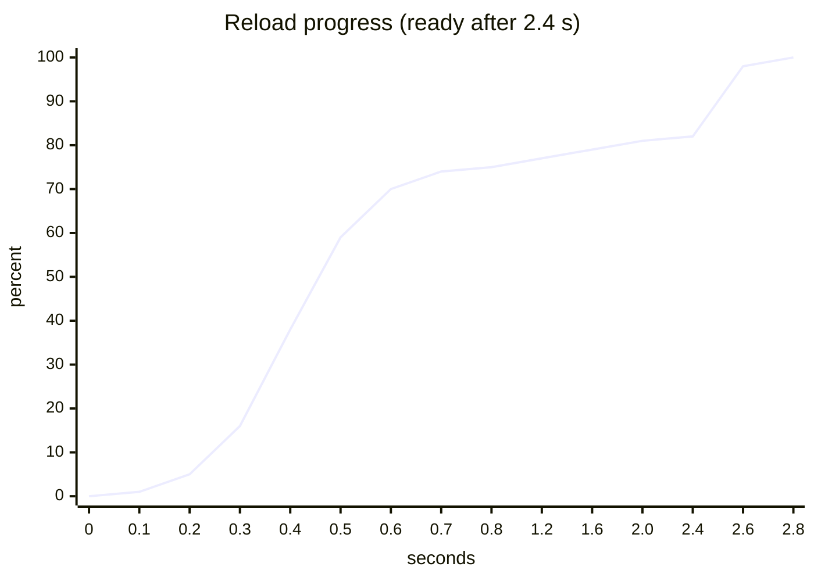

# UX design system

How Clip Factory Cloud looks, moves and sounds. The summary is in [CONTRACTS.md §11](CONTRACTS.md#11-design-system-summary-details-in-docsux_design_systemmd);
this file is the full reference. The code lives in `web/`; tokens are CSS custom properties on `:root`.

## Principles

1. **One action stands out.** Each screen has at most one tomato call-to-action. Everything else is quiet.
2. **Glass, never solid.** Every surface lets the backdrop show through.
3. **Nothing ever overflows.** Text wraps or truncates inside its box at every width from 320 px.
4. **Delight on the moments that matter.** Confirm, a finished job, a new skill. Not on every click.
5. **Plain English a child can follow.** Labels say what happens in everyday words: "Keep", "Throw away",
   "Make clips", never "Submit". See the [kid-proof checklist](#kid-proof-checklist).

## Colour tokens

| Token | Value | Use |
|---|---|---|
| `--sage` | `#9CAF88` | Hero cards, active navigation, success, the backdrop |
| `--sage-deep` | `#6F8560` | Text and icons on light glass that must read as sage |
| `--offwhite` | `#F7F5EF` | Base of most glass tints, light text on sage |
| `--tomato` | `#E8412C` | **Every primary CTA**, focus ring accent, the headline swash, the review badge |
| `--tomato-deep` | `#C7321F` | CTA pressed state |
| `--ink` | `#1E2A1B` | Body text, icons |
| `--ink-soft` | `rgba(30, 42, 27, 0.68)` | Secondary text |
| `--danger` | `#B3261E` | Error text (never used for buttons; destructive buttons are outlined) |

Glass tints are these colours at low alpha:

| Token | Value |
|---|---|
| `--glass-offwhite` | `rgba(247, 245, 239, 0.42)` |
| `--glass-sage` | `rgba(156, 175, 136, 0.38)` |
| `--glass-tomato` | `rgba(232, 65, 44, 0.86)` (CTAs stay readable, still slightly translucent) |
| `--glass-edge` | `rgba(255, 255, 255, 0.55)` |
| `--glass-shadow` | `0 8px 32px rgba(30, 42, 27, 0.14)` |

Contrast: body text is `--ink` on glass over the default backdrop (≥ 7:1). White text on tomato CTAs is ≥ 4.5:1 at
14 px semibold and up. Never put text directly on the moving backdrop.

## The liquid glass recipe

```css
.glass {
  background: var(--glass-offwhite);
  -webkit-backdrop-filter: blur(22px) saturate(160%);
  backdrop-filter: blur(22px) saturate(160%);
  border: 1px solid var(--glass-edge);
  border-radius: var(--radius-l);
  box-shadow: var(--glass-shadow), inset 0 1px 0 rgba(255, 255, 255, 0.6);
}
/* Refractive edge: a soft highlight along the top-left, like light catching curved glass. */
.glass::before {
  content: ""; position: absolute; inset: 0; border-radius: inherit; pointer-events: none;
  background: linear-gradient(135deg, rgba(255,255,255,.45), rgba(255,255,255,0) 40%);
  mix-blend-mode: soft-light;
}
@supports not ((backdrop-filter: blur(1px)) or (-webkit-backdrop-filter: blur(1px))) {
  .glass { background: rgba(247, 245, 239, 0.92); }
}
```

Variants: `.glass--sage` (hero, active nav), `.glass--strong` (dialogs and sheets, alpha 0.62 so long text stays
easy to read), `.glass--cta` (tomato).

**The backdrop.** A fixed layer behind the app with three large blurred blobs (sage, off-white, a little tomato) that
drift slowly (60-second loop, paused with reduced motion). The owner can choose a background image in Settings; it
replaces the blobs and the glass shows it through.

**About the phone's wallpaper.** The owner asked to see the phone's background through the app. Browsers and
installed PWAs cannot see the operating system's wallpaper, so the glass shows the app backdrop or the owner's chosen
image instead. Choosing the same photo as the phone's wallpaper gives the same effect.

## Typography

| Role | Font | Size (clamp) | Weight / style |
|---|---|---|---|
| Display | Times New Roman, Tinos, serif | `clamp(2.25rem, 6vw, 4rem)` | 400 italic, tight leading 1.05 |
| H1 | Times New Roman | `clamp(1.75rem, 4vw, 2.5rem)` | 400, often italic |
| H2 | Inter | 1.25rem | 600 |
| Body | Inter | 1rem (16 px, never smaller on phones, so iOS does not zoom inputs) | 400, leading 1.5 |
| Small / meta | Inter | 0.8125rem | 500 |
| Numbers (stats) | Inter, `font-variant-numeric: tabular-nums` | 2rem | 600 |

The tomato **swash**: a hand-drawn SVG underline under one or two italic words of a display headline ("Make it
*viral*"). Used once per screen at most.

Inter loads from Google Fonts with `display=swap`; Tinos is the metric-compatible fallback for Times New Roman where
it is missing (Android, Linux).

## Layout and spacing

- Spacing scale (px): 4, 8, 12, 16, 24, 32, 48, 64. Tokens `--space-1` … `--space-8`.
- Radii: `--radius-s` 10 px (inputs, chips), `--radius-m` 16 px (cards), `--radius-l` 24 px (panels), pills 999 px.
- Content max width 1200 px, centred. Gutters 16 px on phones, 24 px on tablets, 32 px on desktop.
- Grid: one column on phones; cards in rows of 2 from 768 px, 3 from 1100 px (`repeat(auto-fill, minmax(min(100%, 300px), 1fr))`).
- Breakpoints: phone < 768 px, tablet 768–1099 px, desktop ≥ 1100 px.

**Layout inspiration** (the "Sorrel" reference): a big serif italic headline on a sage hero card, pill buttons beside
it, a row of cards below, and a rating-style stat block (for example "8 clips waiting · 3 jobs running · 24 posted").
The person in the reference image is not used.

## Navigation

| Width | Navigation |
|---|---|
| < 768 px | Bottom glass tab bar, **icons only**, no words. Each icon has an `aria-label` and a tooltip on long-press. Five items: Home, New job, Review (with badge), Insights, Settings. Respects `env(safe-area-inset-bottom)`. Each target ≥ 48 × 48 px. "Get the app" is not a tab: it is a card in Settings and a one-time banner on Home. |
| ≥ 768 px | Left glass sidebar with icons and names. A hamburger (three stripes) at the top collapses it to icons only; the choice is remembered on that device. Collapsed items show their name as a tooltip. A **Get the app** item (download icon) sits at the bottom of the sidebar, apart from the main items, and disappears once the app is installed. |

The active item uses `--glass-sage` and a small tomato dot. The current page has `aria-current="page"`.

## Components

| Component | Notes |
|---|---|
| Button (primary) | Tomato glass pill, icon + white text, 48 px tall minimum. One per screen (the update bar's Reload is the only extra). |
| Button (secondary) | Off-white glass pill, ink text, edge highlight. |
| Button (quiet) | Text only with an underline on hover. |
| Card | Glass, `--radius-m`, padding 16–24 px, `min-width: 0` so children can shrink. |
| Hero card | Sage glass, display headline with swash, primary CTA. |
| Stat block | Three numbers with labels, tabular figures. |
| Link input | Large pill input, shows the detected platform icon (YouTube, Twitch, Kick) as you type. |
| Upload drop zone | Dashed glass area, drag and drop on desktop, tap to pick on phones, progress bar while uploading. |
| Job progress | The nine steps as a vertical list with status icons; the running step pulses; the overall progress bar on top. |
| Clip card | 9:16 cover with play, hook, moment-type chip, score, duration, checklist summary. |
| Clip review | Vertical player, captions per platform in tabs (editable), checklist, Confirm (primary) and Decline (outlined). |
| Skill row | Name, description (two lines, then "Show more"), built-in tag, on/off switch, delete for owner skills. |
| Toggle, select, inputs | 16 px text, glass background, tomato focus ring `outline: 2px solid var(--tomato); outline-offset: 2px`. |
| Toast | Glass, top on desktop, above the tab bar on phones, auto-hides after 4 s, `role="status"`. The Undo toast stays 8 s and shows a shrinking ring around its Undo button. |
| Empty state | One line of serif italic, one plain sentence that names the button to tap, one action. |
| Error | Plain sentence, what to do next, and a Retry when possible. |
| Get the app card | See [Get the app card](#get-the-app-card). |
| Update bar | See [Update bar](#update-bar). |

## Sounds

Two sounds, synthesised with the Web Audio API (no audio files):

| Sound | When |
|---|---|
| **Tap** (short, soft, high click) | A click on an enabled button, link, tab, switch or card. |
| **Deny** (lower, duller double tick) | A click on a disabled control, and when an action fails with an error. |

Rules:
- **Click only, never on scroll.** Sounds are triggered from the `click` event alone. Browsers do not fire `click`
  for scrolls, swipes or drags, so scrolling on a phone never makes a sound. Never use `pointerdown`, `touchstart`
  or `scroll` for sounds.
- Disabled controls get no native click, so they are marked `aria-disabled="true"` (kept focusable and clickable)
  and their click plays deny instead of doing anything.
- The audio context is created on the first click (browsers require a user gesture).
- Settings → Sound turns both off (`soundEnabled`). Sounds are quiet (peak gain about 0.15).

## Motion and delight

- Durations: 120 ms (press), 200 ms (hover, toggle), 320 ms (sheets, page fade). Easing `cubic-bezier(.2,.8,.2,1)`.
- Buttons press to `scale(0.97)` and spring back.
- **Delight moments** (the "dopamine hits"), only these:
  - Confirm a clip: a short burst of tomato and sage confetti from the button, the card slides away, the badge counts down.
  - A job finishes: the progress ring fills and glows once; a toast "8 clips are ready to review".
  - A skill is added: the row pops in with a small bounce.
  - An update is installed: the Reload progress bar ([the reload curve](#the-reload-curve)) ends in a small sparkle.
- Reduced motion (system `prefers-reduced-motion` or `reduceMotion` in Settings): no confetti, no drifting backdrop,
  fades only.

## Overflow rules (never let text leave its box)

These are global rules, not per-component fixes:

```css
*, *::before, *::after { box-sizing: border-box; }
html, body { overflow-x: hidden; }
img, video, svg, canvas { max-width: 100%; height: auto; display: block; }
.card, .glass, [class*="grid"] > * { min-width: 0; }          /* flex and grid children may shrink */
h1, h2, h3, p, li, dd, td, label, button { overflow-wrap: anywhere; }
.truncate { overflow: hidden; text-overflow: ellipsis; white-space: nowrap; }
.clamp-2 { display: -webkit-box; -webkit-line-clamp: 2; -webkit-box-orient: vertical; overflow: hidden; }
```

- Long URLs, file names and skill descriptions wrap (`overflow-wrap: anywhere`) or truncate with a full-text tooltip.
- Buttons grow in height rather than letting their label escape; icon buttons have a fixed square size.
- Media keeps its aspect ratio with `aspect-ratio: 9 / 16` and `object-fit: cover`.
- Playwright tests load every screen at 320, 375, 390, 430, 768, 1024 and 1440 px and fail if any element's content
  is wider than its box or the page scrolls sideways ([TESTING.md](TESTING.md)).

## Accessibility

- WCAG 2.1 AA: contrast, focus visible on every control, keyboard reachable, labels on icon-only buttons.
- Live regions for job progress and toasts.
- Touch targets 48 × 48 px minimum on phones (44 × 44 px is the floor anywhere).
- Sounds and motion are never the only feedback; every state also has text.

## Installable app (PWA)

- `manifest.webmanifest`: name "Clip Factory", short name "Clips", `display: standalone`, theme colour `#9CAF88`,
  background `#F7F5EF`, maskable icons 192 and 512 px, and an Apple touch icon.
- A service worker precaches the app shell for instant start and offline viewing of the shell. It never caches API
  responses, presigned media URLs or `config.json`.
- Installs from the browser menu on iPhone (Share → Add to Home Screen), Android and desktop Chrome, Edge and Safari,
  guided by the [Get the app card](#get-the-app-card). Mac and Windows can also download the desktop app.
- After a deploy, the [update bar](#update-bar) says what changed and offers Reload instead of swapping silently. The
  service worker never caches `/version.json` or `/downloads/manifest.json`.
- The status bar uses `theme-color` and `apple-mobile-web-app-status-bar-style: black-translucent` so the glass
  reaches the top of the phone screen.

## Get the app card

Where it lives: the **Get the app** page from the sidebar (≥ 768 px); on phones a card at the top of Settings and a
one-time banner on Home. Rules are in [CONTRACTS.md §12.1](CONTRACTS.md#121-get-the-app-sidebar-item-on-phones-a-card-in-settings-plus-a-one-time-banner-on-home).

Anatomy, top to bottom, inside one `.glass--strong` card:

1. **Device picture**: a simple line drawing of the detected device (a laptop for Mac, a monitor for Windows, a
   phone). No brand logos.
2. **Headline** (serif italic): "Get Clip Factory on this Mac" / "... this PC" / "... this phone".
3. **One big button**, the screen's tomato CTA, with a download or plus icon. The size comes from
   `/downloads/manifest.json` (the sizes below are examples):

   | Device | Button | Under the button |
   |---|---|---|
   | Mac | "Download for Mac · 9 MB" | quiet link "or install from this browser" (only where the browser offers it) |
   | Windows | "Download for Windows · 7 MB" | quiet link "or install from this browser" |
   | Linux, ChromeOS | "Install app" (browser install); Linux also "Download for Linux" when listed | – |
   | Android | "Install app" | if the browser gives no prompt: picture steps "Tap ⋮ → Install app" |
   | iPhone, iPad | no button: three numbered picture steps | in a non-Safari browser, step 0: "Open this page in Safari first" |

4. **First-open hint** (Mac and Windows only, small text with an info icon), because the builds are unsigned
   ([ADR-19](DECISIONS.md#adr-19-unsigned-desktop-builds-for-now)):
   - Mac: "If your Mac says it can't open it: System Settings, Privacy & Security, Open Anyway." (macOS 15 and later
     no longer accept right-click → Open for unsigned apps, so the app gives the route that works everywhere.)
   - Windows: "If Windows warns you: More info → Run anyway."
5. **Other devices** (collapsed): "Getting it on another device?" lists the other choices, so the owner can fetch the
   `.exe` from a Mac for a family PC.

The **iPhone steps** draw the real Share icon (square with an up arrow) inline, at text size, so a child can match it
on screen:

| Step | Picture | Words |
|---|---|---|
| 1 | Share icon, highlighted in the Safari toolbar | "Tap the Share button" |
| 2 | The share sheet with "Add to Home Screen" ringed in tomato | "Scroll down, tap **Add to Home Screen**" |
| 3 | The Add button top right ringed in tomato | "Tap **Add**. Done!" |

**The Home banner** (phones and desktop, until installed or dismissed): a slim glass strip, download icon, "Get the
app on this phone", a **secondary** pill "Show me" (so Home keeps one tomato button) and a quiet "Not now", which hides
it for 30 days. Once installed, the sidebar item, card and banner all disappear ([BR-16](BUSINESS_REQUIREMENTS.md#br-16-never-offer-the-app-once-it-is-installed)).

States: a missing download file (not in `/downloads/manifest.json`) quietly turns the card into the browser-install
version; an unreachable manifest does the same. Never a dead link, never an error on this card.

## Update bar

Shown when `/version.json` reports a version other than the running one ([CONTRACTS.md §12.2](CONTRACTS.md#122-update-banner-whats-new--reload)).

```
 ┌───────────────────────────────────────────────────────────────┐
 │ ✦  New!  [ Settings ] [ Profile picture ]      Later  (↻ Reload) │
 └───────────────────────────────────────────────────────────────┘
   sparkle  area pills (1–3 words each, max 3)      quiet   tomato CTA
```

| Part | Spec |
|---|---|
| Container | `.glass--strong` pill bar, fixed at the bottom, centred, max width 640 px, 12 px from the edge; on phones it sits above the tab bar (`bottom: calc(tab-bar height + env(safe-area-inset-bottom) + 8px)`). `role="status"`, `aria-live="polite"`. |
| Entrance | Slides up 24 px and fades in over 320 ms, `cubic-bezier(.2,.8,.2,1)`; one soft sparkle twinkle. Reduced motion: fade only. |
| Sparkle | 20 px tomato four-point star icon. |
| Title | "New!" in Inter 600. Never a version number. |
| Pills | Off-white glass chips, 13 px Inter 500, `--radius-s`, single line with ellipsis; on narrow phones they wrap under the title and the bar grows taller rather than overflowing. Labels come from `version.json` `areas`. |
| Reload | Tomato pill, refresh icon + "Reload", 48 px tall. It is the one allowed second tomato button on a screen, because it belongs to the app, not to the page. |
| Later | Quiet text button; hides the bar until the next check (5 minutes, or when the app comes back to the screen). |
| While reloading | Pills and buttons fade out; the bar's fill becomes the progress bar (below) with "Updating…" and the percentage for screen readers (`role="progressbar"`, `aria-valuenow`). |

### The reload curve

The owner asked for "fast to 80 % or to 70 %, slow in and slow out, but in the middle really quick". The bar runs in
three phases:

| Phase | From → to | Time | Curve |
|---|---|---|---|
| 1. Rush | 0 → 75 % | 800 ms | ease-in-out cubic, `cubic-bezier(0.65, 0, 0.35, 1)`: soft start, fast middle, soft landing |
| 2. Creep | 75 → at most 90 % | while the new service worker installs and activates (`skipWaiting` by `postMessage`) and fresh files load | `p = 75 + 15 × (1 − e^(−t / 2.5 s))`: always moving, slower and slower, never reaching 90 |
| 3. Finish | current → 100 % | 400 ms | ease-out cubic, `cubic-bezier(0.33, 1, 0.68, 1)`; then a 350 ms sparkle, then `location.reload()` |

A cap of 10 s from the press jumps straight to phase 3. Reduced motion: a plain linear fill to 100 %, no sparkle.

Example: ready after 2.4 s.

| Time (s) | 0 | 0.1 | 0.2 | 0.3 | 0.4 | 0.5 | 0.6 | 0.7 | 0.8 | 1.2 | 1.6 | 2.0 | 2.4 | 2.6 | 2.8 |
|---|---|---|---|---|---|---|---|---|---|---|---|---|---|---|---|
| Bar (%) | 0 | 1 | 5 | 16 | 38 | 59 | 70 | 74 | 75 | 77 | 79 | 81 | 82 | 98 | 100 |



Why it works: the first 0.8 s shows most of the progress, so the press feels instant; the slow creep hides the
unknown wait without ever freezing; the quick finish and sparkle land the reward.

## Kid-proof checklist

The owner's bar: "even a 6-year-old should be able to use it, or an 8-year-old"
([UX-13](BUSINESS_REQUIREMENTS.md#ux-13-kid-proof-a-68-year-old-can-use-it)). Every screen and every pull request that
changes one is checked against this list.

**One next step**
- [ ] Exactly one tomato button on the screen, and it is the thing to do next. (Only the update bar may add a second.)
- [ ] The button says what happens, with an icon and a word: "Make clips", "Keep", "Throw away", "Try again".

**Big and clear**
- [ ] Every tap target ≥ 48 × 48 px on phones, with at least 8 px between neighbours.
- [ ] Buttons show icon + word everywhere except the phone tab bar.
- [ ] Body text 16 px or larger; no grey-on-grey.

**Words a child knows**
- [ ] Sentences of 8 words or fewer where possible; no jargon on screen.

  | Instead of | Say |
  |---|---|
  | Submit, Start job | Make clips |
  | Confirm | Keep |
  | Decline, Delete | Throw away |
  | Retry | Try again |
  | Upload | Pick a video |
  | Failed, Error 500 | "That didn't work. Tap Try again." |
  | Pending integration | Waiting for the account connection |

**No dead ends**
- [ ] Every screen has a way forward and a way back.
- [ ] Empty states name the exact button to tap: "Nothing here yet. Tap **Make clips** to start."
- [ ] Every error says what to do next, with the button to do it.

**Mistakes are cheap**
- [ ] No "Are you sure?" dialogs. Throwing away shows a toast with **Undo** for 8 s; nothing is deleted until it ends.
- [ ] Forms can't be filled in wrong: a **Paste** button next to the link box, the link checked while typing (platform
  icon appears), hints right under the field, the main button inactive until the input is valid (its click plays the
  deny sound and points at what is missing).

**Always know what is happening**
- [ ] Anything that takes longer than 300 ms shows progress.
- [ ] Success is celebrated (confetti, sparkle, a friendly toast), within the [delight moments](#motion-and-delight).
- [ ] Sounds and motion are never the only feedback; every state also has words.
